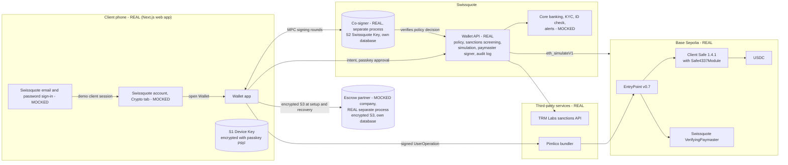
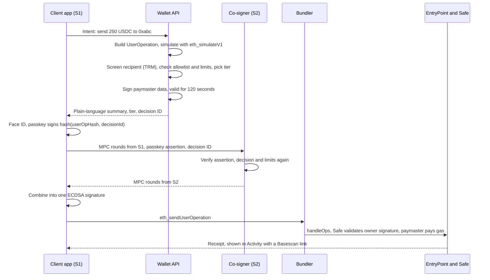

# Swissquote Wallet

A self-custody wallet that Swissquote could launch for its clients. The client holds the keys. Swissquote checks, explains and pays for each transaction, but it can never move or freeze the client's funds.

## 1. Summary

Swissquote Wallet lives inside the Swissquote app. In the demo, the client enters an email and password on a mocked Swissquote sign-in screen, lands on their Swissquote account and opens Wallet from the Crypto tab. The client's crypto sits in a Safe smart account on-chain. One threshold key controls it, split into three shares:

- the **Device Key**, on the client's phone, unlocked with Face ID;
- the **Swissquote Key**, held by Swissquote's co-signing service;
- the **Recovery Key**, an encrypted backup that only the client's own passkey can unlock.

Any two shares can sign, and the full key never exists anywhere. In daily use the phone and Swissquote sign together. Before Swissquote adds its signature, it screens the recipient against sanctions lists, simulates the transaction and explains it in plain language. Large payments need extra confirmation, and Swissquote pays the network fee. When the phone is lost, Swissquote and the Recovery Key restore access after an identity check and a waiting period. If Swissquote disappears, the phone and the Recovery Key sign without it.

Moving crypto between the Swissquote account and the wallet takes one tap. Swissquote took part in creating the wallet, so it already knows the client controls it. That is the wallet ownership proof the FINMA Travel Rule asks for, obtained automatically at creation.

The demo signs and sends real transactions on Base Sepolia (an Ethereum layer-2 testnet). It covers create, sign, lose, recover, an attacker being refused, and an exit without Swissquote.

## 2. Requirement coverage

| Requirement | Our answer | Section | In the demo |
| --- | --- | --- | --- |
| Custody model, pros and cons, threat model | 2-of-3 threshold ECDSA controlling a Safe account | 3 | Real |
| Architecture diagram, mocked parts marked | Diagram and component table | 4 | Real and mocked parts labelled |
| Wallet creation linked to the client's identity | Key ceremony inside the Swissquote session, signed ownership declaration | 6.1 | Real, email-and-password bank login mocked |
| Authentication, small vs high value | Passkey per transaction, three risk tiers | 6.2 | Real passkeys, step-up factors mocked |
| A real transaction on a blockchain | USDC transfers on Base Sepolia | 6.3, 12 | Real |
| Recovery from a lost, stolen or destroyed phone | Swissquote Key and Recovery Key, ID check, 48-hour hold, key rotation on-chain | 6.4 | Real, ID check mocked |
| Recovery refuses an attacker with the phone and email | Liveness match against KYC record, hold period, client-only passkey | 6.4 | Real flow, ID check mocked |
| Funds back if Swissquote is gone | Independent mode: Device Key and Recovery Key sign without Swissquote | 6.4 | Real |
| Business case | Retention, swap and staking revenue, lower verification cost | 10 | n/a |
| Established crypto libraries only | DKLs23 (Silence Labs), Safe, ERC-4337, WebAuthn | 5.4 | Real |
| Mocked share holder is a separate process with its own storage | Co-signer and escrow run as their own processes with their own databases | 4 | Real |
| Bonus: gasless transactions | Swissquote VerifyingPaymaster with quotas | 7 | Real |
| Bonus: compliant dApp interaction | Allowlist, sanctions screening, simulation, step-up | 8 | Real, except KYT provider |
| Custody and Travel Rule reasoning | Not custody; AMLA applies to the co-signer; ownership proven at creation | 9 | n/a |
| AI tools used | Listed | 15 | n/a |

## 3. Custody model

### 3.1 Decision

We use 2-of-3 threshold signing (MPC, specifically the DKLs23 protocol) to produce a single ECDSA key. On EVM chains that key is the only owner of a Safe smart account. On Bitcoin it controls a native address.

| Share | Name in the app | Created | Stored | Unlocked by |
| --- | --- | --- | --- | --- |
| S1 | Device Key | On the phone, during the key ceremony | On the phone, encrypted with a key derived from the client's passkey (WebAuthn PRF). In production: Secure Enclave or Android StrongBox | Face ID or fingerprint |
| S2 | Swissquote Key | In Swissquote's co-signer, during the same ceremony | Co-signer database. In production: an HSM | Swissquote's policy checks pass and the client's passkey approves the exact transaction |
| S3 | Recovery Key | On the phone during the ceremony, encrypted at once, plaintext deleted | Ciphertext with an independent escrow partner and in the client's printable Recovery Kit | The client's recovery passkey, synced end to end encrypted by iCloud Keychain or Google Password Manager |

Each pair of shares has one job:

- **S1 + S2, daily use.** Phone and Swissquote sign together. Swissquote applies its checks.
- **S2 + S3, recovery.** The phone is gone. Swissquote and the Recovery Key rotate the wallet to a new phone.
- **S1 + S3, independent mode.** Swissquote is unavailable or the client wants to act alone. The client signs with no Swissquote involvement.

Recovery replaces the key instead of reusing it. The new phone, Swissquote and a new Recovery Key run a fresh key ceremony, and the old key signs one on-chain transaction that swaps the Safe's owner to the new key. The Safe address and balances stay the same, and every old share, including the one on the stolen phone, stops working.

### 3.2 Why not the other models

| Model | Verdict | Reason |
| --- | --- | --- |
| Custodial account | Rejected | That is what Swissquote offers today. It does not answer clients who want their own keys. |
| Seed phrase | Rejected as the main method | Most Swissquote clients will not store 24 words safely, and one photo of the paper is enough to steal everything. |
| Shamir or SLIP-39 split backup | Rejected | The seed has to be reassembled in one place to sign. If Swissquote and a partner each hold a plain share, they can restore it without the client. |
| Smart account with passkey owners only | Rejected alone | EVM only. Passkeys sign with P-256, which Bitcoin does not accept. |
| MPC alone | Kept as the signer | Signs for any chain. On EVM, without a smart account, it gets no gas sponsorship, no on-chain rules and no address-preserving rotation. |
| **MPC + Safe (chosen)** | Chosen | MPC gives every chain and no single point of theft. Safe adds gasless transactions, on-chain rotation and room for on-chain rules. |

The [`ecdsa-tss-js` library](https://github.com/silence-laboratories/ecdsa-tss-js) from our notes only does 2-of-2. We need 2-of-3, so we use Silence Labs' DKLs23 packages instead (section 5.4).

### 3.3 Pros and cons

Pros:

- Nobody holds a complete key, so stealing one share or hacking one server steals nothing.
- Swissquote cannot move funds. It cannot freeze them either, because S1 + S3 signs without it.
- Recovery needs no seed phrase. The Recovery Key rides on a passkey the client already syncs.
- Swissquote's checks sit in front of every normal transaction: screening, simulation, limits, step-up.
- One signer covers EVM, Bitcoin and other secp256k1 chains, and a second threshold key covers Ed25519 chains (section 5.3).
- The wallet address survives recovery on EVM.

Cons, and how we handle them:

- **MPC signing takes several message rounds between phone and co-signer.** Daily signing needs a network connection, as any banking app does.
- **Silence Labs' licence is non-commercial.** It is fine for the prototype. Production needs a commercial agreement with Silence Labs or a move to the Apache-licensed Lockness `cggmp24` (section 5.4).
- **On Bitcoin, recovery means a sweep to a new address**, because a native Bitcoin address cannot change its key.
- **Independent mode needs the Recovery Kit or a release from the escrow partner.** That friction is on purpose. It is what stops a phone thief.
- **The client trusts the app code.** Every wallet vendor has this exposure. We limit it in section 3.4.
- **A Safe transaction costs two to three times more gas than a plain transfer.** On Base that is still around one to three US cents.

### 3.4 Threat model

| Who | What they have | Can they steal? | Can they lock the client out? | What stops them |
| --- | --- | --- | --- | --- |
| Thief with a locked phone | Encrypted S1 | No | No. The client recovers with S2 + S3 | S1 is encrypted under the passkey. The client locks the wallet from e-banking or the hotline. |
| Thief who saw the phone passcode | Usable S1 and the synced passkeys | Small amounts, up to the daily limit, to recipients that pass the checks, until the client locks the wallet | No | Risk tiers, holds on new recipients, 24-hour delay to raise limits, wallet lock. Independent mode also needs S3, which sits in the Recovery Kit at home or with the escrow, which releases it only after an ID check. |
| Attacker with phone, email and SIM | All of the above plus email codes and SMS | No | No | Recovery requires the Swissquote login, a liveness check matched to the KYC record and a 48-hour hold with alerts on every channel. |
| Swissquote alone, a rogue employee or a hacked co-signer | S2 and the client registry | No, one share signs nothing | No. Swissquote can refuse to co-sign, and the client then uses independent mode | Threshold. In production, S2 lives in an HSM and recovery approvals need two employees. |
| Swissquote together with the escrow partner | S2 and the encrypted S3 | No. S3 is encrypted under the client's passkey | No | End-to-end encryption. Neither party ever sees S3 in plaintext. |
| Escrow partner alone | Encrypted S3 | No | It can refuse to release S3. The client uses the Recovery Kit copy | Contract and supervision of the partner. |
| Apple or Google | Synced passkeys, end-to-end encrypted | No | Losing the Apple or Google account removes the recovery passkey. The client keeps S1 and re-issues S3 | The client can register a second recovery passkey. |
| Malicious app update | Code running next to S1 and the passkey | In theory, yes | In theory, yes | Open-source client, reproducible builds, third-party audits. Even a malicious app needs S2, with its limits, or S3, which sits offline or in escrow. |
| Phishing dApp, address poisoning, malicious approvals | The client's attention | Only if the client signs | No | dApp allowlist, simulation in plain language, approval checks, verified recipient labels (section 8). |
| Swissquote shuts down for good | Nothing | No | No | Independent mode and the open-source rescue tool. The account is a standard Safe that Safe{Wallet} can operate. |
| An authority orders a freeze | Swissquote's co-signer | No | Swissquote can only stop co-signing | Swissquote complies within its power, which is to refuse to act. It cannot seize funds. |

The three questions from the brief:

- **Who could steal funds?** Only someone who controls two shares. In practice that means the client's phone plus the client's recovery passkey and the Recovery Kit, or Swissquote's co-signer plus a recovery approved through the ID check and the 48-hour hold.
- **Who could lock the client out?** Nobody on their own. If one party refuses, the client uses the other two shares. The client is locked out only after losing both the phone and the recovery passkey. Section 6.4 covers that case.
- **Could Swissquote, alone or with a partner, move the funds?** No. Swissquote holds one share. The escrow partner holds only ciphertext that needs the client's passkey. No combination of Swissquote and third parties reaches two usable shares.

## 4. Architecture



| Component | Runs as | Holds | Demo status |
| --- | --- | --- | --- |
| Swissquote sign-in and account | Email-and-password form checked against demo client fixtures, then a Swissquote account screen with Wallet in the Crypto tab | Mock session with client ID and KYC status | Mocked, no connection to Swissquote authentication |
| Wallet app | Next.js web app on the phone, opened from the mocked Swissquote account using its session. In production: inside the Swissquote iOS and Android apps | S1 (encrypted), passkey | Real |
| Wallet API | Next.js route handlers, Swissquote side | Policy rules, paymaster signing key, audit log | Real |
| Co-signer | Its own Node.js process with its own SQLite database. It runs one MPC party and re-checks every policy decision | S2 | Real process. The HSM is mocked: S2 is encrypted at rest in SQLite |
| Escrow partner | Its own Node.js process with its own SQLite database | Encrypted S3 and an identity attestation | Real process, mocked company |
| Core banking, KYC, ID check, alerts | Fixtures behind the Wallet API: client accounts, a KYC photo per client, an alert feed | Client identity | Mocked |
| Swissquote treasury | A testnet key holding USDC. It stands in for Swissquote's custody when the client moves funds to or from the account | Testnet USDC | Real transfers, mocked bank ledger |
| Bundler | Pimlico public bundler | Nothing | Real |
| Sanctions screening | TRM Labs public sanctions API, no key needed | Nothing | Real |
| Simulation | `eth_simulateV1` through viem's `simulateCalls` on the public Base Sepolia RPC | Nothing | Real |
| Contracts | EntryPoint, Safe and USDC are already deployed. We deploy the VerifyingPaymaster and a demo savings vault | Paymaster deposit | Real |
| Rescue tool | Open-source script that signs with S1 + S3 | Nothing until the client loads shares | Real |

The client app never holds S2, and the escrow never holds S3 in plaintext.

## 5. Networks and chains

### 5.1 Demo network: Base Sepolia (chain ID 84532)

We picked Base Sepolia because everything the demo needs is already deployed there. We checked each address below with `eth_getCode` on 2026-10-10.

| Contract | Address |
| --- | --- |
| EntryPoint v0.7 | `0x0000000071727De22E5E9d8BAf0edAc6f37da032` |
| SafeL2 1.4.1 | `0x29fcB43b46531BcA003ddC8FCB67FFE91900C762` |
| SafeProxyFactory 1.4.1 | `0x4e1DCf7AD4e460CfD30791CCC4F9c8a4f820ec67` |
| Safe4337Module v0.3.0 (for EntryPoint v0.7) | `0x75cf11467937ce3F2f357CE24ffc3DBF8fD5c226` |
| SafeModuleSetup | `0x2dd68b007B46fBe91B9A7c3EDa5A7a1063cB5b47` |
| USDC (Circle) | `0x036CbD53842c5426634e7929541eC2318f3dCF7e` |
| Circle Paymaster v0.7 | `0x31BE08D380A21fc740883c0BC434FcFc88740b58` |

Other reasons for this choice:

- Circle's faucet hands out testnet USDC, and Pimlico's bundler and paymaster support the chain for free on testnet.
- The public RPC at `https://sepolia.base.org` answers `eth_simulateV1`, so simulation needs no API key.
- Rhinestone's ERC-7579 modules are deployed there, ready for phase 2.
- On Base mainnet a USDC transfer costs about half a cent to one cent, so the production gas bill matches the demo.

We use EntryPoint v0.7 because permissionless.js supports Safe accounts on v0.6 and v0.7 only.

Stretch goal: the same threshold key signs a Bitcoin testnet4 transaction from a native SegWit (P2WPKH) address. That proves the "any chain" claim with a second, non-EVM chain.

### 5.2 Production networks

- **Ethereum mainnet** for larger holdings and the widest dApp support.
- **Base and Arbitrum** for payments and stablecoins, where gas costs cents. The Safe gets the same address on every EVM chain because it is deployed with CREATE2 (EIP-1014) from the same factory, owner and salt.
- **Bitcoin**, native SegWit addresses signed with the same ECDSA key. Taproot comes later, once threshold Schnorr with key tweaking is audited.
- **Solana** with a second threshold key on Ed25519. Solana lets a separate account pay the fee, so Swissquote can sponsor Solana transfers natively.
- **Infrastructure we would self-host:** a bundler (Pimlico's open-source Alto), so no third party sees client order flow; our own VerifyingPaymaster; our own RPC nodes, with a commercial provider as backup.

### 5.3 One signer for every chain

Two threshold keys cover every major chain:

| Curve | Chains |
| --- | --- |
| secp256k1 ECDSA | Ethereum and all EVM chains, Bitcoin SegWit, Tron, Cosmos, XRP |
| Ed25519 | Solana, TON, Stellar, Sui, Aptos, NEAR |
| BIP340 Schnorr (later) | Bitcoin Taproot |

Each chain then plugs in through the same three steps: build the transaction and get the bytes to sign, have the threshold key sign them, then attach the signature and broadcast. The signer never needs to know which chain it is signing for.

- **Demo:** viem handles EVM through a custom account (`toAccount`) that forwards the hash to the MPC signer. For the Bitcoin stretch goal, `bitcoinjs-lib` accepts an async external signer (`signInputAsync`).
- **Production long tail:** Trust Wallet Core's `TransactionCompiler` follows exactly these three steps through `preImageHashes` and `compileWithSignatures`. Its repository has compiler tests for about 50 chains: Bitcoin, Ethereum, Cosmos, Solana, Tron, XRP, Sui, Aptos, TON, Polkadot, Stellar, NEAR, Cardano and more. Adding a chain means adding a coin type, with no new cryptography.
- **Precedent:** the open-source Vultisig SDK (MIT, 2-of-3 vaults, 40+ chains) is built from these same two parts, DKLs and Wallet Core.

Smart-account features (paymaster, on-chain rotation, ERC-7579 rules) exist only on EVM. On other chains the co-signer applies the same policy off-chain before it signs with S2, so the checks work the same.

### 5.4 Libraries

| Purpose | Hackathon | Production |
| --- | --- | --- |
| Threshold ECDSA, 2-of-3 | Silence Labs DKLs23 WASM: `@silencelaboratories/dkls-wasm-ll-web` in the browser, `-node` in the co-signer. It provides key generation, signing, key rotation and lost-share recovery. Trail of Bits audited the DKLs23 core in 2024; the WASM wrapper has no public audit | Silence Labs commercial SDK, or Lockness `cggmp24` (Apache-2.0, audited by Kudelski, no key refresh yet) wrapped for WASM |
| Threshold Ed25519 | Not in the demo | Silence Labs `multi-party-schnorr` (audited by HashCloak) or Zcash Foundation `frost-ed25519` (audited by NCC) |
| EVM transactions and simulation | `viem` (`toAccount`, `simulateCalls` with `traceAssetChanges`) | same |
| Smart account and ERC-4337 | `permissionless` (`toSafeSmartAccount`, `createSmartAccountClient`), Safe 1.4.1, Safe4337Module, EntryPoint v0.7 | same, plus Safe7579 and `@rhinestone/module-sdk` |
| Paymaster contract | eth-infinitism `VerifyingPaymaster`, `releases/v0.7` branch | same, audited fork |
| Passkeys | `@simplewebauthn/browser` and `@simplewebauthn/server` with the PRF extension | Native passkey APIs, plus App Attest and Play Integrity |
| Sanctions | TRM Labs public sanctions API | Chainalysis or TRM KYT with SECO, OFAC, EU and UN lists |
| Other chains | `bitcoinjs-lib` (stretch goal) | `@trustwallet/wallet-core` |
| dApp connection | In-app approved dApps | Reown WalletKit (WalletConnect) |

Two library caveats:

- **Licence.** The Silence Labs licence allows non-commercial use only, so we will confirm with Silence Labs that a hackathon prototype qualifies.
- **Signature format.** The Safe owner is a custom viem account. It hashes the Safe's EIP-712 data locally, the MPC signs the digest, and it returns `r, s, v` with `v` as 27 or 28.

## 6. Wallet lifecycle

### 6.1 Creation

The whole flow takes under a minute.

1. **Sign in and open Wallet.** The client enters an email and password on the mocked Swissquote sign-in screen. The demo checks fixture credentials and creates a mock session carrying the client ID and KYC-verified status. The client lands on their Swissquote account, opens Wallet from the Crypto tab and taps "Create wallet". The wallet uses that same session.
2. **Device Key.** Face ID creates a passkey for the wallet with the PRF extension turned on.
3. **Key ceremony.** The phone and the co-signer run a DKLs23 2-of-3 key generation over an authenticated connection. The phone runs parties 1 and 3, the co-signer runs party 2. The result is one public key. Each party generated its own share, and no one ever saw the full key.
4. **Store S1.** The app derives an AES-GCM key from the passkey's PRF output, encrypts S1 with it and stores it on the phone. In production, S1 goes into the Keychain or Android Keystore behind a biometric check.
5. **Recovery Key.** The client confirms a recovery passkey in iCloud Keychain or Google Password Manager. The app encrypts S3 under that passkey's PRF output, uploads the ciphertext to the escrow partner, offers it as a printable Recovery Kit and wipes the plaintext. The escrow also stores a Swissquote-signed identity attestation. With it, the escrow can verify the client later without Swissquote.
6. **Wallet address.** The app derives the Safe address with CREATE2: owner is the MPC address, threshold 1, Safe4337Module enabled. Nothing is deployed yet. The Safe deploys with the first transaction, and Swissquote pays that gas.
7. **Link to the client.** The co-signer records `{clientId, publicKey, safeAddress, passkeyId}`. The new key then signs an EIP-712 ownership declaration within five minutes of the ceremony: "Swissquote client 123456 controls Safe 0x…, nonce, timestamp". The Swissquote account lists the address as the client's own verified wallet, with method and date. Section 9.3 explains why this matters for the Travel Rule.

During step 3 the phone briefly holds S1 and S3 together, before it encrypts S3. A phone compromised at that moment is outside what any wallet can defend, and we say so.

### 6.2 Authentication

- **App access.** The demo starts with a mocked Swissquote email-and-password sign-in, followed by the Swissquote account screen. The client opens Wallet inside that account and uses the same session, including when returning to an existing wallet. Email and password grant account access; passkeys protect wallet shares and approve transactions.
- **Every signature.** Face ID approves a passkey assertion whose challenge is the hash of the exact UserOperation plus the policy decision ID. The co-signer verifies the assertion with SimpleWebAuthn before it joins the MPC rounds. The client therefore approves the same transaction Swissquote checked, and a tampered app cannot swap it.
- **Device binding.** S1 exists only on that phone, and the passkey is registered to it. In production we add App Attest or Play Integrity.
- **Risk signals.** These feed the tier choice: new device, recent SIM change, unusual country, transaction speed and recipient risk score.

| Tier | When | The client | Swissquote |
| --- | --- | --- | --- |
| Standard | Up to CHF 1,000, within a daily CHF 5,000, to a known or verified recipient, approved asset or dApp | Face ID | Screens, simulates, co-signs, pays gas |
| Confirm | Above CHF 1,000, or the first payment to a new address | Face ID plus Swissquote confirmation (PIN, mocked) after reading the summary | Same, plus an alert to every device |
| High value | Above CHF 10,000, above CHF 1,000 to an unverified external wallet, or raising a limit | Face ID, Swissquote confirmation and a liveness selfie matched to the KYC photo (mocked). The first payment to that address waits 24 hours and can be cancelled | Same, plus a flag for operations review |
| Blocked | Sanctioned or high-risk address, contract or function not on the list, or a simulation showing an unexpected loss | Reads why | Refuses to co-sign or sponsor |

Clients can lower their limits at once. Raising a limit takes 24 hours and a high-value step-up, so a thief cannot raise limits and empty the wallet in the same session.

### 6.3 Signing a transaction



### 6.4 Recovery

| Situation | Who takes part | How long | Result |
| --- | --- | --- | --- |
| Phone lost, stolen or destroyed | Client, Swissquote, escrow partner or Recovery Kit | About 48 hours (60 seconds in the demo) | New phone, new key, same Safe address |
| Recovery passkey lost, phone still working | Client and Swissquote | Minutes | S1 + S2 run a new ceremony and issue a new Recovery Key |
| Swissquote gone for good | Client, plus the escrow partner or the Recovery Kit | Minutes with the kit, the escrow's service time otherwise | Funds moved anywhere without Swissquote |
| Phone and recovery passkey both lost | Nobody can help | n/a | Locked out. This is the price of Swissquote never being able to act alone. The app runs a recovery check every six months and offers a second recovery passkey to make this unlikely |

**Lost phone, step by step.**

1. **Lock.** The client locks the wallet from e-banking or the hotline. The co-signer stops signing for the old device at once.
2. **Start recovery.** On the new phone, the client signs in to the mocked Swissquote account with email and password, opens Wallet from the Crypto tab and taps "Recover existing wallet".
3. **Prove identity.** The client scans an ID and takes a liveness selfie. Swissquote matches both against the KYC record from account opening. A consumer wallet cannot do this, because it never saw the client's ID.
4. **Wait.** A 48-hour hold starts. Alerts go out by push, email, SMS and e-banking message. Any still-trusted factor can cancel the recovery: the old passkey, e-banking or the hotline.
5. **Release S3.** The co-signer approves and the escrow releases the encrypted S3. The client signs in to iCloud or Google, the recovery passkey syncs, and the app decrypts S3 on the new phone. The client can skip the escrow by scanning the Recovery Kit instead, but the 48-hour hold still applies, because S2 must sign.
6. **Rotate.** The new phone, the co-signer and a new Recovery Key run a fresh key ceremony. The old key, signing with S2 + S3, sends one sponsored UserOperation that calls `swapOwner` on the Safe. On Bitcoin, the old key signs a sweep to the new address instead.
7. **Clean up.** Swissquote deletes the old S2 and the escrow deletes the old ciphertext. The stolen phone's S1 now controls nothing.

**What stops an attacker who has the phone and the email.**

- Email codes and SMS are only alert channels and weak signals. Neither is ever enough on its own.
- Recovery requires the Swissquote login and a liveness match against the KYC photo. An attacker cannot fake the client's face.
- The 48-hour hold gives the client time to see the alerts and cancel.
- S3 is encrypted under the client's recovery passkey. An attacker would also need the client's Apple or Google account, or the Recovery Kit kept at home.
- Swissquote staff cannot shortcut the process. Even a bribed employee cannot decrypt S3.

**Bonus demo: an attacker is refused.** A second browser plays the attacker. It holds the stolen phone's email inbox and starts a recovery. The email code passes, the liveness match fails against the KYC photo (mocked identity provider), and the recovery stops. The real client gets an alert: "Someone tried to recover your wallet. We blocked it." The audit log records the attempt.

**If Swissquote's services are gone for good.**

1. The client opens the installed app, which still runs without Swissquote's servers, or the open-source rescue tool.
2. Face ID unlocks S1.
3. The client scans the Recovery Kit, or asks the escrow partner for the ciphertext. The escrow checks the client's ID against its own stored attestation. The recovery passkey decrypts S3.
4. S1 and S3 run the DKLs signing protocol locally, using the same library, with no new cryptography. The tool signs a Safe transaction that sends everything to an address of the client's choice, or adds a new owner.
5. With no Swissquote paymaster, gas is paid from a small ETH balance. In production it can be paid in USDC through Circle's permissionless paymaster.

The Safe is standard, so the client, or any other wallet provider, can also manage it in Safe{Wallet}.

## 7. Gasless transactions (bonus)

- **Who pays.** Swissquote. It funds a deposit in the EntryPoint for its own VerifyingPaymaster contract, the eth-infinitism v0.7 sample.
- **How it works.**
  1. Once a transaction passes policy, the Wallet API signs the paymaster data with a validity window: valid from now, valid until two minutes later.
  2. The paymaster contract only checks that signature. It reads no outside state, which keeps it inside the ERC-7562 validation rules.
  3. The EntryPoint takes the gas from Swissquote's deposit.
- **What the client sees.** "Network fee: paid by Swissquote." The client never needs ETH to move USDC.
- **How abuse is prevented.**
  - Only Safes in the co-signer registry, which means only KYC-verified clients, get sponsored.
  - Only transactions that passed the policy check get a sponsorship signature.
  - Each client gets a quota: wallet-to-Swissquote and Swissquote-to-wallet moves are always free, plus 30 other sponsored operations a month.
  - Each operation has a gas cap.
  - The signature expires after two minutes.
  - Swissquote monitors the deposit and gets an alert on unusual draw-downs.
- **Cost.** A sponsored Safe operation on Base costs roughly USD 0.01 to 0.03. Our estimate is two to three times a plain USDC transfer, which costs USD 0.005 to 0.01.
- **Past the quota.** The client pays gas in USDC through Circle Paymaster, which works with any ERC-4337 account on Base and Arbitrum for a 10% surcharge. The client still never needs ETH.
- **Other chains.** On Solana, Swissquote is the fee payer. On Bitcoin there is no sponsorship mechanism, so the client pays the fee in BTC and the app says so.
- **Fallback if we run short of time.** Pimlico's verifying paymaster with a sponsorship policy webhook. Pimlico calls our server with `user_operation.sponsorship.requested`, and our policy service answers `{"sponsor": true}` or `false`.

## 8. Compliant dApp interaction (bonus)

Every transaction, whether a plain payment or a dApp call, goes through one pipeline:

1. **Decode.** Read the target contract, function and amounts from the call data.
2. **Allowlist and limits.** The contract, the function and the asset must be on Swissquote's approved list. The policy service checks the customer's transaction and daily limits.
3. **Sanctions and address risk.** Every external address goes through TRM Labs' sanctions API, which is real in the demo and needs no key. In production we would use Chainalysis or TRM Labs for scam and illicit-finance risk screening, with coverage of the SECO, OFAC, EU and UN lists. Switzerland applies SECO sanctions first.
4. **Simulation.** viem's `simulateCalls` runs the calls from the Safe's address and returns asset changes before and after.
5. **Plain-language summary.** The simulation output becomes sentences, for example:

   > You send **250.00 USDC** to **Anna Muster**, a verified Swissquote client.
   > You receive nothing.
   > Network fee: paid by Swissquote.
   > Checks passed: recipient not on sanctions lists, within your daily limit.

6. **Tier.** The amount, the recipient and the risk signals pick the tier and its step-up (section 6.2).
7. **Sponsor, co-sign and submit.** As in section 6.3.
8. **Log.** The decision, the simulation, the screening result and the signatures go into a hash-chained audit log.

Rules for dApps:

- **Approved list only.** The app shows approved dApps under "Explore". In the demo that means USDC transfers and a "Swissquote Savings" vault we deploy (an OpenZeppelin ERC-4626 vault on testnet USDC). In production the list would cover reviewed protocols such as Aave, Uniswap and Lido, connected through WalletConnect.
- **Token approvals.** Unlimited approvals are rewritten to the exact amount, or flagged. Approvals to unknown spenders are blocked, and `setApprovalForAll` is flagged.
- **Safe admin calls.** Calls that change the Safe itself are blocked from dApps: `addOwnerWithThreshold`, `swapOwner`, `enableModule`, `setGuard` and any `delegatecall`. Only Swissquote's own recovery and settings flows may make these calls. This closes a common phishing route for smart accounts.

The demo shows three refusals: a payment to a known sanctioned address (`0x098B716B8Aaf21512996dC57EB0615e2383E2f96`, flagged by TRM), a call to a contract not on the list, and an unlimited approval.

In phase 2 the client can add on-chain rules through ERC-7579 modules on the Safe (Safe7579 adapter, Rhinestone modules, all deployed on Base Sepolia). Examples are a timelock on large withdrawals (`ColdStorageHook`) and a registry hook so only audited modules can be installed. These rules bind even Swissquote.

## 9. Legal feasibility

This is our reading of the sources in section 16, not legal advice. Section 9.6 lists what a lawyer would need to confirm.

The [legal and regulatory briefing](docs/LEGAL_AND_REGULATORY.md) critically reviews and qualifies the claims in this section, including custody, automatic ownership verification, co-signed payment roles, retention and EU expansion. Treat those claims as working hypotheses pending the reviews described there, not established launch permissions.

### 9.1 Custody

Our position: this is not custody.

- **Banking Act.** The Banking Act (BankA Art. 16 no. 1bis) treats crypto as custody assets when the bank must hold them available for the client at all times. Swissquote cannot move the client's crypto, so it holds nothing for the client.
- **Federal Council DLT report (2018).** Providers of non-custodial wallets "merely make software available" and fall outside AMLA when they have no power of disposal, "either in law or in practice" (p. 137). With multi-signature, when power of disposal is shared, the assets are not part of the provider's bankruptcy estate (pp. 66 to 67).
- **What this means.** Wallet assets never sit on Swissquote's balance sheet. No segregation under BankA Art. 37d or SchKG Art. 242a is needed, and no capital is held against them. FINMA Guidance 01/2026 on crypto custody capital does not apply.
- **The licensing reform.** It was in consultation from October 2025 to February 2026. The explanatory report says no licence is needed when power of disposal stays "exclusively" (ausschliesslich) with the client, "in particular for non-custodial wallet models". Someone could argue that Swissquote's ability to refuse co-signing weakens "exclusively". Our answer: refusing is not control. The client signs alone with S1 + S3 at any time, so Swissquote's co-signature is a protective service the client chooses to use.
- **The partner grey zone from the brief.** It does not arise. Swissquote plus the escrow partner cannot sign, because S3 is encrypted under the client's passkey.

### 9.2 AMLA and the co-signer

Since 2021, AMLO Art. 4(1)(b) covers anyone who helps transfer virtual currencies to a third party within a continuing business relationship, even without power of disposal. The Federal Council's explanatory report names multi-signature key holders as an example. So co-signing is an activity under the Anti-Money Laundering Act (AMLA).

That suits Swissquote. It is a bank and is already under AMLA, so the co-signer runs on its existing KYC, transaction monitoring and sanctions processes. The policy service in section 8 is how those duties are carried out.

The escrow partner stores only encrypted data. The 2021 report says safekeeping encrypted keys "can" fall under AMLA. MME's view is that it does not when the client also holds a usable key. To remove the doubt, we would choose an escrow partner that is already supervised or affiliated with a self-regulatory organisation (SRO).

### 9.3 Travel Rule and wallet ownership

The rule:

- **AMLO-FINMA Art. 10 para. 1.** Payment orders must carry originator and beneficiary information. FINMA Guidance 02/2019 applies this to crypto, with no exception for self-hosted wallets.
- **Transfers to or from external wallets.** Until information can be exchanged, these are allowed only when the wallet belongs to the institution's own client and ownership is "proven using suitable technical means".
- **Off-chain.** The information does not have to travel on the blockchain.

The methods FINMA accepts:

- **FINMA annual report 2020.** A pre-agreed amount and time, such as a micro-payment, or "a clear message to the blockchain within a specified time period".
- **FINMA annual report 2022.** It added time-boxing, and logging in to the wallet in front of the institution's staff, if documented.

Our method: the wallet's ownership is proven when it is created.

- Swissquote is one of the three parties in the key ceremony.
- The new key signs an ownership declaration within five minutes. That is message signing within a set time window, a method FINMA has accepted.
- Every later co-signed transaction proves control again.
- There is no Satoshi test, no screenshot and no USD 15 withdrawal fee.

Swissquote's current help page accepts deposits only from "a wallet for which you are the sole owner of the private key". That wording would change to "a wallet you control". With 2-of-3, no single private key exists, but the client alone controls two shares.

| Flow | What happens |
| --- | --- |
| Swissquote account to own wallet | Swissquote is the sending institution. The originator and beneficiary are the same client, and the wallet was proven theirs at creation. Logged, instant, no fee. |
| Own wallet to Swissquote account | Accepted automatically with the same proof. Incoming funds are screened as today. |
| Wallet to another Swissquote Wallet client | Swissquote knows both sides. The data stays inside the bank. The recipient's name is shown only if they opted in (section 9.4). |
| Wallet to an exchange or bank | The client sends from a self-hosted wallet. Our reading is that Swissquote is not the originator's institution under Art. 10, because it carries out no payment order for the client. To be safe, the wallet still asks for the beneficiary's name and sends originator and beneficiary data off-chain through a Travel Rule network. Mocked in the demo. |
| Wallet to someone else's self-hosted wallet | Show an "Unverified external wallet" warning, screen the address and collect the beneficiary's name. A warning and audit log alone do not satisfy applicable identity and beneficial-owner verification requirements. For high-value tiers the client can send the recipient a link to sign a message proving ownership, similar to verification of payee. |
| Exchange or bank to the client's wallet | The other institution must check that the client owns this wallet. The client taps "Prove ownership". The wallet signs the institution's challenge, through ERC-1271 on the Safe, or sends a time-boxed transaction. |

**Is Swissquote the sending institution when the client pays a third party?** We think not. The client initiates the transfer from a self-hosted wallet, and Swissquote co-signs as a security service without power of disposal. Because AMLA still covers the co-signing, the wallet collects and can send the same data a sending institution would. If FINMA reads it the other way, only one setting changes, not the architecture.

**Records.** Decisions, simulations, screening results and signatures are kept in a hash-chained log for at least ten years (AMLA Art. 7).

### 9.4 Data protection and banking secrecy

- **Showing a recipient's name.** Telling another client that someone banks with Swissquote discloses a client relationship, which BankA Art. 47 protects under criminal law. The name is shown only if the recipient switched on "Let other Swissquote clients see my name when they pay me".
- **Travel Rule data to other institutions.** It is sent under AMLO-FINMA Art. 10 para. 4, with a notice in the terms. That law is the legal basis under the data protection act (FADP Art. 31), and transfers abroad follow FADP Arts. 16 and 17.

### 9.5 EU

MiCA recital 83 excludes providers of non-custodial wallets. The EU Transfer of Funds Regulation asks institutions to check self-hosted wallet ownership above EUR 1,000, and its EBA guidelines list message signing among the accepted methods. Swissquote obtained a MiCA licence in Luxembourg in H1 2026, so the same design can serve EU clients.

### 9.6 Open questions for counsel

- FINMA has not, as far as we found, commented on a 2-of-3 setup with a backup encrypted to the client.
- The final wording of the licensing reform. As of early October 2026 it had not been sent to Parliament.
- Whether FINMA treats co-signed payments to exchanges as Art. 10 payment orders.
- The regulatory status of the escrow partner.
- A feature-by-feature legal and operational review before production, including [FINMA Circular 2023/1 on operational risks and resilience](https://www.finma.ch/~/media/finma/dokumente/dokumentencenter/myfinma/rundschreiben/finma-rs-2023-01-20221207.pdf?sc_lang=en) and [Circular 2018/3 on outsourcing](https://www.finma.ch/en/news/2017/12/20171205-mm-rs-outsourcing/) for external service providers.

## 10. Business case

**Today.**

- Swissquote has 1.22 million accounts and CHF 96.3 billion in client assets (30 June 2026).
- Crypto earned CHF 85.7 million in 2025, about 12% of revenue, and CHF 14.6 million in H1 2026, down 66%.
- A client who wants self-custody must whitelist an address, prove they own it and pay USD 10 (native coin) or USD 15 (ERC-20 token) per withdrawal. After that, Swissquote no longer sees those assets. Withdrawals to exchanges are not supported at all.

**What Swissquote gains.**

1. **Retention.** Self-custodied assets stay one tap from Swissquote's exchange (SQX). When the client sells, buys or rebalances, it happens at Swissquote. Our calculation from reported fee income and volume puts Swissquote's take on that at roughly 0.6 to 0.7%.
2. **New revenue, from swaps and premium.** A 0.5% swap fee in the standard wallet, below MetaMask (0.875%), Phantom (0.85%) and Coinbase Wallet (up to 1%). A premium subscription waives Swissquote's swap fee.
3. **New revenue, from staking.** Non-custodial staking through Swissquote validators, with a lower commission than today's 20% to be evaluated against operating costs. FINMA Guidance 08/2023 treats staking without custody of the withdrawal keys as non-custodial.
4. **Lower costs.** Ownership checks for the client's own wallet become automatic, with no manual whitelisting or Satoshi tests and fewer support tickets. Wallet assets need no capital or segregation. A self-hosted co-signer avoids wallet-as-a-service fees: Privy charges USD 0.05 per monthly active user, Turnkey USD 0.10 per signature.
5. **New clients.** We found no major bank that offers retail clients a self-custody wallet. PostFinance's terms exclude external wallets. Revolut stays custodial. Sygnum offers Safe-based recovery for web3 wallets. A Swiss bank that offers keys plus a recovery net reaches people who distrust exchanges after events like the Bybit hack (USD 1.5 billion, February 2025) but fear losing a seed phrase.

**Pricing: transaction fees or an optional premium subscription.** The standard wallet is free for Swissquote clients, with fees based on transaction type. Transfers between Swissquote wallets carry no Swissquote transfer fee. Gas is free for moves between Swissquote and the wallet and for 30 other operations a month. Premium waives Swissquote's swap fee; its subscription price remains to be set. DEX liquidity fees, spreads, price impact and any unsponsored network costs still apply and are disclosed before signing.

**Further revenue ideas, outside the core demo.** Bank loans for crypto trading could earn interest, with an on-chain collateral vault to explore and explicit liquidation rules. A wallet-linked Swissquote debit card could convert crypto at payment time and generate conversion fees and card revenue, with loyalty points or cashback funded from that revenue. Business and wealth-management wallet services could charge service fees. These products need separate legal review.

**Illustrative unit economics.** These are assumptions, not forecasts. The table models the standard tier, using today's 20% staking commission as a baseline before any proposed reduction; premium revenue and waived swap fees are not included.

| Per active wallet per year | Assumption | CHF |
| --- | --- | --- |
| Swap fees | CHF 2,000 swapped at 0.5% | +10.00 |
| Staking commission | CHF 1,500 of ETH staked at 2.5%, 20% commission | +7.50 |
| Sponsored gas | 120 operations at USD 0.03 | -3.00 |
| Direct margin | | about +14.50 |

With 5% of today's accounts (about 61,000 wallets), the direct margin is roughly CHF 0.9 million a year. That figure leaves out the larger effect, retention. Every CHF 100 million of crypto that stays and trades once a year on SQX at 0.6% brings CHF 0.6 million.

## 11. App experience

The client is Claire, 52, from Lausanne, a Swissquote client since 2019. She holds some ETH and USDC on Swissquote and has never used a crypto wallet. Each step below is a screen she sees.

The demo opens on a Swissquote-branded sign-in screen with "Email", "Password" and "Sign in". Claire uses demo credentials and reaches a mocked Swissquote account overview. From there she opens the Crypto tab and selects Wallet. This entry flow is labelled as a demo in the UI.

1. **Discover.** Inside the Swissquote app's Crypto tab, the Wallet card reads: "Your own wallet. Your keys, our protection." She taps "Create wallet". Returning clients tap "Open wallet"; "Recover existing wallet" is available here too.
2. **Secure your wallet.** Three steps follow, each with one sentence and one button.
   - **Device Key.** "Protected by Face ID, stored on this phone." Face ID creates it.
   - **Swissquote Key.** "Swissquote checks every payment with you and can never move your money alone."
   - **Recovery Key.** "Saved to your iCloud Keychain. Helps you get back in if you lose your phone." The app offers a Recovery Kit PDF to print and keep at home.
3. **Ready.** "Your wallet is ready." Below that, her address and a green line: "Linked to your Swissquote account. Ownership verified."
4. **Home.** The total balance with the 24-hour change, a chart and tiles for each asset. Two buttons read "Add from Swissquote" and "Send to Swissquote". The "+" button opens Receive, Send and Swap.
5. **Add from Swissquote.** She picks USDC and an amount, then Face ID. The funds arrive in seconds with no fee and no address checks.
6. **Send.** She picks a recipient from contacts, by address or by scanning a QR code. A badge describes the recipient: "Verified Swissquote client: Anna Muster", "Exchange: Kraken" or "Unverified external wallet". The review screen shows the plain-language summary from section 8 and "Network fee: paid by Swissquote". Face ID sends it. A status sheet tracks it to "Completed" with a link to the transaction.
7. **A larger payment.** Above CHF 1,000 an extra screen reads "This is a larger payment" and asks for her Swissquote PIN. Above CHF 10,000, or to a new unverified wallet, it asks for a selfie, and a first payment to that address waits 24 hours with a "Cancel" button.
8. **A blocked payment.** "We can't co-sign this payment. The address is on a sanctions list." Below that, a short explanation and a support link.
9. **Explore.** A list of approved dApps, each with a short description and its risk. Every dApp request gets the same plain-language review. Unlimited approvals are shown as "Allow Uniswap to spend all your USDC, forever? We recommend 250 USDC."
10. **Prove ownership.** When an exchange asks her to prove the wallet is hers, she taps "Prove ownership" and approves with Face ID.
11. **Activity.** Every transaction appears with its status and the checks run on it: "Checked: sanctions clear, simulated, within limit".
12. **Security centre.** It shows the state of the three keys, the devices, her limits, "Lock wallet", the Recovery Kit, a recovery check-up and "Use without Swissquote", which explains independent mode.
13. **Lost phone.**
    - In e-banking: "Lock wallet".
    - On the new phone: Swissquote email-and-password sign-in, Crypto tab, Wallet, "Recover existing wallet", then the ID check.
    - A countdown screen: "Your wallet will be restored on 12 October at 14:05. We alerted all your devices."
    - Then: "Welcome back. Same address, same balance."

Most of these screens already exist in this repository as a UI prototype, built from Fuse wallet references (see `DESCRIPTION.md`):

| Proposal screen | Existing route | Change needed |
| --- | --- | --- |
| Swissquote sign-in and account overview | New routes | Mocked Swissquote-branded email-and-password sign-in, then an account overview with a Crypto tab containing Wallet |
| Wallet welcome, recover entry | `/onboarding-welcome` | Swissquote branding. Open from Wallet inside the authenticated Swissquote account, with "Create wallet", "Open wallet" or "Recover existing wallet" as appropriate |
| Secure your wallet | `/onboarding-secure` | The 2FA Key becomes the Swissquote Key. The Recovery Key becomes a recovery passkey plus Recovery Kit, with email kept as an alert channel |
| Home and the "+" menu | `/home` | Add "Add from Swissquote" and "Send to Swissquote". EVM assets instead of Solana |
| Coins | `/coin-breakdown` | USDC, ETH and BTC instead of SOL tokens |
| Choose recipient | `/choose-recipient` | Address, ENS or Swissquote contact, with verification badges |
| Send review | `/send-hide-my-wallet` | Replace Hide My Wallet with the checks summary and tier step-up |
| Transaction tracking, history | `/transaction-tracking`, `/history` | Real statuses from the bundler and chain |
| Identity check during recovery | `/pending-verification` | Liveness step and recovery countdown |
| Security centre | `/settings` | Keys, limits, lock, Recovery Kit, independent mode |
| Fuse Plus | `/fuse-plus` | Rebrand as Swissquote Wallet Premium, with a mocked subscription and a Swissquote swap-fee waiver. Disclose remaining costs |

## 12. Demo script, about four minutes

| Time | What the judges see |
| --- | --- |
| 0:00 | Claire enters her demo email and password on the mocked Swissquote sign-in screen. Her Swissquote account opens; she selects Crypto, then Wallet, and taps "Create wallet". Three keys, then "ready". The co-signer's terminal shows party 2 joining the key ceremony. |
| 0:45 | "Add from Swissquote": 100 USDC from the treasury reaches her Safe address on Base Sepolia. A Basescan link proves it. |
| 1:15 | She sends 20 USDC to Anna, a verified client, with Face ID. On Basescan: the Safe deploys and transfers in one UserOperation, and Swissquote's paymaster pays the gas. |
| 1:45 | She sends 2,000 USDC to a new address and gets the step-up. A send to the sanctioned address is blocked. A deposit into the savings vault shows its plain-language preview. An unlimited approval is flagged. |
| 2:30 | "Lose the phone": the browser's storage is wiped. In a second browser the attacker uses compromised demo email-and-password credentials to enter the mocked Swissquote account and open Wallet recovery. Sign-in passes, the liveness check fails, and recovery is refused. Claire gets an alert. |
| 3:00 | Claire recovers in a new browser: mocked Swissquote email-and-password sign-in, Crypto tab, Wallet recovery, liveness passed, a 60-second hold, recovery passkey, new key ceremony. `swapOwner` runs on-chain. Same address, same balance. She sends 5 USDC. |
| 3:40 | "Swissquote is gone": we stop the co-signer process. In independent mode, the Recovery Kit and Face ID move her funds to an outside address. |

## 13. What is real and what is mocked

| Real | Mocked, and labelled in the UI and README |
| --- | --- |
| DKLs23 2-of-3 key generation and signing across phone and co-signer | Swissquote email-and-password sign-in, client session, account overview and Crypto tab, core banking ledger, KYC records |
| Passkeys with PRF encryption of S1 and S3 | Identity check and liveness match (fixture photos) |
| Co-signer and escrow as separate processes with their own databases | HSM: S2 is encrypted at rest in SQLite instead |
| Safe, ERC-4337 UserOperations, Pimlico bundler on Base Sepolia | Escrow partner as a company: real process, invented organisation |
| Swissquote VerifyingPaymaster contract and sponsorship signatures | Push, SMS, email and e-banking alerts: an in-app alert feed |
| Sanctions screening through TRM Labs' public API | Travel Rule messages to other institutions |
| Simulation through `eth_simulateV1` | Swissquote PIN step-up |
| Safe owner rotation on recovery, independent mode signing | Swissquote treasury: a testnet key standing in for custody |

## 14. Build plan

```
app/                 Next.js client and Wallet API route handlers (policy, simulation, paymaster signing, bank mock)
services/cosigner/   Node.js process, MPC party 2, holds S2, SQLite
services/escrow/     Node.js process, holds encrypted S3, SQLite
contracts/           VerifyingPaymaster (eth-infinitism v0.7) and the ERC-4626 demo vault, with deploy scripts
tools/rescue/        Script: sign with S1 + S3 without Swissquote
```

The order protects the core story first. Bonus points only count when create, sign and recover work end to end.

1. **Core.**
   - Key ceremony across phone and co-signer.
   - Safe address and first sponsored USDC transfer on Base Sepolia.
   - Lose the phone and recover with S2 + S3, including `swapOwner`.
2. **Bonus.** Policy pipeline (allowlist, TRM screening, simulation summary), risk tiers, our own VerifyingPaymaster with quotas, demo vault and approval checks.
3. **Polish.** Attacker refusal, independent mode and rescue script, Recovery Kit PDF, Bitcoin testnet stretch goal.

## 15. AI tools used

| Tool | Used for |
| --- | --- |
| Claude Code (Anthropic, Claude Opus 5.5) | Research for this proposal: regulation, MPC and account-abstraction libraries, testnet contract addresses, Swissquote figures. Drafting this document. |
| OpenAI Codex | Updating this proposal from revised team notes; checking the MPC library's threshold and the added FINMA references. |

Before submission, the team adds the other tools it used, including those used to build the UI prototype, and what each was used for.

## 16. Sources

Regulation:

- FINMA Guidance 02/2019, payments on the blockchain: https://www.finma.ch/en/~/media/finma/dokumente/dokumentencenter/myfinma/4dokumentation/finma-aufsichtsmitteilungen/20190826-finma-aufsichtsmitteilung-02-2019.pdf
- FINMA annual report 2020, wallet verification methods (pp. 43 to 44): https://www.finma.ch/~/media/finma/dokumente/dokumentencenter/myfinma/finma-publikationen/geschaeftsbericht/20200325-finma-jahresbericht-2020.pdf
- FINMA, anti-money-laundering supervision 2022 (time-boxing): https://www.finma.ch/en/documentation/dossier/dossier-geldwaeschereibekaempfung/geldwaeschereiaufsicht-2022/
- AMLO-FINMA: https://www.fedlex.admin.ch/eli/cc/2015/390/de
- AMLO Art. 4: https://www.fedlex.admin.ch/eli/cc/2015/791/de
- Federal Council DLT report, 2018: https://www.newsd.admin.ch/newsd/message/attachments/55153.pdf
- Federal Council explanatory report on the AMLO amendment, 2021: https://www.newsd.admin.ch/newsd/message/attachments/67150.pdf
- Banking Act: https://www.fedlex.admin.ch/eli/cc/51/117_121_129/de
- SchKG: https://www.fedlex.admin.ch/eli/cc/11/529_488_529/de
- FINMA Guidance 01/2026, crypto custody: https://www.finma.ch/en/~/media/finma/dokumente/dokumentencenter/myfinma/4dokumentation/finma-aufsichtsmitteilungen/20260112-finma-aufsichtsmitteilung-01-2026.pdf
- FINMA Guidance 08/2023, staking: https://www.finma.ch/en/~/media/finma/dokumente/dokumentencenter/myfinma/4dokumentation/finma-aufsichtsmitteilungen/20231220-finma-aufsichtsmitteilung-08-2023.pdf
- Consultation on crypto institutions (SIF): https://www.sif.admin.ch/en/newnsb/x4TMWQ1SWofNoFx7XyHhY
- SIF overview of DLT, blockchain and tokenisation: https://www.sif.admin.ch/en/dlt-blockchain-en
- Goldblum, crypto licences in Switzerland: https://goldblum.ch/crypto/crypto-licence-switzerland/
- Legalaes, SRO licences: https://legalaes.com/sro-license-in-switzerland/
- MME on the AMLA scope for DLT services (AJP 9/2023): https://mme.ch/hubfs/Erweiterter%20Geltungsbereich%20des%20Geldw%C3%A4schereigesetzes%20f%C3%BCr%20Dienstleister%20im%20DLT-Bereich%2c%20AJP%2092023.pdf
- MiCA: https://eur-lex.europa.eu/legal-content/EN/TXT/?uri=CELEX:32023R1114
- EU Transfer of Funds Regulation: https://eur-lex.europa.eu/legal-content/EN/TXT/?uri=CELEX:32023R1113

Standards and libraries:

- ERC-4337: https://eips.ethereum.org/EIPS/eip-4337
- ERC-7562: https://eips.ethereum.org/EIPS/eip-7562
- ERC-7579: https://eips.ethereum.org/EIPS/eip-7579
- EIP-712: https://eips.ethereum.org/EIPS/eip-712
- ERC-1271: https://eips.ethereum.org/EIPS/eip-1271
- EIP-1014: https://eips.ethereum.org/EIPS/eip-1014
- eth-infinitism account-abstraction: https://github.com/eth-infinitism/account-abstraction
- Safe smart accounts: https://docs.safe.global/advanced/smart-account-overview
- Silence Labs DKLs23: https://github.com/silence-laboratories/dkls23
- Silence Labs DKLs23 WASM packages: https://github.com/silence-laboratories/silent-shard-dkls23-ll
- Lockness cggmp21: https://github.com/LFDT-Lockness/cggmp21
- Zcash Foundation FROST: https://github.com/ZcashFoundation/frost
- Trust Wallet Core: https://github.com/trustwallet/wallet-core
- Vultisig SDK: https://github.com/vultisig/vultisig-sdk
- Pimlico supported chains: https://docs.pimlico.io/guides/supported-chains
- Pimlico sponsorship webhook: https://docs.pimlico.io/guides/how-to/sponsorship-policies/webhook
- Circle USDC addresses: https://developers.circle.com/stablecoins/usdc-contract-addresses
- Circle Paymaster addresses: https://developers.circle.com/paymaster/addresses-and-events
- NIST threshold cryptography: https://csrc.nist.gov/Projects/threshold-cryptography

Business:

- Swissquote H1 2026 results: https://www.swissquote.com/en/api/internal/media/get-media?filename=press-releases%2Fad+hoc_EN_Media_Release_H1_2026.pdf
- Swissquote 2025 results: https://www.swissquote.com/en/api/internal/media/get-media?filename=press-releases/ad+hoc+MI+Swissquote+FY+2025_EN.pdf
- Swissquote crypto pricing: https://www.swissquote.com/en-ch/private/trade/pricing/cryptocurrencies
- Swissquote crypto help, external wallets: https://www.swissquote.com/en-ch/private/help/trade/products/crypto-asset-products
- Swissquote staking: https://www.swissquote.com/en-ch/private/trade/products/cryptocurrencies/staking
- Sygnum, web3 wallet recovery on Safe: https://www.sygnum.com/news/sygnum-launches-web3-wallet-recovery-built-on-safe/
- MetaMask swap fees: https://consensys.com/blockchain-use-cases/finance/metamask-swaps
- Privy pricing: https://www.privy.io/pricing
- Turnkey pricing: https://www.turnkey.com/pricing
