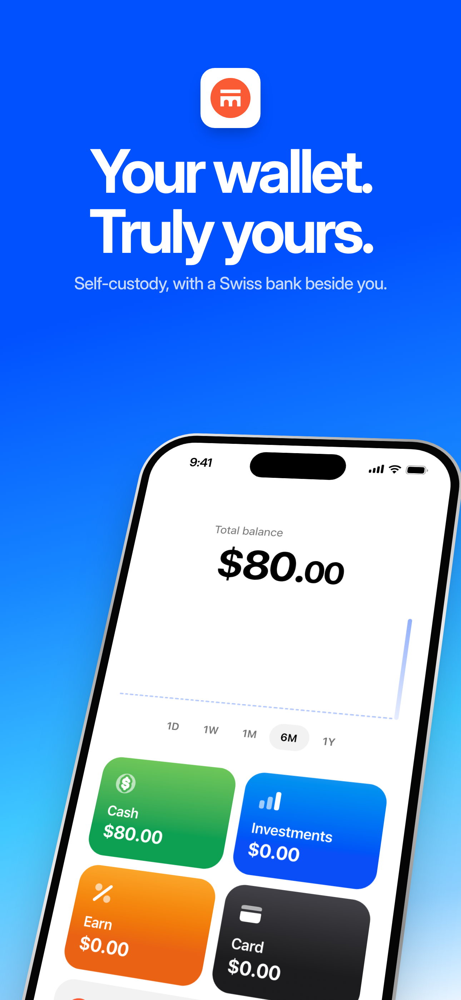
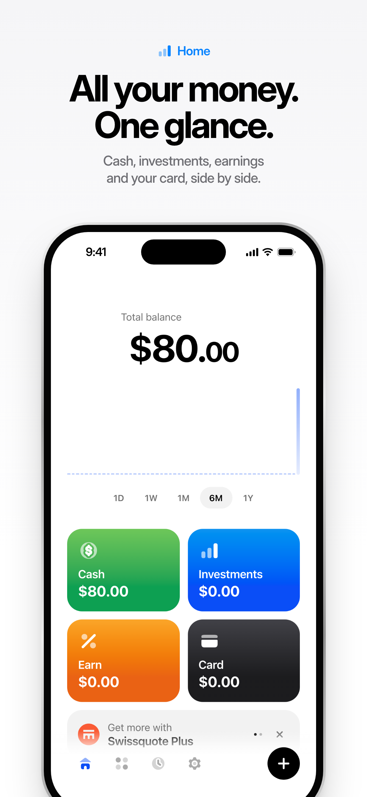
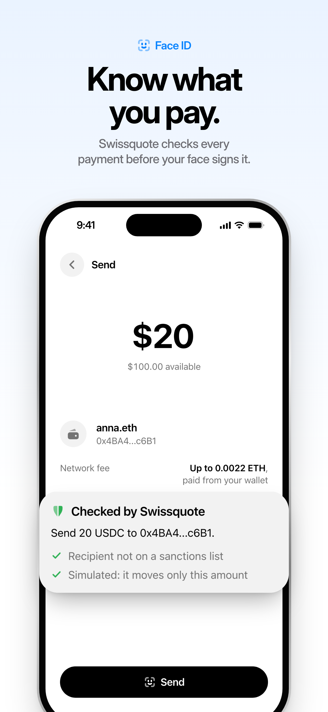
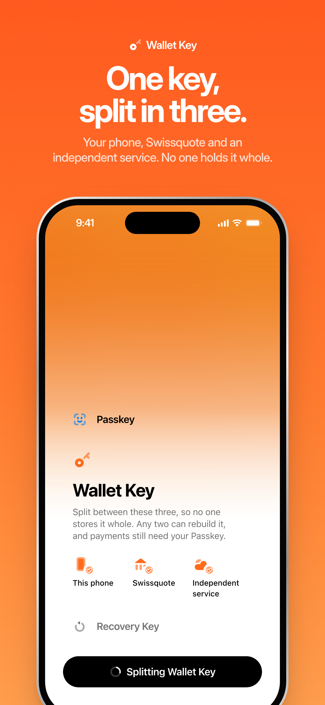
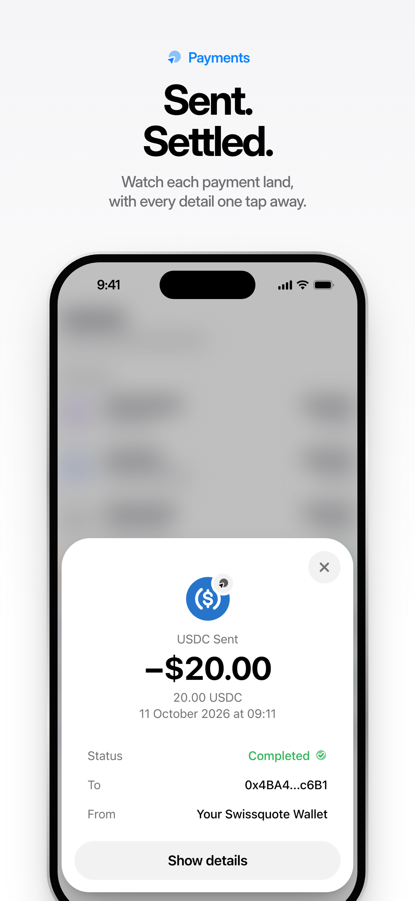
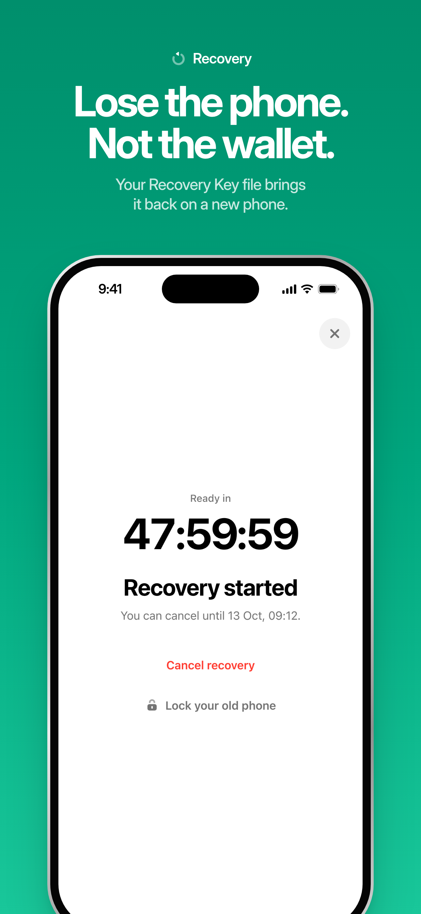
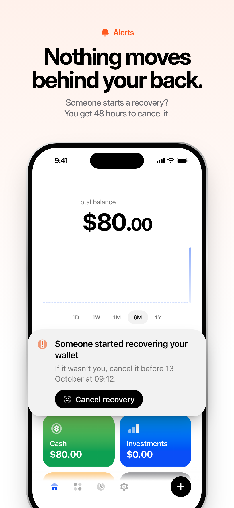
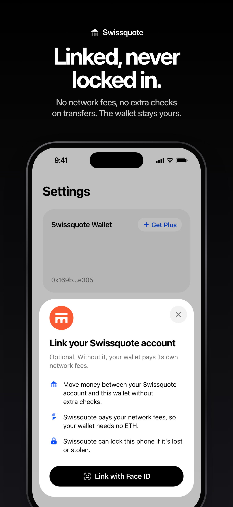

# Swissquote Wallet

A self-custody crypto wallet Swissquote could offer its clients. The client holds the keys. Swissquote screens each payment, pays a linked wallet's network fees and helps recover a lost phone. It cannot move the funds, alone or with the independent service that holds the third key share.

<p align="center">
  
  
  
  
</p>
<p align="center">
  
  
  
  
</p>

## How it works

- **Two signatures.** The wallet is an ERC-4337 smart account. Every payment needs the wallet key and the passkey on the phone, behind Face ID.
- **One key, split in three.** The wallet key is split 2-of-3 with Shamir between the phone, Swissquote and an independent service. Even together, Swissquote and the service lack the passkey.
- **Checked before Face ID.** Swissquote screens and simulates every payment, and the phone shows the result before the client signs.
- **Recovery.** A Recovery Key file kept off the phone restores the wallet on a new phone after a 48-hour on-chain delay, which the old phone can cancel.
- **Exit.** If Swissquote is gone for 30 days, the independent service releases its share and the wallet pays its own gas.
- **Optional link.** A wallet linked to a Swissquote account gets sponsored gas, transfers with no extra checks, a lock for a stolen phone and Swissquote Plus.
- **Swap.** One Face ID swaps USDC and ETH through an on-chain test pool in a single sponsored operation, after Swissquote reviews the swap and its exact approval.

This is a hackathon build. The protocol runs for real, on a local chain or Base Sepolia. The Swissquote sign-in, the HSMs and demo-mode sanctions screening are [mocked](docs/REFERENCE.md#what-is-real-and-what-is-mocked).

## Run it

You need Node.js 22.18 or later.

```bash
npm install
npm run local
```

Open http://localhost:3000/onboarding-welcome, create a wallet, then run `npm run fund` for 100 USDC and 0.01 ETH.

## Docs

- [protocol.md](protocol.md) is the spec. It wins where the code or the docs disagree.
- [Security model](docs/SECURITY.md): custody, threat model, wallet creation, authentication, recovery and known limits.
- [Reference](docs/REFERENCE.md): the demo walkthrough, commands, architecture, APIs, gasless payments and compliance.
- [Legal position](docs/LEGAL.md): custody and the Travel Rule.
- [Shamir and recovery](docs/SHAMIR_AND_RECOVERY.md), [dApp integration](docs/DAPP_INTEGRATION.md), [pitch summary](PITCH_SUMMARY.md) and [business cases](BUSINESS_CASES.md).

## Business case

10,000 wallets × (10% kept + 10% new) × CHF 600 = CHF 1.2 million a year, and CHF 79 million of assets kept with clients who would otherwise have left.

| Input | Source or assumption | Value |
| --- | --- | --- |
| Accounts on 30 June 2026 | [H1 2026 results](https://www.swissquote.com/en/api/internal/media/get-media?filename=press-releases%2Fad+hoc_EN_Media_Release_H1_2026.pdf), p. 1. Includes 423,409 Yuh accounts with CHF 4.0 billion of assets (p. 7). Without Yuh, assets per account rise to about CHF 116,000, so our averages are low. | 1.22 million |
| Client assets on 30 June 2026 | H1 2026 results, p. 1 | CHF 96.3 billion, about CHF 79,000 per account |
| Net revenues expected for 2026 | H1 2026 results, p. 3. The first half brought CHF 364.2 million (p. 1). | CHF 730 million, about CHF 600 per account a year |
| Crypto trading fee | [Crypto pricing](https://www.swissquote.com/en-ch/private/trade/pricing/cryptocurrencies), Standard tier, under USD 6,000 traded in 30 days | 1% |
| Withdrawal fee to an external wallet | Crypto pricing, withdrawal fees | USD 15 for USDC, USD 10 for BTC or ETH |
| Wallets in the first year | Assumption, 0.8% of accounts | 10,000 |
| Clients kept | Assumption, 1 wallet client in 10 would otherwise have left Swissquote | 1,000 × CHF 600 = CHF 600,000 a year, and 1,000 × CHF 79,000 = CHF 79 million of assets |
| New clients | Assumption, 1 wallet client in 10 is new to Swissquote. We count no assets for them. | 1,000 × CHF 600 = CHF 600,000 a year |
| Swaps in the app | Assumption, CHF 5,000 per wallet a year at the 1% fee | 10,000 × CHF 50 = CHF 500,000 a year |
| Swissquote Plus | Assumption, 1 wallet client in 10 links the wallet and pays for Plus all year. The app sells it for 10 USDC per 30 days, which we count as CHF 10 a month. The price is our guess. | 1,000 × CHF 120 = CHF 120,000 a year |
| Free transfers into the wallet | Assumption, 4 a year per wallet, each waiving the USD 15 fee | 10,000 × USD 60 = USD 600,000 a year forgone |
| Sponsored gas | Assumption, 24 payments per linked wallet a year at USD 0.05 on a layer-2 chain. We count every wallet as linked, which overstates the cost. | 10,000 × USD 1.20 = USD 12,000 a year |
| Net | Sum of the lines above, counting USD 1 as CHF 1. The 2025 closing rate was CHF 0.79 (Annual Report 2025, p. 64), so this overstates the costs, and Plus. | About CHF 1.2 million a year |

## AI tools

At commit `2618e8a`, 100 of the 190 non-merge commits carry a `Co-Authored-By: Claude` trailer: 89 name Claude Opus 5.5 and 11 name Claude Fable 5.1. They cover the protocol, contracts, Shamir split, phone SDK, Wallet API, independent service, CLI, screens and deck. OpenAI Codex helped with the early proposal (`4ab11d3`). The other 90 commits carry no AI trailer, including the first compliance engine (`d69a4fe`).

TODO(team): say how the team reviewed AI-written code before merging it.
