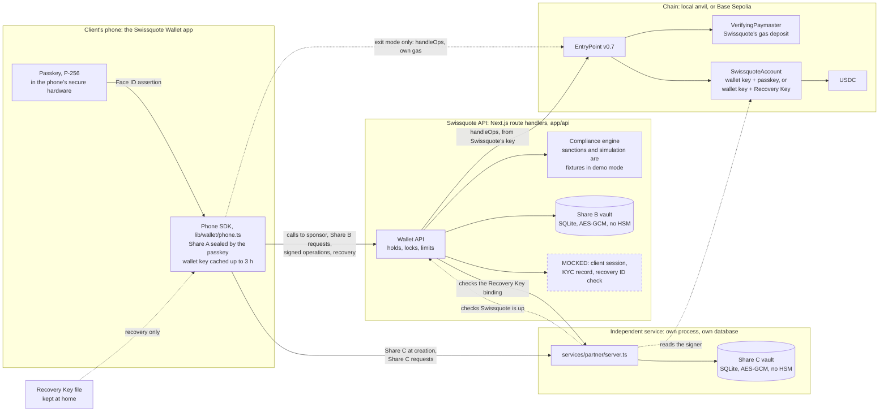

# Swissquote Wallet

Swissquote Wallet is a self-custody crypto wallet that Swissquote could offer its clients. The client holds the keys. Swissquote screens each payment, pays the network fee and helps recover a lost phone. Swissquote cannot move the client's funds, alone or together with the independent service that holds the third key share.

Self-custody asks clients to become security experts, and a signing prompt tells them little about what they approve. Today a client who wants their own keys must whitelist an external address and pay USD 10 (native coin) or USD 15 (ERC-20 token) per withdrawal ([pricing](https://www.swissquote.com/en-ch/private/trade/pricing/cryptocurrencies), [external wallets](https://www.swissquote.com/en-ch/private/help/trade/products/crypto-asset-products)). After that, Swissquote no longer sees those assets. Swissquote Wallet keeps self-custody one tap from the Swissquote account.

This is a hackathon build. The whole protocol runs for real on a local chain. The parts that need a real bank, such as the client's Swissquote session, the ID check and the HSMs, are mocked. [Known limits](#known-limits) lists what a judge should not take on trust. [protocol.md](protocol.md) is the spec, and it wins where the code or these docs disagree.

| Submission item | Where |
| --- | --- |
| The end-to-end demo | [The demo story](#the-demo-story) |
| Custody model and threat model | [Custody model](#custody-model), [Threat model](#threat-model), [Known limits](#known-limits) |
| Architecture diagram with mocked parts marked | [Architecture](#architecture), [What is real and what is mocked](#what-is-real-and-what-is-mocked) |
| Wallet creation, authentication, recovery | [Wallet creation](#wallet-creation), [Authentication](#authentication), [Recovery](#recovery), [Exit without Swissquote](#exit-without-swissquote) |
| Custody and Travel Rule handling | [Legal position](#legal-position) |
| What Swissquote gains | [Business case](#business-case) |
| Bonus topics | [Gasless payments](#bonus-gasless-payments), [Compliant dApp interaction](#bonus-compliant-dapp-interaction), [The attacker with the phone and the email](#the-attacker-with-the-phone-and-the-email) |
| AI tools | [AI tools](#ai-tools) |
| Commands and API | [Run it locally](#run-it-locally), [Reference](docs/REFERENCE.md) |

Each section links to its depth in [`docs/`](docs/). The [pitch summary](PITCH_SUMMARY.md) is the short version for a non-technical audience.

## The demo story

One story, end to end: create a wallet, pay with Face ID, lose the phone, recover the wallet. Run `npm run local`, then open http://localhost:3000/onboarding-welcome in two browsers, or two browser profiles, as the old phone and the new phone.

1. **Create a wallet.** Tap **Create new wallet**, then **Create Passkey**, **Split Wallet Key**, **Save Recovery Key** and **I saved it off this phone**. Run `npm run fund` for 100 USDC. Note the ID card number in Settings.
2. **Sign in and pay.** On Home, tap the action button, then **Send**. Enter an address and an amount, read the **Checked by Swissquote** card, tap **Send** and approve with Face ID. Above 1,000 USDC the payment waits 24 hours.
3. **Lose the phone and recover.** In the second browser, tap **Recover existing wallet** and load the Recovery Key file. Type the ID card number, tap **Scan ID**, then **Restore with Face ID**. Run `npm run warp` to pass the 48-hour hold, then tap **Finish recovery**. The new phone now controls the same address with the same funds.

The same story runs without a browser, on software phones. Run these in order against a fresh `npm run local`:

```bash
npm run account anna                                                # a wallet with 100 USDC
npm run send anna 0x000000000000000000000000000000000000dEaD 20     # leaves at once
npm run fund anna 2000
npm run send anna 0x000000000000000000000000000000000000dEaD 2000   # held for 24 hours
npm run warp 24                                                     # prints "Released"
npm run attack anna                                                 # A1 to A7, each refused
npm run recover anna                                                # lost phone: recovery onto anna-new
npm run warp
npm run finish anna-new                                             # anna-new controls the same address
npm run sunset                                                      # Swissquote is gone
npm run exit anna-new 0x000000000000000000000000000000000000dEaD all
npm run sunset off
```

More: the [demo walkthrough](docs/REFERENCE.md#demo-walkthrough) has every screen and message, and [Commands](docs/REFERENCE.md#commands) lists every command.

## Custody model

The wallet is an ERC-4337 smart account, `SwissquoteAccount`. Every operation needs two signatures, and the account checks both on chain:

| Mode | First signature | Second signature | What it may call |
| --- | --- | --- | --- |
| Normal | The wallet key | The passkey on the phone, behind Face ID | Any call, through `execute`. Not `initiateRecovery`. |
| Recovery | The wallet key | The Recovery Key kept at home | Only `initiateRecovery`, which starts a 48-hour delay |

The wallet key is split 2-of-3 with Shamir secret sharing. Share A lives on the phone, Share B with Swissquote and Share C with the independent service. Any two shares rebuild the key on the phone. Even together, Swissquote and the independent service lack the passkey and the Recovery Key.

| Model | Our call |
| --- | --- |
| Custodial | Not chosen. It is custody, the product these clients already leave. |
| Seed phrase | Not chosen. One lost phrase loses the funds. |
| MPC, threshold signatures | Not chosen. Swissquote and its partner could sign without the client. |
| Passkey-only smart account | Partly chosen. We keep the account and the passkey, and add a second key. |
| Split backup, Shamir or SLIP-39 | Partly chosen. We split the wallet key, but the shares alone cannot spend. |

More: [Custody model](docs/SECURITY.md#custody-model) has each model's pros and cons, what ours gets right and what it costs.

## Threat model

| Who | Can they steal? | Can they lock the client out? |
| --- | --- | --- |
| Thief with a locked phone | No | No |
| Thief who can unlock the phone | Within Swissquote's limits, until the client reports the phone and Swissquote [locks](docs/SECURITY.md#the-lock) it. A cached key can still pay through a public bundler for up to 3 hours. | Until the report |
| Thief with the phone and the email inbox | No. No email reset exists. | No |
| Thief with the Recovery Key file | Only with the owner's ID number too, and only if the client does not cancel within 48 hours | No |
| Swissquote alone | No | Yes, while it runs |
| Independent service alone | No | Yes, by refusing Share C |
| Swissquote and the independent service together | No | Yes, by both refusing |
| Swissquote, with a stolen Recovery Key file | Yes, after 48 hours. Swissquote can block the client's cancel. | Yes |
| Swissquote's server tampering with an operation | No. The phone checks it before Face ID. | No |
| Malicious app build | Yes, in theory | Yes, in theory |

**Could Swissquote alone, or with the partner, move the funds without the client?** No. They could take the wallet only with something the client holds, a stolen Recovery Key file or a malicious app build the client runs.

More: the [threat model](docs/SECURITY.md#threat-model) gives what each party holds and what stops them.

## Architecture



The dashed box is mocked. Everything else runs for real in this build. The independent service is a real separate process with its own database, but the company behind it is a stand-in. The dotted line to the EntryPoint is exit mode, used only when Swissquote is gone.

More: [Components](docs/REFERENCE.md#components), [Swissquote's API](docs/REFERENCE.md#swissquotes-api) and [the independent service's API](docs/REFERENCE.md#the-independent-services-api).

## Wallet creation

Every key is generated on the client's phone. The passkey lives in the phone's secure hardware, behind Face ID. `split()` in `lib/wallet/shamir.ts` splits a fresh wallet key into Share A, sealed on the phone under the passkey's PRF output where the authenticator supports PRF, Share B for Swissquote and Share C, which the phone sends straight to the independent service. Each holder checks its share before storing it. The whole wallet key is stored nowhere. The Recovery Key goes into the file `Swissquote Wallet Recovery Key.txt`, which the client keeps off the phone.

The wallet is created inside the client's signed-in Swissquote session, which is mocked. The wallet key signs "Wallet 0x… belongs to Swissquote client *number*." Swissquote registers the wallet to that session and keeps the statement as the Travel Rule ownership proof.

More: [Wallet creation](docs/SECURITY.md#wallet-creation) has each step and when each key leaves its holder.

## Authentication

The client proves who they are with the passkey, behind Face ID, for every operation. The wallet itself uses no password, SMS code or email link. Before Face ID, the phone checks the operation Swissquote built. The passkey signs that exact hash, and the account requires the authenticator's user-verified flag on chain. Share A never leaves the phone, which binds the wallet to the device.

These are the local policy's numbers:

| Payment | What the client does | What happens |
| --- | --- | --- |
| Up to 1,000 USDC | One Face ID | It leaves at once. |
| Above 1,000 USDC, within the limits | One Face ID | It leaves 24 hours later in chain time. The client can cancel it until then. Compliance runs again before release. |
| Above 10,000 USDC in one payment, or above 5,000 USDC sent in 24 hours of chain time | Nothing | Swissquote refuses it. |

Swissquote's servers enforce these limits. The account itself enforces only the signatures. The hold has two halves. The paymaster's sponsorship is valid only from the release time, so the EntryPoint refuses the payment before then, whoever submits it. Swissquote runs compliance again before it releases the payment.

More: [Authentication](docs/SECURITY.md#authentication) and [the two halves of the hold](docs/SECURITY.md#small-and-large-payments).

## Recovery

| What happened | Who is involved | How long |
| --- | --- | --- |
| Phone lost, destroyed or stolen | The client with a new phone, the Recovery Key file and their ID, Swissquote and the independent service | Minutes, then 48 hours |
| Recovery Key lost, phone fine | The client moves the funds to a new wallet. | Minutes, then days for a large balance |
| Phone and Recovery Key both lost | Nobody can help. | Never |
| Independent service gone | The client and Swissquote. Payments keep working. | Recovery waits until C is available. |
| Swissquote gone | The client and the independent service | 30 days, then minutes |

The Recovery Key must sign the exact recovery. The ID number must match the owner's KYC record, which is mocked, and five wrong numbers stop ID checks for an hour. The recovery then waits 48 hours on chain, and the old phone, or the client with the Recovery Key through Swissquote, can cancel it. If a thief can unlock the old phone, the client locks it with **Lock your old phone** or `npm run lock`.

### Exit without Swissquote

If Swissquote's services are gone for `EXIT_AFTER`, 30 days by default, the independent service opens exit mode. It then releases Share C for an operation the passkey approved. The phone rebuilds the key from Shares A and C, and the wallet pays its own gas through any public bundler. In this build the exit runs from the terminal only. `npm run sunset` simulates the outage, and `npm run exit` moves the funds.

### The attacker with the phone and the email

`npm run attack <account>` plays a thief with the client's phone and email inbox, and asserts each refusal. `npm run e2e` runs it as step 11.

1. **A1.** Pay without Face ID. Share A stays sealed.
2. **A2.** Reset by email. No email reset exists.
3. **A3.** Use a Recovery Key the thief made. Both share holders refuse to bind it.
4. **A4.** Show the thief's own ID. The ID check refuses it.
5. **A5.** Use the real Recovery Key without the owner's ID. The ID check refuses it.
6. **A6.** Unlock the phone and pay. Swissquote's lock refuses it once the owner reports the phone.
7. **A7.** Forge an ID with the owner's number. The mock check passes it, and the owner cancels within the 48 hours.

More: [recovery](docs/SECURITY.md#recovery), [the lock](docs/SECURITY.md#the-lock), [the exit](docs/SECURITY.md#exit-without-swissquote), [the attack](docs/SECURITY.md#the-attacker-with-the-phone-and-the-email) and [every recovery step](docs/SHAMIR_AND_RECOVERY.md).

## Legal position

This is engineering research checked on 10 October 2026, not legal advice.

**Custody.** The practical test for custody is who can move the funds. Swissquote cannot. The account accepts a transfer only with the passkey in the client's phone, and no Swissquote key meets that rule, even combined with the independent service's. Swissquote's other powers decide whether it helps and move no asset. The weak point is that withholding Share B stops the client paying while Swissquote runs, so the client contract should allow refusal only on a legal ground.

**Travel Rule.** FINMA requires ownership of a client's own wallet to be proven by suitable technical means. Swissquote Wallet makes the proof automatic. At creation, inside the signed-in app, the wallet key signs a statement that the wallet belongs to that client number. Transfers between the Swissquote account and the wallet then need no whitelisting form and no test transfer. A production proof should also verify the account through ERC-1271, which is not built.

**Sending institution.** When the client pays a third party, the client signs and the client's account sends. Swissquote screens, pays gas and relays, and cannot change the recipient or the amount. Our position is that Swissquote is not the ordering institution, but it is a financial intermediary for the assistance, so KYC, monitoring and sanctions duties apply. Until FINMA or counsel confirms that reading, we would treat each sponsored payment as if Swissquote were the ordering institution.

More: the [legal position](docs/LEGAL.md) has every citation, shared control with the independent service, the other rules that apply and the questions for counsel.

## Business case

A Swissquote client who wants their own keys today pays USD 15 to move USDC to an external wallet. Swissquote then loses sight of the coins, and some clients take the whole account with them. Swissquote earns about CHF 600 a year and holds about CHF 79,000 of client assets per account, so each client who leaves takes both. Swissquote Wallet keeps that client one tap from trading.

Our model is 10,000 wallets × (10% kept + 10% new) × CHF 600 = CHF 1.2 million a year, and CHF 79 million of assets kept with the 1,000 clients who would otherwise have left. The fee lines about cancel out. Swaps at the published 1% fee and Swissquote Plus bring in CHF 620,000 a year. Free transfers into the wallet and sponsored gas cost CHF 612,000, counting one dollar as one franc, which overstates them. Costs also fall, by amounts no public figure shows. There is no seed phrase to support, and coins in the client's own wallet need none of the cold storage, multi-signature wallets and sub-custodians that Swissquote runs for the crypto it holds ([Annual Report 2025](https://www.swissquote.com/en/api/internal/media/get-media?filename=2026-03/Annual%20Report%20full%20report_18.03.2026_vFINAL.pdf), p. 115). The case does not depend on crypto prices. Net crypto assets income fell 66% to CHF 14.6 million in H1 2026, but the CHF 600 counts the whole account.

| Input | Source or assumption | Value |
| --- | --- | --- |
| Accounts on 30 June 2026 | [H1 2026 results](https://www.swissquote.com/en/api/internal/media/get-media?filename=press-releases%2Fad+hoc_EN_Media_Release_H1_2026.pdf), p. 1. Includes 423,409 Yuh accounts with CHF 4.0 billion of assets (p. 7). Without Yuh, assets per account rise to about CHF 116,000, so our averages are low. | 1.22 million |
| Client assets on 30 June 2026 | H1 2026 results, p. 1 | CHF 96.3 billion, about CHF 79,000 per account |
| Net revenues expected for 2026 | H1 2026 results, p. 3. The first half brought CHF 364.2 million (p. 1). | CHF 730 million, about CHF 600 per account a year |
| Crypto trading fee | [Crypto pricing](https://www.swissquote.com/en-ch/private/trade/pricing/cryptocurrencies), Standard tier, under USD 6,000 traded in 30 days | 1% |
| Withdrawal fee to an external wallet | Crypto pricing, withdrawal fees | USD 15 for USDC, USD 10 for BTC or ETH |
| Wallets in the first year | Assumption, 0.8% of accounts | 10,000 |
| Clients kept | Assumption, 1 wallet client in 10 would otherwise have left Swissquote | 1,000 × CHF 600 = CHF 600,000 a year, and 1,000 × CHF 79,000 = CHF 79 million of assets |
| New clients | Assumption, 1 wallet client in 10 is new to Swissquote. We count no assets for them. | 1,000 × CHF 600 = CHF 600,000 a year |
| Swaps in the app | Assumption, CHF 5,000 per wallet a year at the 1% fee | 10,000 × CHF 50 = CHF 500,000 a year |
| Swissquote Plus | Assumption, 1 wallet client in 10 at CHF 10 a month. The app's Plus screen is a demo, and the price is our guess. | 1,000 × CHF 120 = CHF 120,000 a year |
| Free transfers into the wallet | Assumption, 4 a year per wallet, each waiving the USD 15 fee | 10,000 × USD 60 = USD 600,000 a year forgone |
| Sponsored gas | Assumption, 24 payments per wallet a year at USD 0.05 on a layer-2 chain | 10,000 × USD 1.20 = USD 12,000 a year |
| Net | Sum of the lines above, counting USD 1 as CHF 1. The 2025 closing rate was CHF 0.79 (Annual Report 2025, p. 64), so this overstates the costs. | About CHF 1.2 million a year |

## Bonus: gasless payments

Swissquote pays every fee. Its `VerifyingPaymaster` holds an ETH deposit at the EntryPoint, and Swissquote's own key submits operations, so the client never holds ETH. Swissquote sponsors only payments compliance allows and the recovery calls. It refuses a payment of 0, sponsors at most 20 of a wallet's operations per hour, fixes the gas limits and simulates `handleOps` before it submits.

More: [Gasless payments](docs/REFERENCE.md#gasless-payments) has each rule and its error message.

## Bonus: compliant dApp interaction

Every payment Swissquote sponsors goes through the compliance engine first. The engine checks the call against an allowlist, screens every address it touches for sanctions, simulates it, applies limits with extra checks above a threshold, and signs its decision into a hash-chained audit log. The client reads Swissquote's plain-language summary on the **Checked by Swissquote** card before Face ID. A refusal shows its reasons and never freezes the wallet. In demo mode, fixtures do the screening and the simulation, and the card carries a **Demo** tag.

More: the [compliance engine](docs/REFERENCE.md#compliance-engine) has each check, its HTTP API and its own limits.

## What is real and what is mocked

Everything not listed here runs for real, including the independent service as its own process and exit mode. These parts are mocked:

- The signed-in Swissquote session and the client's KYC record, labelled **Mock** in the app.
- The ID document and liveness check. **Scan ID** scans nothing.
- HSMs. Shares B and C are AES-GCM sealed in SQLite.
- The native app. Share A and the key cache live in a web app.
- Sanctions and simulation, which use fixtures in demo mode.
- The independent service's company. It runs as a process.
- The chain. The demo runs on a local anvil chain.
- The Investments, Earn and Card tiles, the promo cards, Swap and Swissquote Plus, each with a **Demo** tag.

More: [What is real and what is mocked](docs/REFERENCE.md#what-is-real-and-what-is-mocked) names the production answer for each.

## Known limits

- The key split is our own code and needs an audit.
- The phone rebuilds the key. This is Shamir sharing, not threshold signing.
- It is EVM-only.
- Cancelling a held payment is not trustless.
- The lock is Swissquote's, not the chain's.
- A phone lost while Swissquote is gone is not covered.
- The mock ID check passes a forged number.
- Swissquote keeps availability powers.
- Recovery needs both share holders.
- The Recovery Key cannot be replaced.
- Some parts are not built, such as recovery alerts on every channel and Travel Rule messaging.

More: [Known limits](docs/SECURITY.md#known-limits) explains each one and lists everything not built.

## AI tools

- **Claude Code (Anthropic).** At commit `2618e8a`, 100 of the 190 non-merge commits carry a `Co-Authored-By: Claude` trailer. 89 name Claude Opus 5.5 and 11 name Claude Fable 5.1. Commits with the trailer cover the protocol, the contracts, the Shamir split, the phone SDK, the Wallet API, the independent service, the CLI, the screens, the deck and this README. The `track/*` branches were written by Claude Code agents working from a shared brief.
- **OpenAI Codex.** Commit `4ab11d3` lists it in the early proposal, for updating the proposal from team notes and checking the MPC library's threshold and the FINMA references. No commit trailer names it.
- **No trailer.** The other 90 commits carry no AI trailer. They include the first compliance engine (`d69a4fe`).

Count the commits with:

```bash
git rev-list --no-merges --count HEAD
git log --no-merges --grep='Co-Authored-By: Claude' --format=%h | wc -l
```

TODO(team): say how the team reviewed AI-written code before merging it.

## Run it locally

You need Node.js 22.18 or later and [Foundry](https://getfoundry.sh), with `anvil` and `forge` on your PATH.

```bash
npm install
npm run local
```

Open http://localhost:3000/onboarding-welcome when it prints the command list. Every run without `--prod` starts from an empty chain and wipes `data/`.

More: [Run it locally](docs/REFERENCE.md#run-it-locally) covers ports, `--prod`, every command, the checks, Base Sepolia and [iOS](docs/REFERENCE.md#run-it-on-ios).
