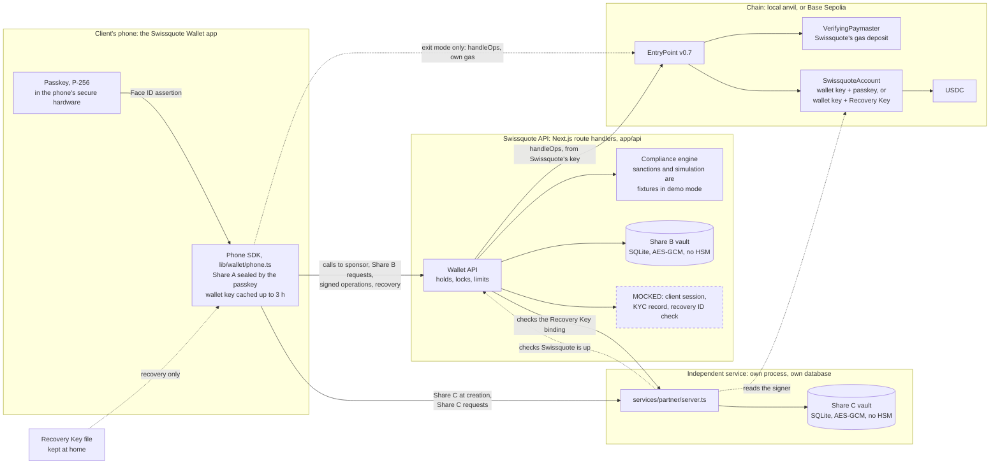

# Swissquote Wallet

Swissquote Wallet is a self-custody crypto wallet that Swissquote could offer its clients. The client holds the keys. Swissquote screens each payment, pays the network fee and helps recover a lost phone. Swissquote cannot move the client's funds, alone or together with the independent service that holds the third key share.

This is a hackathon build. The whole protocol runs for real on a local chain. The parts that need a real bank, such as the client's Swissquote session, the ID check and the HSMs, are mocked. [What is real and what is mocked](#what-is-real-and-what-is-mocked) lists them, and [Known limits](#known-limits) lists what a judge should not take on trust.

[protocol.md](protocol.md) is the spec. Where the code or this README disagree with it, protocol.md wins. [Shamir key sharing and wallet recovery](docs/SHAMIR_AND_RECOVERY.md) walks through the cryptography and every recovery step. The [pitch summary](PITCH_SUMMARY.md) is the short version for a non-technical audience.

| Submission item | Where |
| --- | --- |
| The end-to-end demo | [The demo story](#the-demo-story) |
| Custody model and threat model | [Custody model](#custody-model), [Threat model](#threat-model), [Known limits](#known-limits) |
| Architecture diagram with mocked parts marked | [Architecture](#architecture), [What is real and what is mocked](#what-is-real-and-what-is-mocked) |
| Wallet creation, authentication, recovery | [Wallet creation](#wallet-creation), [Authentication](#authentication), [Recovery](#recovery), [Exit without Swissquote](#exit-without-swissquote) |
| Custody and Travel Rule handling | [Legal position](#legal-position) |
| What Swissquote gains | [Business case](#business-case) |
| Bonus topics | [Gasless payments](#bonus-gasless-payments), [Compliant dApp interaction](#bonus-compliant-dapp-interaction), [The attacker with the phone and the email](#the-attacker-with-the-phone-and-the-email) |
| AI tools | [AI tools](#ai-tools) |
| Commands and API | [Run it locally](#run-it-locally), [Swissquote's API](#swissquotes-api) |

## Why

Self-custody asks clients to become security experts. A lost seed phrase loses the funds, and one photo of it gives them away. A signing prompt tells the client little about what they approve.

A Swissquote client who wants their own keys today must whitelist an external address and pay USD 10 (native coin) or USD 15 (ERC-20 token) per withdrawal ([pricing](https://www.swissquote.com/en-ch/private/trade/pricing/cryptocurrencies), [external wallets](https://www.swissquote.com/en-ch/private/help/trade/products/crypto-asset-products)). After that, Swissquote no longer sees those assets. With 1.22 million accounts and CHF 96.3 billion in client assets ([H1 2026 results](https://www.swissquote.com/en/api/internal/media/get-media?filename=press-releases%2Fad+hoc_EN_Media_Release_H1_2026.pdf)), every client who leaves for a separate wallet takes future trading with them.

Swissquote Wallet keeps self-custody one tap from the Swissquote account. The client keeps the authority to move funds. Swissquote adds checks before each payment and a recovery path after a lost phone.

## The demo story

One story, end to end: create a wallet, pay with Face ID, lose the phone, recover the wallet. Start the stack with `npm run local` (see [Run it locally](#run-it-locally)). Use two browsers, or two browser profiles, as the old phone and the new phone.

### 1. Create a wallet

1. In the first browser, open http://localhost:3000/onboarding-welcome and tap **Create new wallet**.
2. `/onboarding-secure` shows "Signed in to Swissquote as *name* · Mock". The app runs inside a mock Swissquote session, as a made-up client with a KYC record. Tap **Create Passkey**. Face ID creates the passkey.
3. Tap **Split Wallet Key**. Face ID runs again and gives the key that seals Share A. The phone splits the wallet key, keeps Share A, sends Share B to Swissquote and sends Share C straight to the independent service.
4. Tap **Save Recovery Key**. The share sheet, or a download, saves `Swissquote Wallet Recovery Key.txt`. Tap **I saved it off this phone**. The app registers the wallet and opens Home.
5. In a terminal, run `npm run fund`. Home shows 100 USDC.

Settings shows the client's ID card number under **ID on file · Mock**. Note it for the recovery.

### 2. Sign in and pay

Face ID is the sign-in. Each payment gets its own Face ID approval over that exact payment.

1. On Home, tap the action button, then **Send**.
2. In the recipient sheet, paste an address and continue.
3. On `/send`, which shows "Network fee: Paid by Swissquote", enter an amount and tap **Continue**. Swissquote runs its compliance check and sponsors the payment. The **Checked by Swissquote** card shows Swissquote's reading, such as "Send 20 USDC to 0x1bA5...Cf4c.", with "Recipient not on a sanctions list" and "Simulated: it moves only this amount".
4. Tap **Send**. Face ID approves the operation, the phone signs it and Swissquote submits it to the chain. `/transaction-tracking` shows the payment.

Above 1,000 USDC, `/send` also says "Large payment. It leaves on *date*, and you can cancel until then." The payment waits 24 hours in chain time. Home shows it with **Cancel payment**.

### 3. Lose the phone and recover

The first browser now plays the lost phone. Losing it loses Share A and the passkey. The Recovery Key file and the client's ID card are what is left.

1. In the second browser, open http://localhost:3000/onboarding-welcome and tap **Recover existing wallet**.
2. On `/recover`, choose the Recovery Key file, or paste the key, and tap **Continue**.
3. On **Confirm it's you**, type the ID card number from step 1 into **ID card number** and tap **Scan ID**. The screen says "Mock scan: the camera would read your ID card and check your face."
4. On **Secure this phone**, tap **Restore with Face ID**. Swissquote matches the number to the owner's KYC record. The new phone creates a new passkey and a new wallet key. Swissquote releases the old Share B, and the independent service releases the old Share C. The phone rebuilds the old key for one signature and starts the recovery on chain.
5. The new phone counts down the 48-hour hold in chain time and offers **Lock your old phone**. The old phone's Home shows "Someone started recovering your wallet" with **Cancel recovery**.
6. Run `npm run warp` to move chain time 48 hours ahead. Tap **Finish recovery**. The new phone now controls the same address with the same funds.

### The same story in the terminal

`npm run account` creates a wallet on a software phone, so the whole story runs without a browser. Every command below runs as written, in this order, against a fresh `npm run local`:

```bash
npm run account anna                                                # a wallet with 100 USDC
npm run send anna 0x000000000000000000000000000000000000dEaD 20     # leaves at once
npm run fund anna 2000
npm run send anna 0x000000000000000000000000000000000000dEaD 2000   # held for 24 hours
npm run warp 24                                                     # prints "Released"
npm run attack anna                                                 # A1 to A7, each refused
npm run recover anna                                                # lost phone: recovery onto anna-new
npm run warp
npm run finish anna-new                                             # anna-new controls the same address
npm run sunset                                                      # Swissquote is gone
npm run exit anna-new 0x000000000000000000000000000000000000dEaD all
npm run sunset off
```

`npm run lock anna` and `npm run unlock anna` report the phone lost and found. `npm run cancel-payment anna` cancels a held payment, and `npm run cancel anna` cancels a pending recovery, both with the Recovery Key.

To recover a browser wallet from the terminal, run `npm run recover ~/Downloads/"Swissquote Wallet Recovery Key.txt" recovered <ID number>`. The browser plays the old phone and can cancel the recovery from Home. `npm run e2e` runs the whole protocol as a test.

## Custody model

### We chose a smart account that needs two independent keys

The wallet is an ERC-4337 smart account, `SwissquoteAccount`. Every operation needs two signatures, and the account checks both on chain:

| Mode | First signature | Second signature | What it may call |
| --- | --- | --- | --- |
| Normal | The wallet key | The passkey on the phone, behind Face ID | Any call, through `execute`. Not `initiateRecovery`. |
| Recovery | The wallet key | The Recovery Key kept at home | Only `initiateRecovery`, which starts a 48-hour delay |

The wallet key is a secp256k1 key split 2-of-3 with Shamir secret sharing. Share A lives on the phone, Share B with Swissquote and Share C with an independent service. Any two shares rebuild the key on the phone. The passkey and the Recovery Key are never split and never leave the client.

We wanted four things. Swissquote must be unable to move funds, even together with its partner, because that is both the legal line for custody and the promise to the client. The client must not need a seed phrase, and daily use must be one Face ID. A lost phone must be recoverable without any single party able to recover it alone. And the build must use established open-source components, not new cryptography.

### Five common models, and why we did not pick one as-is

| Model | How it works | For | Against | Our call |
| --- | --- | --- | --- | --- |
| Custodial | Swissquote holds the keys, as in today's Swissquote crypto account | Simplest for the client. Recovery is a password reset. | It is custody, with the Banking Act duties that come with it. The client holds no keys, which is why self-custody clients leave. | Not chosen. It is the product these clients already leave. |
| Seed phrase | The client's device holds one key, backed up as 12 or 24 words | Full client control. Works on every chain. | One lost phrase loses the funds and one photo gives them away. No screening before signing. Swissquote sees nothing. | Not chosen. It is the problem this project solves. |
| MPC, threshold signatures | The parties hold key shares and sign together. The full key never exists in one place. | No single place ever holds the key. The output is an ordinary signature, so it works on Bitcoin too. | Complex protocols that need an audited library and an audited integration. If Swissquote and its partner hold two of three shares, they can sign without the client. The spending rules live in the parties' servers, not on chain. | Not chosen. Two servers that can sign alone is the custody problem we set out to remove. |
| Passkey-only smart account | An ERC-4337 account checks a WebAuthn passkey | No seed phrase. Face ID. Rules enforced on chain. Gas sponsorship. | The passkey is the only factor. Whoever takes over the Apple or Google account that syncs it can spend. Losing it needs a separate recovery scheme. EVM only. | Partly chosen. We keep the account and the passkey, and add a second, independent key. |
| Split backup, Shamir or SLIP-39 | The seed is split into shares held by the user, friends or services. A threshold of shares rebuilds it. | No single backup to lose or steal. An open standard. | Whoever rebuilds the seed holds the whole key and can spend. If services hold enough shares, they can spend. No screening, no delay, no cancel. | Partly chosen. We split the wallet key, but the account also needs the passkey or the Recovery Key, so the shares alone cannot spend. |

Our model is the last two combined. Shamir sharing alone lets two holders spend. A passkey alone has no recovery. Together, two holders who rebuild the key still lack the passkey, and a lost passkey is replaced through the Recovery Key and a delay the client can cancel.

### What our model gets right

- Neither Swissquote nor the independent service can move funds with what they hold, alone or together. Together they can rebuild the wallet key, but the account also needs the passkey for any payment and the Recovery Key to start a recovery.
- There is no seed phrase. Daily use is one Face ID per payment.
- A lost phone is recoverable with the Recovery Key, the owner's ID and both share holders, behind a 48-hour on-chain delay the client can cancel.
- The address stays the same after recovery, so deposit addresses and allowlists stay valid.
- Swissquote screens and sponsors every payment, shows the client its reading before Face ID, and holds large payments for 24 hours.
- The parts are established open-source code: EntryPoint v0.7 and its sample `VerifyingPaymaster` from eth-infinitism, OpenZeppelin's `WebAuthn` and `ECDSA`, noble-curves, viem and ox.

### What it costs

The phone rebuilds the whole wallet key, so this is not threshold signing. The split is our own code and needs an audit. The account is EVM-only. Swissquote keeps availability powers. While it runs, it can lock a client out without moving their funds. [Known limits](#known-limits) has each of these in detail.

## Threat model

| Who | What they hold | Can they steal? | Can they lock the client out? | What stops them |
| --- | --- | --- | --- | --- |
| Thief with a locked phone | Sealed Share A | No | No. The client recovers with B, C and the Recovery Key. | Share A opens only with the passkey's PRF output, where the authenticator supports PRF. Every operation needs a passkey assertion with Face ID. |
| Thief who can unlock the phone | Share A, the passkey, maybe the cached key | Until the client reports the phone, within Swissquote's limits. Up to 1,000 USDC a payment leaves at once. A larger payment waits 24 hours. At most 5,000 USDC a day. | Until the report, they can cancel recoveries from the phone. | The lock ([A6](#the-attacker-with-the-phone-and-the-email)). Once the client reports the phone, Swissquote refuses its payments, its Share B requests and its cancels of a recovery, and stops its held payments at release. The lock cannot stop a key still cached on the phone, for up to 3 hours, paying through a public bundler with the thief's own ETH. |
| Thief with the phone and the email inbox | The locked phone and the client's email | No | No | No Face ID, so no passkey. No email reset exists. A forged Recovery Key, or the thief's own ID, is refused (A1 to A4). |
| Thief with the Recovery Key file | The Recovery Key | Only with the owner's ID number too, and only if the client does not cancel within 48 hours | No | Swissquote tells the key's holder nothing about the owner (A5). The ID number must match the owner's KYC record, and five misses stop ID checks on that wallet for an hour. A forged ID with the owner's number passes the mock (A7), so the 48-hour delay and the cancel are the last defence. |
| Swissquote alone (rogue employee, breached server) | Share B, sponsorship, submission, guardian, the lock | No. One share is not the key, and the account also needs the passkey. | Yes. It can withhold B, refuse to sponsor or submit, lock the phone and cancel recoveries as guardian. The funds stay in the account. | Nothing while Swissquote runs. [Exit mode](#exit-without-swissquote) covers Swissquote gone, not Swissquote refusing. The [legal section](#why-this-is-not-custody) proposes contract terms for refusal. |
| Independent service alone | Share C | No | It can refuse C, which blocks recovery and exit. | The threshold. It releases C only for a recovery that Swissquote approved and the bound Recovery Key signed, or in exit mode for an operation the passkey approved. |
| Swissquote and the independent service together | B and C, so the full wallet key | No. Normal mode needs the passkey. Recovery mode needs the Recovery Key and can only call `initiateRecovery`. | Yes, by both refusing. | The account's second signature in each mode. This is the security claim in protocol.md. |
| Swissquote, with a stolen Recovery Key file | B, the KYC record, approval power and the Recovery Key | Yes, after 48 hours, unless the client cancels. Both cancel paths in the app run through Swissquote, so a hostile Swissquote can block the cancel for the whole 48 hours. | Yes | Only the client keeping the Recovery Key file safe. Production should have the independent service alert the client on every release of Share C. |
| Swissquote's server tampering with an operation | The UserOperation it builds | No | No | Before Face ID, the phone checks the sender and the callData, checks that a paymaster is set, and recomputes the hash. The paymaster, not the client, pays any gas Swissquote sets. |
| Malicious app build | Code next to Share A and the passkey | Yes, in theory | Yes, in theory | Out of scope for the protocol. In the web build, Swissquote's server serves the phone's code, so the web build trusts Swissquote. The iOS build bundles the code. Production needs a native app, reproducible builds and audits. |

Both ways to cancel a recovery run through Swissquote. The old phone's cancel needs Swissquote's sponsorship and, on a cache miss, Share B. A locked phone's cancel is refused, so the client then cancels through Swissquote with the Recovery Key, on `/recover` or with `npm run cancel`.

**Who could steal funds?** Someone who can unlock the client's phone, within Swissquote's limits, until the client reports it. Someone with the Recovery Key file and the owner's ID, or a forgery that passes the ID check, if the client does not cancel within 48 hours. A malicious app build. No server can, alone or with the other server.

**Who could lock the client out?** Swissquote alone, by withholding Share B or sponsorship, by locking the phone, or by cancelling recoveries as guardian. The independent service, by refusing Share C, which blocks recovery and exit. A thief with the unlocked phone, by cancelling recoveries until the client reports it. The client, by losing the phone and the Recovery Key together.

**Could Swissquote alone, or with the partner, move the funds without the client?** No. Together they can rebuild the wallet key, but the account also needs the passkey for any payment. Starting a recovery needs the Recovery Key, and a recovery replaces the keys only after 48 hours that the client can cancel. They could take the wallet only with something the client holds: a stolen Recovery Key file, or a malicious app build the client runs.

## Known limits

- **The key split is our own code.** `lib/wallet/shamir.ts` is 53 lines, about 30 of them logic, on @noble/curves' field and point arithmetic, with Feldman commitments that each holder checks. It needs an audit, or a swap for an audited library, before launch.
- **The phone rebuilds the key.** This is Shamir sharing, not threshold signing. The full wallet key exists on the phone at creation, on each cache miss and at recovery, and stays in memory for up to 3 hours. The phone receives Share B on a cache miss, for an operation its passkey approved. It receives Share C only at recovery (Swissquote approved, Recovery Key signed) or at exit (passkey approved). Each holder checks its own rule first. A compromised phone app sees the key, which still moves nothing without the passkey.
- **It is EVM-only.** The passkey and recovery rules live in an EVM contract. Bitcoin script cannot verify a P-256 passkey or hold a cancellable recovery. A Bitcoin path would need a Taproot policy whose recovery branch opens only after a relative timelock (`OP_CHECKSEQUENCEVERIFY`).
- **Cancelling a held payment is not trustless.** Swissquote discards its copy, but the signed operation stays valid on chain until 48 hours after its release time. Anyone holding a copy could submit it, and Swissquote's paymaster would pay. A trustless cancel would spend the payment's nonce on chain. That is not built.
- **The lock is Swissquote's, not the chain's.** It cannot stop a key still cached on the stolen phone, for up to 3 hours, from signing an operation the thief submits through a public bundler with their own ETH.
- **A phone lost while Swissquote is gone is not covered.** Exit mode needs Share A. The production answer is in [Exit without Swissquote](#exit-without-swissquote).
- **The mock ID check passes a forged number.** It compares the typed number with the KYC record. An ID that carries the owner's number passes, as a good forgery might pass a real check. The 48-hour delay and the client's cancel then stop it (A7).
- **Swissquote keeps availability powers.** While it runs, it can lock a client out without moving funds. Exit mode covers Swissquote gone, not Swissquote refusing.
- **Recovery needs both share holders.** If the independent service is gone when the phone is lost, the funds stay locked until it returns.
- **The Recovery Key cannot be replaced.** The account has no function to change it. A client who loses it moves the funds to a new wallet.
- **Not built.** Alerts on every channel when a recovery starts (only the old phone's Home, and `/recover` once the Recovery Key is loaded, show it). Signing the ownership statement again after a recovery (the owner record keeps the first key's signature). An exit screen in the app. Travel Rule messaging and an ERC-1271 ownership check. A gas price cap and monitoring of the paymaster deposit. A durable, externally anchored audit store. Audits of `SwissquoteAccount`, `lib/wallet/shamir.ts` and the phone SDK.

## Architecture



The dashed box is mocked. Everything else runs for real in this build. The independent service is a real separate process with its own database, but the company behind it is a stand-in. The dotted line to the EntryPoint is exit mode, used only when Swissquote is gone.

**Smart account** (`contracts/`, Foundry). `SwissquoteAccount` runs on EntryPoint v0.7 and checks the two modes in the [custody table](#we-chose-a-smart-account-that-needs-two-independent-keys), each over the userOpHash. Its config holds the wallet key's address, the passkey's P-256 public key, the Recovery Key's address and Swissquote as guardian. `RECOVERY_DELAY` is a constant 48 hours. `cancelRecovery` accepts the guardian or the account itself, and `finalizeRecovery` is open to anyone after the delay. `SwissquoteAccountFactory` deploys CREATE2 clones, so the address is known before deployment. `script/Deploy.s.sol` deploys the factory and Swissquote's funded `VerifyingPaymaster`, and on a local chain (31337) an EntryPoint and a mintable test USDC.

**Phone SDK** (`lib/wallet/phone.ts`, with the split in `lib/wallet/shamir.ts`). Keeps Share A sealed with AES-GCM under the passkey's WebAuthn PRF output, so only Face ID opens it, where the authenticator supports PRF. Builds every call itself and checks Swissquote's operation before Face ID. At onboarding it sends Share C straight to the independent service at a URL pinned in the app build (`NEXT_PUBLIC_PARTNER_URL`), so Swissquote never sees C.

**Swissquote Wallet API** (`app/api`, Next.js route handlers). Holds Share B, the client records, held payments and locks in SQLite (`data/swissquote.db`), with Share B sealed by AES-GCM. It runs the compliance check, signs sponsorship and submits operations to the EntryPoint itself, with no external bundler.

**Independent service** (`services/partner/server.ts`). Its own process and its own database (`data/partner.db`), sealed under its own key. Under `npm run local` that key lives in `data/partner.env`, which the app never loads. It stores Share C only for a key Swissquote ticketed, learns the Recovery Key only from a wallet-key signature, and releases C only for an `initiateRecovery` that Swissquote approved and the bound Recovery Key signed. It never takes part in a normal payment. In exit mode it also releases C for a passkey-approved operation. Its endpoints are `POST /shares`, `GET /shares/:signer`, `POST /shares/:signer/recovery-key`, `POST /recovery`, `GET /exit` and `POST /exit`.

**Compliance** (`lib/compliance`, `services/compliance`, `app/api/compliance`). The policy engine that decides whether Swissquote assists. See [Compliant dApp interaction](#bonus-compliant-dapp-interaction).

**App** (Next.js 16, and an iOS build with Capacitor). The screens read one shared wallet store (`app/(tabs)/_components/wallet.ts`), which reads Swissquote every 4 seconds and when the app regains focus, so a payment, a recovery, a lock or a warped chain shows without a reload.

### Swissquote's API

| Method and path | What it does |
| --- | --- |
| `POST /api/session` | Mocked. Signs the phone in as a made-up client with a KYC record. |
| `GET /api/config` | The chain ID and the EntryPoint and USDC addresses. |
| `POST /api/shares` | Stores Share B after checking it against the commitments, and returns a signed ticket for the independent service. |
| `GET /api/wallets?signer=&recoveryKey=` | The address a key will register at, so the key can sign the ownership statement first. |
| `POST /api/wallets` | Registers a wallet. Needs the session, the wallet key's Recovery Key binding and its ownership statement. |
| `GET /api/wallets/:address` | Keys, lock, USDC balance, pending recovery, chain time and held payments. Releases held payments that are due. Returns the owner record only to the owner's own session (header `x-swissquote-session`). |
| `GET /api/wallets/:address/activity` | The wallet's USDC transfers. |
| `POST /api/wallets/:address/operations` | Runs compliance and Swissquote's limits, and sponsors the call. Returns the operation, its hash, Swissquote's `summary` and a `demo` flag. |
| `POST /api/wallets/:address/share` | Releases Share B for an operation the passkey approved. |
| `POST /api/wallets/:address/operations/:hash` | Submits the signed operation, or holds it if it was sponsored for later. |
| `DELETE /api/wallets/:address/operations/:hash` | Cancels a held payment, with a Face ID assertion or a Recovery Key signature. |
| `POST`, `DELETE /api/wallets/:address/lock` | Locks or unlocks the phone's credentials, after the ID check. |
| `GET /api/recovery?signature=&at=` | Finds the wallet a Recovery Key signature restores, with any pending recovery. Returns no KYC data. |
| `POST /api/recovery` | Runs the ID check and prepares `initiateRecovery`. |
| `POST /api/wallets/:address/recovery` | Releases Share B and a signed approval for a recovery the Recovery Key signed. |
| `DELETE /api/wallets/:address/recovery` | Cancels the pending recovery as guardian, when the Recovery Key asks. |
| `PATCH /api/wallets/:address/recovery` | Finalizes a recovery after the delay. |
| `POST /api/compliance/evaluate`, `GET /api/compliance/keys`, `GET /api/compliance/registry` | The compliance engine for other backends. Needs `COMPLIANCE_API_KEY`. |

## Wallet creation

Every key is generated on the client's phone. Swissquote and the independent service each receive one share and check it before storing it.

| Key | Generated | Lives | When it leaves its holder |
| --- | --- | --- | --- |
| Passkey (P-256) | By the phone's authenticator, behind Face ID, at **Create Passkey** | The authenticator, in the phone's secure hardware | Only its public key, which goes into the account's config |
| Wallet key (secp256k1) | On the phone, by `split()` in `lib/wallet/shamir.ts`, from noble-curves' secure random generator | Nowhere at rest. The phone keeps it in memory for up to 3 hours and drops it when the app closes. | Never as a whole. Its shares go to the three holders. |
| Share A | The same split, at x = 1 | The phone's storage, AES-GCM sealed under the passkey's PRF output and bound to the signer address | Never |
| Share B | The same split, at x = 2 | Swissquote's vault | To a phone, for a passkey-approved operation or a Recovery-Key-signed recovery |
| Share C | The same split, at x = 3 | The independent service's vault | To a new phone, for a recovery Swissquote approved and the Recovery Key signed, or in exit mode for a passkey-approved operation |
| Recovery Key (secp256k1) | On the phone, by viem's `generatePrivateKey` | The file `Swissquote Wallet Recovery Key.txt`, which the client keeps off the phone | Only its address and its signatures |

Creation runs in this order:

1. The app signs in to Swissquote. The session is mocked.
2. The phone creates the passkey.
3. The phone splits a fresh wallet key into Shares A, B and C with Feldman commitments.
4. The phone sends Share B, the commitments and the passkey's public key to `POST /api/shares`. Swissquote checks B against the commitments, stores it and returns a ticket it signed, valid for 5 minutes.
5. The phone sends Share C and the ticket straight to the independent service. The service checks Swissquote's signature, the ticket's expiry and C against the commitments, then stores C.
6. The phone seals Share A under the passkey's PRF output and keeps it.
7. The phone creates the Recovery Key and saves its file. The client confirms **I saved it off this phone**. The wallet key signs a statement naming the Recovery Key's address. Both holders record it once and refuse to rebind it.
8. The wallet key signs "Wallet 0x… belongs to Swissquote client *number*." `POST /api/wallets` checks the session and that signature and registers the wallet. The first operation deploys the account.

This links the wallet to the client's Swissquote identity. Swissquote keeps the owner record (client number, time and the signed statement) as the Travel Rule ownership proof, with no extra step from the client. `GET /api/wallets/:address` returns that record only with the owner's own session, so the public wallet names no owner. `npm run status` checks each record's signature. The session and the KYC record are mocked. Each browser signs in as its own made-up client, and Settings shows "Verified as yours by Swissquote · Mock" with the client's ID card number.

Without WebAuthn PRF support, Share A sits unsealed in web storage. The native app would keep it under a Secure Enclave or Keystore key instead.

## Authentication

The client proves who they are with the passkey, behind Face ID, for every operation. The wallet itself uses no password, SMS code or email link, so there is nothing to phish by email.

1. The phone builds the call and asks Swissquote to sponsor it.
2. Swissquote runs compliance and returns a sponsored UserOperation with its plain-language summary.
3. The phone checks the sender and the callData, checks that a paymaster is set, and recomputes the hash. It shows Swissquote's summary under **Checked by Swissquote**.
4. Face ID unlocks the passkey, which signs that exact hash.
5. If the wallet key is not cached, the same assertion fetches Share B. Swissquote checks it against the wallet's passkey and the prepared operation first.
6. The phone rebuilds the key from A and B, signs the same hash and sends both signatures to Swissquote, which submits them.
7. The account checks the wallet key's signature and the WebAuthn assertion on chain.

The account's check, OpenZeppelin's `WebAuthn.verify`, requires the authenticator's user-verified flag. A passkey prompt that skipped Face ID or the device passcode fails on chain. Swissquote's API checks the same flag before it releases Share B.

The binding to the device comes from Share A. Platform passkeys can sync through iCloud Keychain or Google Password Manager, but Share A never leaves the phone. A synced copy of the passkey on another device gets at most one share, because the independent service releases C only for a recovery or in exit mode. A cached key skips fetching Share B. It never skips Face ID.

### Small and large payments

These are the local policy's numbers:

| Payment | What the client does | What happens |
| --- | --- | --- |
| Up to 1,000 USDC | One Face ID | It leaves at once. |
| Above 1,000 USDC, within the limits | One Face ID | It leaves 24 hours later in chain time. The client can cancel it until then. Compliance runs again before release. |
| Above 10,000 USDC in one payment, or above 5,000 USDC sent in 24 hours of chain time | Nothing | Swissquote refuses it. |

The daily limit counts the payment itself, so with these numbers any single payment above 5,000 USDC is refused before the 10,000 USDC cap applies. A 6,000 USDC payment gets "This payment would go over your daily limit." The limits are Swissquote's assistance rules, enforced by its servers. The account itself enforces only the signatures.

The 24-hour hold has an on-chain half and a Swissquote half.

- **On chain.** Swissquote's paymaster signs the held payment's sponsorship with `validAfter` set to the release time and `validUntil` 48 hours after it. EntryPoint v0.7 refuses the payment before `validAfter` ("AA32 paymaster expired or not due"), whoever submits it. Each held payment takes a random 192-bit nonce key of its own, so later payments do not wait for it. If the account is not deployed yet, Swissquote deploys it first.
- **At Swissquote.** Swissquote keeps the signed operation and releases it on its first read of the wallet after the release time. The app reads every 4 seconds, and `npm run warp` reads after the jump. Swissquote runs compliance again before release. A refusal, a failing simulation or an expired sponsorship stops the payment, and Home shows "Swissquote stopped a payment" with the reason. A payment from a phone locked meanwhile stops with "Swissquote locked this phone after it was reported lost."
- **Cancel.** The client cancels with Face ID (**Cancel payment** on Home) or with the Recovery Key (`npm run cancel-payment`). A locked phone can still cancel its held payments. Swissquote discards its copy. This cancel is not trustless, as [Known limits](#known-limits) explains.
- **Set aside.** Held money is not available. Send shows the balance minus held payments, and Swissquote refuses a payment that would dip into it: "Only N USDC is available. M USDC is set aside for payments that haven't left yet."

## Recovery

| What happened | Who is involved | How long | What stops an attacker |
| --- | --- | --- | --- |
| Phone lost or destroyed | The client with a new phone, the Recovery Key file and their ID. Swissquote checks the ID and releases Share B. The independent service releases Share C. | A few minutes of setup, then 48 hours of chain time | The Recovery Key must sign the exact recovery, and the ID number must match the owner's KYC record (mocked). The old phone shows the pending recovery and can cancel it, and Swissquote cancels it when the Recovery Key asks. |
| Phone stolen and locked | The same as a lost phone | The same | The thief cannot open Share A or make a passkey assertion, so they can neither pay nor cancel the recovery. |
| Phone stolen and unlocked | The same, plus the lock | The same | The client locks the old phone with **Lock your old phone** on the new phone's countdown, or a call to Swissquote (`npm run lock`). See the [threat model](#threat-model). |
| Recovery Key lost, phone fine | The client | Minutes, then days for a large balance | The account cannot change its Recovery Key. The client moves the funds to a new wallet, within the 5,000 USDC daily limit. The app holds one wallet per phone, so in this build the new wallet needs a second phone or browser profile. |
| Phone and Recovery Key both lost | Nobody can help | Never | No one can replace the keys without the Recovery Key. This is the cost of Swissquote having no power to move funds. |
| Independent service gone | The client and Swissquote | Payments: no change. Recovery: blocked until C is available. | Payments use A and B and keep working. A lost phone cannot be recovered without C. Production: the service's contract names a successor that takes over its vault. |
| Swissquote gone | The client and the independent service | 30 days after Swissquote's services stop, then minutes | [Exit without Swissquote](#exit-without-swissquote). |

A recovery runs like this:

1. The new phone loads the Recovery Key and signs a timestamped lookup. `GET /api/recovery` returns the wallet's address, any pending recovery and whether a Swissquote client owns it, and nothing about that client.
2. The new phone creates a new passkey and a new wallet key, split into new shares A', B' and C'. The new key binds itself to the same Recovery Key at both holders.
3. `POST /api/recovery` checks the typed ID number against the owner's KYC record and prepares `initiateRecovery(newSigner, newPasskey)`. Five wrong numbers, each within an hour of the last, stop ID checks on that wallet for an hour ("Too many tries"). The phone checks the operation and recomputes its hash.
4. The Recovery Key signs the operation hash. Swissquote checks that signature against the Recovery Key bound to the old key, releases the old Share B and signs a recovery approval that expires after 5 minutes.
5. The independent service checks the approval, recomputes the hash, checks the call is `initiateRecovery` and checks the Recovery Key's signature. Then it releases the old Share C.
6. The new phone rebuilds the old key from B and C, signs once and submits in recovery mode. The account records the new key and passkey and sets `executeAfter` to now plus 48 hours.
7. During the delay, the old phone can cancel, or Swissquote cancels as guardian when the Recovery Key asks. After it, anyone can call `finalizeRecovery`, which installs the recorded key and passkey. The address, the funds and the Recovery Key stay the same.

During the delay the old keys still work. Recovery is not a freeze, which is why the lock exists. A lock applies only while the wallet's live key and passkey are the locked ones, so a finished recovery ends it without an unlock.

### Exit without Swissquote

If Swissquote's services are gone, the independent service lets the client move funds out with Shares A and C.

- The service opens exit mode once Swissquote has been unreachable or closed for `EXIT_AFTER`. That is 30 days by default, for production. `npm run local` sets 5 seconds, and `npm run local -- --prod` sets 600 seconds. The `EXIT_AFTER` environment variable overrides both.
- The service calls Swissquote's `GET /api/config` every fifth of `EXIT_AFTER`, at least once an hour, and on each exit request. One answer resets the clock. It keeps the last answer's time in its database, so a restart does not reset it.
- `POST /exit` releases Share C only in exit mode, only for an `execute` operation with no paymaster, and only with a passkey assertion that verifies against the account's current passkey. That passkey is on chain or, for an undeployed wallet, in the deployment config the operation carries.
- The exit needs the phone, with Share A and the passkey (one Face ID), a connection to the chain, and ETH in the wallet for gas. The phone rebuilds the key from A and C and the operation goes straight to the EntryPoint through any public bundler. `npm run exit` sends the wallet 0.01 ETH when it holds less than 0.005 ETH, and anvil's second account plays the bundler. An undeployed wallet is deployed by its exit.
- In this build the exit runs from the terminal only (`npm run exit`). The app has no exit screen.
- `npm run sunset` simulates the outage. Every `/api` route then answers 503 "Swissquote's services are closed." `npm run sunset off` runs them again, and `npm run local` clears it on start.

Exit mode does not cover a phone lost while Swissquote is gone. The production answer is for Swissquote's resolution plan to escrow Share B with the independent service or an escrow agent. That is safe because B and C together cannot move funds without the passkey or the Recovery Key, and a recovery on chain needs no Swissquote signature. Anyone can finalize, and the guardian can only cancel. The service's recovery rule would need an exit-mode variant. The passkey works only on Swissquote's domain, so the wind-down plan must also keep that domain serving the app.

### The attacker with the phone and the email

`npm run attack <account>` plays a thief who stole the client's phone and has their email inbox. It tries every way in, prints who refused each attempt and why, and asserts it. `npm run e2e` runs it as step 11.

1. **A1. Pay from the phone without Face ID.** Share A stays sealed. The thief's own passkey cannot open it. Swissquote refuses Share B, and the account would reject the operation (AA24).
2. **A2. "Forgot my keys" with the email inbox.** No email reset exists. A recovery needs the Recovery Key's signature.
3. **A3. Recover with a Recovery Key the thief made.** No wallet uses it. Both share holders refuse to bind it, and the account would reject it (AA24).
4. **A4. The thief's own ID card.** The ID check refuses it.
5. **A5. The real Recovery Key without the owner's ID.** Swissquote finds the wallet but tells the thief nothing about the owner. The ID check refuses.
6. **A6. A thief who can unlock the phone.** Face ID passes, so the phone pays like the owner's, within Swissquote's limits. The owner reports it, and Swissquote locks it. Swissquote then refuses the phone's payment, its Share B request and its cancel of the owner's recovery, each with 423 "Swissquote locked this phone after it was reported lost."
7. **A7. The Recovery Key and a forged ID that carries the owner's number.** The mock check passes it. The recovery waits 48 hours in public, finishing early fails, and the owner cancels it through Swissquote with the Recovery Key.

## Legal position

Research checked on 10 October 2026, against Swiss law including the 1 October 2026 AMLA and AMLO amendments ([FINMA notice](https://www.finma.ch/en/documentation/dossier/dossier-geldwaeschereibekaempfung/hinweise-zur-revision-des-geldwaeschereigesetzes-und-der-geldwaeschereiverordnung/)). This is engineering research, not legal advice or FINMA approval. Our proposition is client-controlled assets with regulated bank assistance.

### Why this is not custody

Crypto custody under the Banking Act turns on an undertaking to keep assets available for the client and allocated to them ([BankA Art. 16 no. 1bis and Art. 37d](https://www.fedlex.admin.ch/eli/cc/51/117_121_129/de), [FINMA Guidance 01/2026](https://www.finma.ch/en/~/media/finma/dokumente/dokumentencenter/myfinma/4dokumentation/finma-aufsichtsmitteilungen/20260112-finma-aufsichtsmitteilung-01-2026.pdf)). The practical test is who can move the funds. We argue Swissquote cannot:

- The power of disposal sits with the client. The account accepts a transfer only with the passkey, which lives in the client's phone. No Swissquote key meets that rule, alone or combined with the independent service's. Anyone can read the rule in the deployed contract.
- The assets sit in the client's own account contract, not in Swissquote's name or on its books. Swissquote offers screening, gas and recovery help. It does not undertake to keep the assets available.
- Swissquote's remaining powers are availability powers. Withholding Share B, refusing sponsorship, locking a reported phone and cancelling a recovery as guardian decide whether Swissquote helps. None of them moves an asset or changes who controls it.

The weak point is practical. While Swissquote runs, withholding Share B stops the client from paying once the key cache expires. A regulator could read that as control. Exit mode answers this for a Swissquote that is gone. For a Swissquote that refuses one client, we propose two answers. The client contract allows refusal only on a legal ground. In production, the independent service would also open exit mode for that client after a notice period. That second answer is a design, not built. Counsel must weigh these powers. The licensing reform consulted on from October 2025 is not a launch permission ([SIF consultation](https://www.sif.admin.ch/en/newnsb/x4TMWQ1SWofNoFx7XyHhY)).

### Shared control with the independent service

Shared control between a bank and a partner is a grey zone when the two together can move funds. Here they cannot. Together they can rebuild only the wallet key, and the account refuses any transfer without the passkey and any recovery without the Recovery Key. So even combined, Swissquote and the independent service lack the power of disposal. What remains of the grey zone is the availability powers above, not disposal.

The independent service holds a usable share, so its AML and outsourcing role needs its own review ([FINMA outsourcing](https://www.finma.ch/en/news/2017/12/20171205-mm-rs-outsourcing/)).

### Travel Rule

Payment orders carry originator and beneficiary data ([AMLO-FINMA Art. 10](https://www.fedlex.admin.ch/eli/cc/2015/390/de)). FINMA applies this to crypto with no self-hosted-wallet exemption, and transfers to a client's own wallet need ownership proven by suitable technical means ([FINMA Guidance 02/2019](https://www.finma.ch/en/~/media/finma/dokumente/dokumentencenter/myfinma/4dokumentation/finma-aufsichtsmitteilungen/20190826-finma-aufsichtsmitteilung-02-2019.pdf)). FINMA has described suitable methods, including a message to the blockchain within a set time and time-boxed transfers ([2020 annual report, pp. 43 to 44](https://www.finma.ch/~/media/finma/dokumente/dokumentencenter/myfinma/finma-publikationen/geschaeftsbericht/20200325-finma-jahresbericht-2020.pdf), [AML supervision 2022](https://www.finma.ch/en/documentation/dossier/dossier-geldwaeschereibekaempfung/geldwaeschereiaufsicht-2022/)).

Swissquote Wallet makes the proof automatic. The wallet is created inside the signed-in Swissquote app, and the wallet key signs a statement that the wallet belongs to that client number. Swissquote holds that proof from the moment the wallet exists, so a transfer between the client's Swissquote account and the wallet needs no whitelisting form and no test transfer. Swissquote shows the proof only to the owner, because who owns a wallet is covered by banking secrecy.

Swissquote taking part in wallet creation is useful evidence, not automatic acceptance. A production proof should verify the account itself through [ERC-1271](https://eips.ethereum.org/EIPS/eip-1271) with a fresh single-use challenge, since [EIP-712](https://eips.ethereum.org/EIPS/eip-712) gives no replay protection by itself. `SwissquoteAccount` does not implement ERC-1271 yet. A recovery swaps the wallet key, so the statement must be signed again after each recovery. This build does not do that yet.

### Is Swissquote the sending institution?

When the client pays a third party from the wallet, the client signs and the client's account sends. Swissquote screens the call, pays the gas and relays the signed operation. It cannot change the recipient or the amount, because the phone checks the operation before Face ID and the account checks the signatures.

Our position is that Swissquote is not the ordering institution for that transfer. It never holds the assets and never decides to send them. It is still a financial intermediary for the assistance itself. AMLO Art. 4(1)(b) covers helping transfer virtual currencies to third parties in a continuing relationship, even without power of disposal ([AMLO](https://www.fedlex.admin.ch/eli/cc/2015/791/de), [2021 explanatory report, section 5.7](https://www.newsd.admin.ch/newsd/message/attachments/67150.pdf)). So KYC, monitoring and sanctions duties apply to every sponsored payment.

Until FINMA or counsel confirms that reading, we would launch conservatively and treat each sponsored payment as if Swissquote were the ordering institution:

- A payment to an address Swissquote can attribute to another institution, such as an exchange deposit address, gets originator and beneficiary data sent through a Travel Rule protocol before Swissquote sponsors it. If the receiving institution cannot take the data, Swissquote does not sponsor the payment.
- A payment to another self-hosted wallet keeps the 1,000 USDC hold and the limits, and above that threshold asks the client for the beneficiary's name.
- Swissquote records originator data for every sponsored payment.

This posture is a design. This build exchanges no Travel Rule messages.

### Other rules that apply

- **AML.** Swissquote is a bank and already under AMLA, which now expressly covers Embargo Act breaches ([AMLA](https://www.fedlex.admin.ch/eli/cc/1998/892_892_892/de)). The policy engine supplies technical controls. KYC, monitoring, MROS reporting and case management stay in bank processes.
- **Sanctions.** Swiss sanctions follow SECO ordinances, which can target people, ownership, geography and services, not just addresses ([SECO](https://www.seco.admin.ch/de/sanktionen), [FINMA notice of 20 August 2026](https://www.finma.ch/en/news/2026/08/20260820-sr/)). Refusing sponsorship stops Swissquote's help. Counsel decides the lawful response to an actual order.
- **dApps and tokens.** An allowlist entry is not an exemption. Token function decides FinSA and CISA scope, and an ERC-4626 vault is not a fund exemption ([FINMA token guidance](https://www.finma.ch/en/news/2018/02/20180216-mm-ico-wegleitung/), [FinSA](https://www.fedlex.admin.ch/eli/cc/2019/758/en), [CISA](https://www.fedlex.admin.ch/eli/cc/2006/822/de)).
- **Recovery.** The 48-hour delay is a design choice, not a statutory period. A mocked ID check proves the flow, not identity assurance. Production recovery falls under FINMA's operational-risk and fraud expectations ([Circular 2023/1](https://www.finma.ch/~/media/finma/dokumente/dokumentencenter/myfinma/rundschreiben/finma-rs-2023-01-20221207.pdf?sc_lang=en), [digital-fraud guidance](https://www.finma.ch/en/news/2026/04/20260409-mm-am-02-2026-digitale-betrugsrisiken/)).
- **Privacy and records.** Wallet data can be personal data and biometrics are sensitive ([FADP](https://www.fedlex.admin.ch/eli/cc/2022/491/en)). Showing one client that another banks with Swissquote would touch banking secrecy (BankA Art. 47), which is why the owner record goes only to the owner. AML records are kept at least ten years after the relationship or transaction ends ([AMLA Art. 7](https://www.fedlex.admin.ch/eli/cc/1998/892_892_892/de)).
- **EU.** MiCA's exclusion covers pure non-custodial wallet software, not every bank service reached through one ([MiCA recitals 22 and 83](https://eur-lex.europa.eu/eli/reg/2023/1114/oj/eng)). The Transfer of Funds Regulation requires an ownership assessment for self-hosted transfers above EUR 1,000, which is not a general exemption below it ([Regulation 2023/1113](https://eur-lex.europa.eu/legal-content/EN/TXT/?uri=CELEX:32023R1113)). Swissquote's MiCA authorisation sits with Swissquote Bank Europe SA ([AMF register](https://www.amf-france.org/fr/espace-epargnants/proteger-son-epargne/listes-blanches/psca/swissquote-bank-europe-sa)) and needs per-feature checks.

Staking, loans, cards and wealth services are out of scope and need their own assessments.

### Questions for counsel before a real launch

- Do Swissquote's powers here (withholding Share B, the lock, guardian cancel, sponsorship) amount to custody in any phase?
- What permissions, supervision and contracts does the independent service need, including for exit mode?
- Is the ownership proof acceptable before deployment and after recovery swaps the key?
- Is Swissquote the ordering institution for a sponsored transfer, and which third-party-wallet flows are allowed?
- Which sanctions lists, service restrictions and reporting procedures apply?

## Business case

A Swissquote client who wants their own keys today pays USD 15 to move USDC to an external wallet. Swissquote then loses sight of the coins, and some clients take the whole account with them. Swissquote earns about CHF 600 a year and holds about CHF 79,000 of client assets per account, so each client who leaves takes both. Swissquote Wallet keeps that client one tap from trading.

Our model is 10,000 wallets × (10% kept + 10% new) × CHF 600 = CHF 1.2 million a year, and CHF 79 million of assets kept with the 1,000 clients who would otherwise have left. The fee lines about cancel out. Swaps at the published 1% fee and Swissquote Plus bring in CHF 620,000 a year. Free transfers into the wallet and sponsored gas cost CHF 612,000, counting one dollar as one franc, which overstates them. Costs also fall, by amounts no public figure shows. There is no seed phrase to support, and coins in the client's own wallet need none of the cold storage, multi-signature wallets and sub-custodians that Swissquote runs for the crypto it holds ([Annual Report 2025](https://www.swissquote.com/en/api/internal/media/get-media?filename=2026-03/Annual%20Report%20full%20report_18.03.2026_vFINAL.pdf), p. 115). The case does not depend on crypto prices. Net crypto assets income fell 66% to CHF 14.6 million in H1 2026, but the CHF 600 counts the whole account.

| Input | Source or assumption | Value |
| --- | --- | --- |
| Accounts on 30 June 2026 | [H1 2026 results](https://www.swissquote.com/en/api/internal/media/get-media?filename=press-releases%2Fad+hoc_EN_Media_Release_H1_2026.pdf), p. 1. Includes 423,409 Yuh accounts with CHF 4.0 billion of assets (p. 7). Without Yuh, assets per account rise to about CHF 116,000, so our averages are low. | 1.22 million |
| Client assets on 30 June 2026 | H1 2026 results, p. 1 | CHF 96.3 billion, about CHF 79,000 per account |
| Net revenues expected for 2026 | H1 2026 results, p. 3. The first half brought CHF 364.2 million (p. 1). | CHF 730 million, about CHF 600 per account a year |
| Crypto trading fee | [Crypto pricing](https://www.swissquote.com/en-ch/private/trade/pricing/cryptocurrencies), Standard tier, under USD 6,000 traded in 30 days | 1% |
| Withdrawal fee to an external wallet | Crypto pricing, withdrawal fees | USD 15 for USDC, USD 10 for BTC or ETH |
| Wallets in the first year | Assumption, 0.8% of accounts | 10,000 |
| Clients kept | Assumption, 1 wallet client in 10 would otherwise have left Swissquote | 1,000 × CHF 600 = CHF 600,000 a year, and 1,000 × CHF 79,000 = CHF 79 million of assets |
| New clients | Assumption, 1 wallet client in 10 is new to Swissquote. We count no assets for them. | 1,000 × CHF 600 = CHF 600,000 a year |
| Swaps in the app | Assumption, CHF 5,000 per wallet a year at the 1% fee | 10,000 × CHF 50 = CHF 500,000 a year |
| Swissquote Plus | Assumption, 1 wallet client in 10 at CHF 10 a month. The app's Plus screen is a demo, and the price is our guess. | 1,000 × CHF 120 = CHF 120,000 a year |
| Free transfers into the wallet | Assumption, 4 a year per wallet, each waiving the USD 15 fee | 10,000 × USD 60 = USD 600,000 a year forgone |
| Sponsored gas | Assumption, 24 payments per wallet a year at USD 0.05 on a layer-2 chain | 10,000 × USD 1.20 = USD 12,000 a year |
| Net | Sum of the lines above, counting USD 1 as CHF 1. The 2025 closing rate was CHF 0.79 (Annual Report 2025, p. 64), so this overstates the costs. | About CHF 1.2 million a year |

## Bonus: gasless payments

Swissquote pays every fee. Its `VerifyingPaymaster`, the eth-infinitism v0.7 sample, holds an ETH deposit at the EntryPoint (10 ETH on the local chain) and pays for each operation Swissquote signed. Swissquote's own key submits operations to `EntryPoint.handleOps`, so there is no bundler and the client never holds ETH. A guardian cancel, a finalize and the deployment before a held payment are plain transactions from the same key.

Swissquote limits what it signs:

- **Only payments compliance allows.** `ALLOW` is sponsored at once, and `STEP_UP` is held 24 hours and checked again. Every other payment is refused.
- **Only `execute`, plus recovery.** The operations endpoint sponsors only calls through the account's `execute`, and no call to the account itself except `cancelRecovery`. The one other operation Swissquote sponsors is the `initiateRecovery` it prepares after the ID check. Neither recovery call goes through compliance.
- **No payment of 0.** It answers 403 "Swissquote doesn't pay for a payment of 0 USDC."
- **20 an hour.** Swissquote sponsors at most 20 of a wallet's operations per hour of chain time. It counts what its paymaster paid in the EntryPoint's events over the last 5,000 blocks. The next one gets 429 "Swissquote pays the network fee for up to 20 payments an hour. Try again in N minutes." A recovery cancel and a held payment's release are never refused, but they count.
- **10 minutes.** The sponsorship of a payment that leaves at once lasts the policy's `decisionTtlSeconds`, 600 seconds in the local policy, so it never outlives the compliance decision behind it. After that the API answers 410 "This approval expired. Start again." Each prepared operation can be submitted once, and expired ones are deleted at the next prepare. A held payment's sponsorship instead runs for 48 hours from its release time, and compliance runs again at release.
- **Fixed gas limits.** 300,000 for the call, 1,000,000 for verification, 50,000 before verification and 100,000 for the paymaster.
- **Simulated first.** The API simulates `handleOps` before it submits, which catches a bad signature, sponsorship or nonce before Swissquote pays.

A call that reverts inside the account still costs Swissquote its gas. The Send screen refuses an amount above what is available, and live mode's simulation refuses a transfer the balance cannot cover. Demo mode's simulation does not, so a client who calls the API directly can make Swissquote pay for reverted transfers, up to 20 an hour. Not built: a gas price cap and monitoring of the paymaster deposit.

## Bonus: compliant dApp interaction

Every payment Swissquote sponsors goes through the compliance engine first. `ALLOW` is sponsored at once. `STEP_UP`, above 1,000 USDC, is held 24 hours and checked again. `REVIEW` and `DENY_ASSISTANCE` are refused. A refusal shows its reasons to the client in plain words, stops Swissquote's assistance and never freezes the wallet.

The engine runs these checks:

1. **Decode and allowlist.** Only reviewed functions pass: ERC-20 `transfer` and finite `approve`, ERC-4626 `deposit`, `withdraw` and `redeem`, and batches of up to 16 calls. The contract, the function and the token must be in the policy, and a claimed dApp origin must be listed. It refuses unlisted contracts and functions, unknown calldata, unlimited approvals, `setApprovalForAll`, delegatecalls, account administration and unsupported chains. Fresh local deployments allow USDC `transfer` and finite `approve` for the deployed test vault, plus its ERC-4626 functions. Existing persisted policies are preserved.
2. **Sanctions screening.** TRM Labs' address sanctions endpoint in live mode, fixtures in demo mode. In demo mode, `0x098B716B8Aaf21512996dC57EB0615e2383E2f96` is the sanctioned fixture. Every address the call touches is screened, including addresses the simulation finds.
3. **Simulation.** In live mode, viem's `simulateCalls` over `eth_simulateV1`, from the account's address. The engine refuses an operation whose simulation removes more of an asset than the decoded call intends, or does not confirm the intended amount. Demo mode derives the changes from the decoded call without a chain call.
4. **Limits and extra checks above a threshold.** Limits are integer token base units, never floating-point or CHF estimates. The local policy holds a payment above 1,000 USDC for 24 hours, caps one payment at 10,000 USDC and sets a 5,000 USDC daily limit. On the local chain the daily limit counts what the account sent in the last 24 hours of chain time.
5. **A signed decision.** An expiring Ed25519 decision, appended to a SHA-256 hash-chained audit log. A failed append blocks the decision.

Outages and missing evidence never fall back to `ALLOW`.

The engine writes a plain-language summary of each call, such as "Send 1,500 USDC to 0x…". The client reads it before Face ID, on the **Checked by Swissquote** card, with "Recipient not on a sanctions list" and "Simulated: it moves only this amount". Those two lines are fixed app text. They are true because Swissquote refuses to sponsor what fails screening or simulation. In demo mode the card carries a **Demo** tag, because fixtures did the screening and the simulation. `npm run demo:compliance` prints the engine's summary for six cases.

The engine also has a standalone HTTP API for other backends: `POST /api/compliance/evaluate`, `GET /api/compliance/keys` and `GET /api/compliance/registry`. Each call needs `Authorization: Bearer <COMPLIANCE_API_KEY>` and an `X-Compliance-Subject` header set by the trusted bank backend. `npm run local` does not set `COMPLIANCE_API_KEY`, so these routes answer 503 `COMPLIANCE_API_KEY_NOT_CONFIGURED`. To try them, start the stack with `COMPLIANCE_API_KEY=<secret> npm run local`. The wallet does not use this API. It calls the engine inside Swissquote's server. Never ship the key to a browser.

**Reviewed dApps frontend:** Home links to `/dapps`, a policy-derived ERC-4626 catalogue with deposit, withdrawal, exact-amount approval and revoke-permission flows. Each call uses the existing phone signing API, compliance gate and paymaster. Decisions, demo evidence, expiry, remaining allowance and confirmed transaction hashes are visible. Fresh local deployments include a real test vault with no yield; deposits use two separately reviewed transactions where approval is needed. See [dApp integration and verification](docs/DAPP_INTEGRATION.md) for the backend boundary, safe handling of existing chains and test commands.

The engine's own limits:

- Live mode has no bank usage ledger yet. Operations under a daily cap return `REVIEW` until one is connected with atomic spending reservations.
- The audit file is single-process. A local hash chain cannot prove completeness or stop an operator rewriting history. Production needs shared, durable, externally anchored storage.
- A TRM `CLEAR` means no match in that response. It is not SECO coverage, KYT or Travel Rule clearance.
- Simulation is predictive. It is not proof against malicious tokens or state changes before inclusion.

## What is real and what is mocked

Real in this build: the Shamir split with verified shares, passkeys verified on chain, the ERC-4337 account and factory, Swissquote's paymaster and its limits, the compliance engine with signed decisions and its audit chain, the 24-hour hold, the lock, the 48-hour on-chain delay and cancel, the matching of the ID number to the owner's record with its lockout, the independent service as a separate process with its own storage and secrets, and exit mode.

| Mocked here | Production |
| --- | --- |
| The signed-in Swissquote session and the client's KYC record. Each phone signs in as a made-up client, labelled **Mock** in the app. | The authenticated Swissquote app and the bank's KYC system |
| The ID document and liveness check, during recovery and before a lock. The client types the ID card number, and **Scan ID** scans nothing. | A real identity provider with liveness, matched to the KYC record |
| HSMs. Shares B and C are AES-GCM sealed in SQLite. | HSMs at Swissquote and at the independent service |
| Share A and the key cache live in a web app. Without PRF, Share A sits unsealed in web storage. | The Swissquote iOS and Android apps, with Secure Enclave or Keystore |
| Fixture sanctions and simulation in demo mode | Live mode with contracted list coverage and a bank usage ledger |
| The independent service is a process, not a company. | A separate, supervised company under contract |
| A local anvil chain | Base Sepolia, then Base mainnet |
| The Investments, Earn and Card tiles, the promo cards, Swap and Swissquote Plus carry a **Demo** tag. Only `anna.eth` resolves as a recipient name, from a fixed list. | Swissquote's products, and real name resolution |

## AI tools

- **Claude Code (Anthropic).** At commit `2618e8a`, 100 of the 190 non-merge commits carry a `Co-Authored-By: Claude` trailer. 89 name Claude Opus 5.5 and 11 name Claude Fable 5.1. Commits with the trailer cover the protocol, the contracts, the Shamir split, the phone SDK, the Wallet API, the independent service, the CLI, the screens, the deck and this README. The `track/*` branches were written by Claude Code agents working from a shared brief.
- **OpenAI Codex.** Commit `4ab11d3` lists it in the early proposal, for updating the proposal from team notes and checking the MPC library's threshold and the FINMA references. No commit trailer names it.
- **No trailer.** The other 90 commits carry no AI trailer. They include the first compliance engine (`d69a4fe`).

Count the commits with:

```bash
git rev-list --no-merges --count HEAD
git log --no-merges --grep='Co-Authored-By: Claude' --format=%h | wc -l
```

TODO(team): say how the team reviewed AI-written code before merging it.

## Run it locally

You need Node.js 22.18 or later and [Foundry](https://getfoundry.sh), with `anvil` and `forge` on your PATH.

```bash
npm install
npm run local
```

`npm run local` starts a fresh anvil chain, deploys the contracts, starts the independent service and the app, and writes `.env.local`. Every run without `--prod` starts from an empty chain and wipes `data/`, CLI accounts included. Open http://localhost:3000/onboarding-welcome when it prints the command list. Ctrl-C stops everything.

`npm install` and the first `npm run local` need the network. The first run installs the contract dependencies with `forge soldeer install`. After that, everything runs offline.

Each process gets only its own secrets. The independent service gets Swissquote's public address, not `SWISSQUOTE_KEY` or `SWISSQUOTE_SHARE_KEY`. Its own vault key lives in `data/partner.env`, not in `.env.local`, which `next dev` loads into the app. Plain `npm run local` uses anvil's first account as Swissquote's key, which the tests know.

The app uses port 3000, anvil 8545 and the independent service 4002. If a port is taken, `npm run local` names the process that holds it and exits. Pick other ports with `PORT`, `RPC_PORT` and `PARTNER_PORT`. Browsers refuse some ports, such as 4190, so the independent service cannot use them.

```bash
PORT=3200 RPC_PORT=8546 PARTNER_PORT=4003 npm run local
```

For a public demo behind a tunnel, `npm run local -- --prod` serves a production build and keeps every wallet across restarts. The chain and the share vaults stay in `data/`, the independent service's key in `data/partner.env` and Swissquote's keys in `.env.local`. It resumes when `data/chain.json` and `.env.local` both exist. A fresh `--prod` chain gets a random Swissquote key, funded on anvil, and a resumed one keeps its saved key. Delete `data/` for a fresh chain, as after a contract change. Set `PUBLIC_PARTNER_URL` to the independent service's public URL, because the phone posts Share C there directly. The app and the independent service each need a public hostname. Anvil stays private.

Drive the protocol from a second terminal. The commands read `.env.local`, so they follow the ports. `npm run local` prints this list when it starts.

| Command | What it does |
| --- | --- |
| `npm run status` | Shows chain time, the contracts, Swissquote's gas funds, every wallet with its USDC, owner and pending recovery, and the CLI accounts. |
| `npm run fund [wallet] [amount]` | Mints test USDC, 100 by default. `wallet` is an address or an account name. Without it, the newest wallet gets the USDC. |
| `npm run account <name>` | Creates a wallet with a software passkey, signed in as a mock client, and funds it with 100 USDC. Saves it in `data/accounts/<name>.json`, with its Recovery Key file next to it. |
| `npm run send <from-account> <to> <amount>` | Sends USDC from an account to an address or another account. Above 1,000 USDC it prints that Swissquote holds the payment, and until when. A refusal prints Swissquote's reasons. |
| `npm run cancel-payment <account> [payment]` | Cancels the account's held payments, or one of them, through Swissquote, signed with the Recovery Key. |
| `npm run recover <account \| Recovery Key file> [new-name] [ID number]` | Starts a recovery onto a new software phone. An account brings its owner's ID. A file needs the ID number, which Settings shows. `new-name` defaults to `<account>-new`, or `recovered` for a file. |
| `npm run finish <account>` | Finishes a recovery after the 48-hour delay. |
| `npm run cancel <account>` | Cancels a pending recovery through Swissquote, signed with the Recovery Key. |
| `npm run lock <account>` | Reports the phone lost. Swissquote locks its credentials, after a mocked ID check. |
| `npm run unlock <account>` | Swissquote unlocks the phone, after a mocked ID check. |
| `npm run warp [hours]` | Moves chain time ahead, 48 hours by default. Prints each held payment as Released, Held or Stopped. |
| `npm run sunset [on\|off]` | Closes Swissquote's services, as if gone for good, or runs them again. On by default. |
| `npm run exit <account> <to> [amount]` | Sends USDC without Swissquote, once the independent service has opened exit mode. All of it by default. |
| `npm run attack <account>` | Plays a thief with the account's phone and email inbox, A1 to A7, and prints each refusal. |

Checks, against the running stack where noted:

```bash
npm run e2e                # the protocol end to end, 19 steps, against the running stack
npm run e2e:ui             # create, send, hold, recover, lock and finish in Chromium, against the running app
npm run check:onboarding   # onboarding in Chromium, against the running app
npm run check              # Shamir, onboarding flow and amount unit checks
npm run contracts:test     # Foundry tests for the account
npm run test:compliance    # compliance engine, tampering, providers, HTTP, audit
npm run typecheck
```

Compliance on its own:

```bash
npm run demo:compliance             # six fixture cases, signed receipts, audit chain
npm run check:compliance-providers  # live TRM and Base Sepolia read-only check, uses TRM quota
```

The six demo cases are a 20 USDC transfer (`ALLOW`), a 2,000 USDC transfer (`STEP_UP`), a finite approval plus vault deposit (`ALLOW`), a sanctioned address, an unlisted contract and an unlimited approval (all `DENY_ASSISTANCE`). The vault address is a fixture, not a deployed contract.

**Base Sepolia.** Copy `.env.example` to `.env.local` and fill it in (`CHAIN=base-sepolia`). Deploy, then copy the printed addresses into `.env.local`:

```bash
cd contracts && forge script script/Deploy.s.sol --rpc-url $RPC_URL --private-key $SWISSQUOTE_KEY --broadcast
```

Run `npm run partner` and `npm run dev` in two terminals. This setup keeps every key in one `.env.local`. The CLI commands work there too, with three exceptions. `npm run fund` and `npm run account` print a faucet link instead of minting. `npm run warp` needs anvil. `npm run exit` uses anvil's second account as its bundler, which needs Base Sepolia ETH there.

**Live compliance.** Set `COMPLIANCE_MODE=live` with `COMPLIANCE_POLICY_FILE` (a reviewed policy JSON), `COMPLIANCE_RPC_URLS` (chain ID to HTTPS RPC), `COMPLIANCE_SIGNING_PRIVATE_KEY` (a persistent Ed25519 PKCS#8 PEM, separate from every wallet key) and `COMPLIANCE_API_KEY`. `TRM_API_KEY` and `COMPLIANCE_AUDIT_FILE` are optional. Restart after any change.

**Pitch deck.** [slides/index.html](slides/index.html) is one HTML file that loads its app screens from `slides/screens/`. Open it in a browser. Arrow keys, Space, a click or a swipe move between slides, F toggles full screen, N shows the speaker notes, and printing gives one 16:9 page per slide. To capture fresh screens, run `node --env-file-if-exists=.env.local slides/capture.ts` against a fresh `npm run local`.

### Run it on iOS

The iOS app bundles the screens and the phone's code, so Swissquote's server never serves the code that sits next to Share A. It calls the API at http://localhost:3000, which the iOS Simulator reaches on your Mac. You need Xcode. Run `npm run local` in one terminal, then in a second:

```bash
npm run ios        # static export into out/, copied into ios/
npm run ios:sim    # the same, with a software passkey
npm run ios:open   # opens the project in Xcode
```

In Xcode, pick an iPhone simulator and press Run. With `PORT=3200 npm run local`, build with `NEXT_PUBLIC_API_URL=http://localhost:3200 npm run ios`.

`npm run ios` is the real-passkey build. Real passkeys need an associated domain, which an app on `localhost` cannot have, so WebKit refuses them there. `npm run ios:sim` uses a software passkey kept in the web view's storage instead. It is for the simulator only and must never ship.
