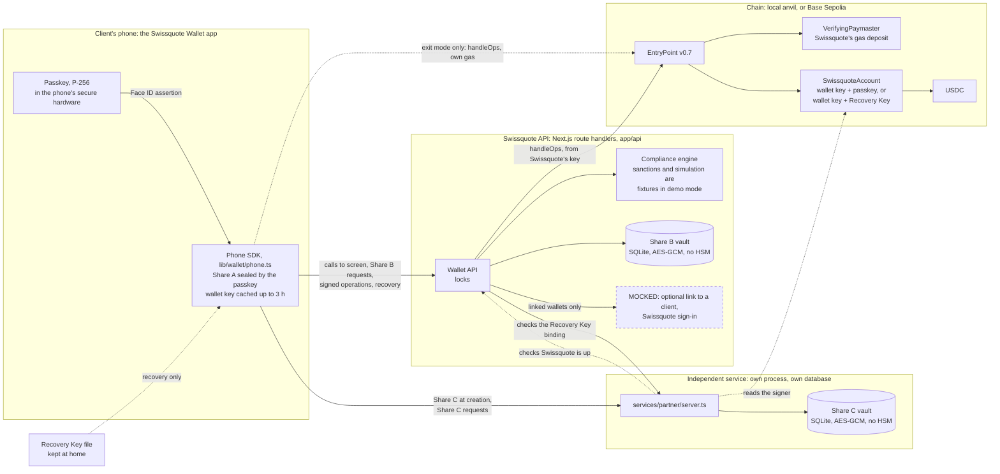

# Reference

This document holds the detail behind the [README](../README.md): the demo screen by screen, how to run the stack, every command, the components and their APIs, what is mocked, and the gasless and compliance rules.

## Demo walkthrough

One story, end to end: create a wallet, pay with Face ID, link it to a Swissquote account, lose the phone, recover the wallet. Start the stack with `npm run local` (see [Run it locally](#run-it-locally)). Use two browsers, or two browser profiles, as the old phone and the new phone.

### 1. Create a wallet

Creating a wallet needs no Swissquote account and no sign-in.

1. In the first browser, open http://localhost:3000/onboarding-welcome and tap **Create new wallet**.
2. On `/onboarding-secure`, tap **Create Passkey**. Face ID creates the passkey.
3. Tap **Split Wallet Key**. Face ID runs again and gives the key that seals Share A. The phone splits the wallet key, keeps Share A, sends Share B to Swissquote and sends Share C straight to the independent service.
4. Tap **Save Recovery Key**. The share sheet, or a download, saves `Swissquote Wallet Recovery Key.txt`. Tap **I saved it off this phone**. The app registers the wallet and opens Home.
5. In a terminal, run `npm run fund`. Home shows 100 USDC. The wallet also gets 0.01 ETH to pay its network fees until it is linked.

### 2. Pay

Face ID is the sign-in. Each payment gets its own Face ID approval over that exact payment.

1. On Home, tap the action button, then **Send**.
2. In the recipient sheet, paste an address and continue. Or tap the scan button next to **Paste** and point the camera at the recipient's QR code: the code the Receive sheet shows, a plain 0x address, or an EIP-681 `ethereum:` link. A link that asks for a USDC `transfer` also brings its amount to `/send`. The browser's `BarcodeDetector` reads the code where it reads QR codes (Chrome), and the `qr` package's decoder where it doesn't (Safari, iOS). A refused or missing camera says so and offers Paste.
3. On `/send`, which shows "Network fee: Paid from your wallet", enter an amount and tap **Continue**. Swissquote runs its compliance check. The wallet is not linked, so Swissquote does not sponsor the payment, and **Network fee** now reads "Up to *amount* ETH, paid from your wallet". The phone worked out that maximum itself. The **Checked by Swissquote** card shows Swissquote's reading, such as "Send 20 USDC to 0x1bA5...Cf4c.", with "Recipient not on a sanctions list" and "Simulated: it moves only this amount".
4. Tap **Send**. Face ID approves the operation, the phone signs it and Swissquote submits it to the chain at once, whatever the amount. `/transaction-tracking` shows the payment, with "Up to *amount* ETH, paid from your wallet" as its fee.

### 3. Link Swissquote

1. In Settings, tap **Link your Swissquote account**. The tray says what linking adds, such as transfers to and from the Swissquote account with no extra checks, network fees paid by Swissquote and the lock on a lost phone.
2. Tap **Link with Face ID**. The app sends the client to their Swissquote account to sign in. This is mocked, and Swissquote accepts at once, as a made-up client. With Face ID, the passkey the account requires for every payment signs that the wallet belongs to that client number. Nothing goes on chain, and no ID is involved.
3. Settings shows the Swissquote account, marked **Linked**, with the client number.

Swissquote now pays the wallet's network fees, and **Network fee** on `/send` reads "Paid by Swissquote".

### 4. Lose the phone and recover

The first browser now plays the lost phone. Losing it loses Share A and the passkey. The Recovery Key file is what is left.

1. In the second browser, open http://localhost:3000/onboarding-welcome and tap **Recover existing wallet**.
2. On `/recover`, choose the Recovery Key file, or paste the key, and tap **Continue**.
3. On **Secure this phone**, tap **Restore with Face ID**. The new phone creates a new passkey and a new wallet key. Swissquote releases the old Share B, and the independent service releases the old Share C. The phone rebuilds the old key for one signature and starts the recovery on chain.
4. The new phone counts down the 48-hour hold in chain time and offers **Lock your old phone**, which the Recovery Key signs. The old phone's Home shows "Someone started recovering your wallet" with **Cancel recovery**.
5. Run `npm run warp` to move chain time 48 hours ahead. Tap **Finish recovery**. The new phone now controls the same address with the same funds.
6. The recovery does not sign the new phone in to Swissquote. In Settings, link again to use the Swissquote account there.

An unlinked wallet recovers the same way, but its countdown offers no lock.

### The same story in the terminal

`npm run account` creates a wallet on a software phone, so the whole story runs without a browser. Every command below runs as written, in this order, against a fresh `npm run local`:

```bash
npm run account phone                                               # a wallet with 100 USDC and 0.01 ETH, not linked
npm run send phone 0x000000000000000000000000000000000000dEaD 20    # leaves at once, its fee paid from the wallet's ETH
npm run link phone                                                  # links it to a mock Swissquote client
npm run attack phone                                                # A1 to A6, each refused
npm run recover phone                                               # lost phone: recovery onto phone-new
npm run warp
npm run finish phone-new                                            # phone-new controls the same address
npm run sunset                                                      # Swissquote is gone
npm run exit phone-new 0x000000000000000000000000000000000000dEaD all
npm run sunset off
```

Without `npm run link phone`, the wallet stays unlinked. It pays its own network fees from its ETH. `npm run attack phone` then runs its unlinked version, without the lock step.

`npm run lock phone` and `npm run unlock phone` report the phone of a linked wallet lost and found, signed with its Recovery Key. `npm run cancel phone` cancels a pending recovery with the Recovery Key.

To recover a browser wallet from the terminal, run `npm run recover ~/Downloads/"Swissquote Wallet Recovery Key.txt" recovered`. The browser plays the old phone and can cancel the recovery from Home. `npm run e2e` runs the whole protocol as a test.

## Run it locally

You need Node.js 22.18 or later. `npm install` brings Foundry's `anvil` and `forge`.

```bash
npm install
npm run local
```

`npm run local` starts a fresh anvil chain, deploys the contracts, starts the independent service and the app, and writes `.env.local`. Every run without `--prod` starts from an empty chain and wipes `data/`, CLI accounts included. Open http://localhost:3000/onboarding-welcome when it prints the command list. Ctrl-C stops everything.

`npm install` and the first `npm run local` need the network. The first run installs the contract dependencies with `forge soldeer install`. After that, everything runs offline.

Each process gets only its own secrets. The independent service gets Swissquote's public address, not `SWISSQUOTE_KEY` or `SWISSQUOTE_SHARE_KEY`. Its own vault key lives in `data/partner.env`, not in `.env.local`, which `next dev` loads into the app. Plain `npm run local` uses anvil's first account as Swissquote's key, which the tests know.

The app uses port 3000, anvil 8545 and the independent service 4002. If a port is taken, `npm run local` names the process that holds it and exits. Pick other ports with `PORT`, `RPC_PORT` and `PARTNER_PORT`. Browsers refuse some ports, such as 4190, so the independent service cannot use them.

```bash
PORT=3200 RPC_PORT=8546 PARTNER_PORT=4003 npm run local
```

For a public demo behind a tunnel, `npm run local -- --prod` serves a production build and keeps every wallet across restarts. The chain and the share vaults stay in `data/`, the independent service's key in `data/partner.env` and Swissquote's keys in `.env.local`. It resumes when `data/chain.json` and `.env.local` both exist. A fresh `--prod` chain gets a random Swissquote key, funded on anvil, and a resumed one keeps its saved key. Delete `data/` for a fresh chain, as after a contract change. Set `PUBLIC_PARTNER_URL` to the independent service's public URL, because the phone posts Share C there directly. The app and the independent service each need a public hostname. Anvil stays private.

`CHAIN=base-sepolia npm run local -- --prod` runs the same stack on Base Sepolia instead of anvil, through `RPC_URL` (default `https://base-sepolia-rpc.publicnode.com`). Swissquote's key lives in `base-sepolia/key`, made on the first run. The first run deploys the contracts with a 0.01 ETH paymaster deposit, so that key needs about 0.012 Base Sepolia ETH; without it the run prints the key's address and stops. Later runs resume the deployment saved in `.env.local`.

Our public demo runs this way at https://wallet.elazdi.com, with the independent service at https://partner.elazdi.com and the slides at https://slides.elazdi.com. `npm run live` pulls origin's main into the repository's main checkout, rebuilds it on Base Sepolia (`CHAIN=anvil` for a local chain) and restarts the stack on localhost:3000, a Cloudflare tunnel and the slides in tmux session `sq-live`, then checks every URL, public and local. That checkout's `.env.local` is the live deployment's, so `npm run status`, `npm run fund` and the rest run there act on the demo. `npm run live check` only checks them, `npm run live stop` stops everything, and `npm run live fresh` starts a new deployment and keeps the old one in `data-<time>/`.

### Commands

Drive the protocol from a second terminal. The commands read `.env.local`, so they follow the ports. `npm run local` prints this list when it starts.

| Command | What it does |
| --- | --- |
| `npm run status` | Shows chain time, the contracts, Swissquote's gas funds, every wallet with its USDC, owner and pending recovery, and the CLI accounts. A linked wallet shows "owner: Swissquote client *number* (mock), ownership signed with Face ID by the wallet's passkey", after checking the record against the passkey the wallet was created with or the one it has now. A wallet with no owner record shows "not linked to a Swissquote client". A linked wallet also shows "Swissquote Plus until *date*", "Swissquote Plus ended *date*" or "no Swissquote Plus". |
| `npm run fund [wallet] [amount] [usdc\|weth]` | Mints test USDC, 100 by default, and on anvil also sends the wallet 0.01 ETH for network fees; with `weth`, mints test WETH, 1 by default, which the app shows as ETH. `wallet` is an address or an account. Without it, the newest wallet gets them. |
| `npm run account <account>` | Creates an unlinked wallet with a software passkey and funds it with 100 USDC and 0.01 ETH, as `npm run fund` does. Saves it in `data/accounts/<account>.json`, with its Recovery Key file next to it. |
| `npm run link <account>` | Links the account's wallet to a mock Swissquote client, as **Link with Face ID** does in Settings: it signs in, and the software passkey signs the statement. Prints the wallet and the client number. |
| `npm run plus <account>` | Buys 30 days of Swissquote Plus for the client of a linked account. The wallet pays Swissquote 10 USDC, as `npm run send` does, and Swissquote extends the client's Plus. Buying while Plus runs adds 30 days to its end. Plus runs in chain time, so `npm run warp` ages it. Prints the client, the date Plus runs until and the balance. An unlinked account must run `npm run link <account>` first. |
| `npm run send <from-account> <to> <amount>` | Sends USDC from an account to an address or another account. A refusal prints Swissquote's reasons. |
| `npm run swap <account> <amount> <usdc\|weth>` | Swaps `amount` of USDC, or of WETH, for the other through the deployment's test pool, in one operation that approves the pool for exactly the input and swaps it, with a minimum 0.5% under the quote. A refusal prints Swissquote's reasons; a price that moved past the minimum reverts the whole operation and nothing moves. A deployment made before the pool, like a resumed live demo, has none until redeployed. |
| `npm run recover <account \| Recovery Key file> [new-account]` | Starts a recovery onto a new software phone, the same way for a linked or an unlinked wallet. `new-account` defaults to `<account>-new`, or `recovered` for a file. |
| `npm run finish <account>` | Finishes a recovery after the 48-hour delay. |
| `npm run cancel <account>` | Cancels a pending recovery through Swissquote, signed with the Recovery Key. |
| `npm run lock <account>` | Reports the phone lost, signed with the account's Recovery Key. Swissquote checks the signature and locks the phone's credentials. Refuses on an unlinked wallet, which has no lock. |
| `npm run unlock <account>` | Swissquote unlocks the phone, when the account's Recovery Key signs the request. Refuses on an unlinked wallet. |
| `npm run warp [hours]` | Moves chain time ahead, 48 hours by default. |
| `npm run sunset [on\|off]` | Closes Swissquote's services, as if gone for good, or runs them again. On by default. |
| `npm run exit <account> <to> [amount]` | Sends USDC without Swissquote, once the independent service has opened exit mode. All of it by default. |
| `npm run attack <account>` | Plays a thief with the account's phone and email inbox and prints each refusal. A1 to A6 on a linked wallet. A1 to A5 on an unlinked one, which has no lock. |

### Checks

Checks, against the running stack where noted:

```bash
npm run e2e                # the protocol end to end, a linked and an unlinked wallet, and buying Swissquote Plus, against the running stack
npm run e2e:ui             # create, send, link, recover, lock, finish and buy Plus in Chromium, against the running app
npm run check:onboarding   # onboarding in Chromium, against the running app
npm run check              # Shamir, onboarding flow and amount unit checks
npm run contracts:test     # Foundry tests for the account
npm run test:compliance    # compliance engine, tampering, providers, HTTP, audit
npm run typecheck
```

### Compliance on its own

Compliance on its own:

```bash
npm run demo:compliance             # five fixture cases, signed receipts, audit chain
npm run check:compliance-providers  # live TRM and Base Sepolia read-only check, uses TRM quota
```

The five demo cases are a 20 USDC transfer (`ALLOW`), a finite approval plus vault deposit (`ALLOW`), a sanctioned address, an unlisted contract and an unlimited approval (all `DENY_ASSISTANCE`). The vault address is a fixture, not a deployed contract.

### Base Sepolia

Copy `.env.example` to `.env.local` and fill it in (`CHAIN=base-sepolia`). Deploy, then copy the printed addresses into `.env.local`:

```bash
cd contracts && forge script script/Deploy.s.sol --rpc-url $RPC_URL --private-key $SWISSQUOTE_KEY --broadcast
```

Run `npm run partner` and `npm run dev` in two terminals. This setup keeps every key in one `.env.local`. The CLI commands work there too, with three exceptions. `npm run fund` and `npm run account` print where to get Base Sepolia USDC and ETH instead of funding the wallet. `npm run warp` needs anvil. `npm run exit` uses anvil's second account as its bundler, which needs Base Sepolia ETH there.

### Live compliance

Set `COMPLIANCE_MODE=live` with `COMPLIANCE_POLICY_FILE` (a reviewed policy JSON), `COMPLIANCE_RPC_URLS` (chain ID to HTTPS RPC), `COMPLIANCE_SIGNING_PRIVATE_KEY` (a persistent Ed25519 PKCS#8 PEM, separate from every wallet key) and `COMPLIANCE_API_KEY`. `TRM_API_KEY` and `COMPLIANCE_AUDIT_FILE` are optional. Restart after any change.

### Pitch deck

[slides/index.html](../slides/index.html) is one HTML file that loads its app screens from `slides/screens/`. Open it in a browser. Arrow keys, Space, a click or a swipe move between slides, F toggles full screen, N shows the speaker notes, and printing gives one 16:9 page per slide. To capture fresh screens, run `node --env-file-if-exists=.env.local slides/capture.ts` against a fresh `npm run local`.

### Run it on iOS

The iOS app bundles the screens and the phone's code, so Swissquote's server never serves the code that sits next to Share A. It calls the API at http://localhost:3000, which the iOS Simulator reaches on your Mac. You need Xcode. Run `npm run local` in one terminal, then in a second:

```bash
npm run ios        # static export into out/, copied into ios/
npm run ios:sim    # the same, with a software passkey
npm run ios:open   # opens the project in Xcode
```

In Xcode, pick an iPhone simulator and press Run. With `PORT=3200 npm run local`, build with `NEXT_PUBLIC_API_URL=http://localhost:3200 npm run ios`.

`npm run ios` is the real-passkey build. Real passkeys need an associated domain, which an app on `localhost` cannot have, so WebKit refuses them there. `npm run ios:sim` uses a software passkey kept in the web view's storage instead. It is for the simulator only and must never ship.

## Components



The dashed box is mocked, and only a wallet the client linked to a Swissquote account uses it. Everything else runs for real in this build. The independent service is a real separate process with its own database, but the company behind it is a stand-in. The dotted line to the EntryPoint is exit mode, used only when Swissquote is gone.

**Smart account** (`contracts/`, Foundry). `SwissquoteAccount` runs on EntryPoint v0.7 and checks the two modes in the [custody table](SECURITY.md#we-chose-a-smart-account-that-needs-two-independent-keys), each over the userOpHash. Its config holds the wallet key's address, the passkey's P-256 public key, the Recovery Key's address and Swissquote as guardian. `execute` makes one call; `executeBatch` makes several in one operation, such as a swap's approval and the swap. `RECOVERY_DELAY` is a constant 48 hours. `cancelRecovery` accepts the guardian or the account itself, and `finalizeRecovery` is open to anyone after the delay. `SwissquoteAccountFactory` deploys CREATE2 clones, so the address is known before deployment. `script/Deploy.s.sol` deploys the factory and Swissquote's funded `VerifyingPaymaster`, and on a local chain (31337) an EntryPoint and a mintable test USDC.

**Phone SDK** (`lib/wallet/phone.ts`, with the split in `lib/wallet/shamir.ts`). Keeps Share A sealed with AES-GCM under the passkey's WebAuthn PRF output, so only Face ID opens it, where the authenticator supports PRF. Builds every call itself and checks Swissquote's operation before Face ID. For an operation with no paymaster, it works out the most its gas can cost and returns it on `Prepared` as `fee`, in wei. At onboarding it sends Share C straight to the independent service at a URL pinned in the app build (`NEXT_PUBLIC_PARTNER_URL`), so Swissquote never sees C.

**Swissquote Wallet API** (`app/api`, Next.js route handlers). Holds Share B, the client records and locks in SQLite (`data/swissquote.db`), with Share B sealed by AES-GCM. It runs the compliance check, signs sponsorship and submits operations to the EntryPoint itself, with no external bundler.

**Independent service** (`services/partner/server.ts`). Its own process and its own database (`data/partner.db`), sealed under its own key. Under `npm run local` that key lives in `data/partner.env`, which the app never loads. It stores Share C only for a key Swissquote ticketed, learns the Recovery Key only from a wallet-key signature, and releases C only for an `initiateRecovery` that Swissquote approved and the bound Recovery Key signed. It never takes part in a normal payment. In exit mode it also releases C for a passkey-approved operation. Its endpoints are `POST /shares`, `GET /shares/:signer`, `POST /shares/:signer/recovery-key`, `POST /recovery`, `GET /exit` and `POST /exit`.

**Compliance** (`lib/compliance`, `services/compliance`, `app/api/compliance`). The policy engine that decides whether Swissquote assists. See [Compliance engine](#compliance-engine).

**App** (Next.js 16, and an iOS build with Capacitor). The screens read one shared wallet store (`app/(tabs)/_components/wallet.ts`), which reads Swissquote every 4 seconds and when the app regains focus, so a payment, a recovery, a lock or a warped chain shows without a reload.

## Swissquote's API

| Method and path | What it does |
| --- | --- |
| `POST /api/session` | Mocked. Stands in for the client's Swissquote sign-in when they link a wallet, and accepts at once. A session Swissquote knows stays its client, and a phone without one becomes a new made-up client. |
| `GET /api/config` | The chain ID, the EntryPoint and USDC addresses, the WETH and pool addresses (`weth`, `pool`, null on a chain without a pool), and what Swissquote Plus costs, `plus: { to, price, period }`. `to` is the Swissquote address that takes the payment, `price` is in USDC base units as a string, and `period` is in seconds. The app reads Plus's price and address only here. |
| `POST /api/shares` | Stores Share B after checking it against the commitments, and returns a signed ticket for the independent service. |
| `POST /api/wallets` | Registers a wallet. Takes `{ signer, recoveryKey, signature }`, the signature being the wallet key's Recovery Key binding. Needs no Swissquote account. Answers 409 if another wallet already uses that Recovery Key, which would hide it from its owner's recovery. |
| `GET /api/wallets/:address` | Keys, lock, the USDC, ETH and WETH balances in their smallest units (`usdc`, `eth`, `weth`), the pool's reserves (`pool: { usdc, weth }`, null without a pool), pending recovery and chain time. Returns the owner record, `{ client, createdAt, statement, assertion }`, only to the owner's own session (header `x-swissquote-session`). While the client's Swissquote Plus runs, it also returns `plus: { until }`, in chain seconds, to that session only. |
| `POST /api/wallets/:address/link` | Links the wallet to a Swissquote client. Takes `{ session, assertion }`, the wallet passkey's Face ID assertion over keccak256 of "Wallet 0x… belongs to Swissquote client *number*.", checked against the wallet's live passkey, or the one in its config before deployment. Keeps the statement and the assertion as the owner record. Answers 401 without a known session and 403 if the wallet's passkey did not sign. A wallet stays with the client who first linked it, and there is no unlink. Linking it again, as from a new phone after a recovery, keeps that client. The mock then signs the phone in as them and returns their session as `signedIn`, because the passkey just proved the phone holds the wallet. |
| `POST /api/wallets/:address/plus` | Claims a payment for Swissquote Plus. Takes `{ session, transactionHash }`. Swissquote checks that the session's client owns the wallet, that the transaction succeeded on chain with a USDC transfer of at least the price from the wallet to Swissquote's address, and that no one claimed the transaction before. Plus then runs 30 days more, from its current end if it still runs, or else from now. Returns `{ until }` in chain seconds. Plus belongs to the client, not the wallet. Nothing renews it, so each period is a new payment. Answers 401 without a known session, 403 with `refused: "unlinked"` if the session's client does not own the wallet, 402 with `refused: "payment"` if the transaction failed, is unknown or carries no such transfer, 409 with `refused: "claimed"` if someone claimed it already, and 404 for an unknown wallet. |
| `GET /api/wallets/:address/activity` | The wallet's USDC and WETH transfers, each with its `token`. Each has `sponsored`, true when Swissquote's paymaster paid its gas. |
| `POST /api/wallets/:address/operations` | Runs compliance and Swissquote's sponsorship rules, and prepares the call, or the batch of calls an `executeBatch` makes, every call of it going to compliance. A batch may not call the account itself. Swissquote sponsors it for a linked wallet, and sponsors the old phone's recovery cancel for any wallet. An unlinked wallet's other calls carry no paymaster, and the wallet pays their gas from its ETH. Returns the operation, its hash, Swissquote's `summary` and a `demo` flag. For an unlinked wallet it answers 403 with `refused: "gas"` when the wallet's ETH and its EntryPoint deposit cannot cover the operation's maximum fee. |
| `POST /api/wallets/:address/share` | Releases Share B for an operation the passkey approved. |
| `POST /api/wallets/:address/operations/:hash` | Submits the signed operation. |
| `POST`, `DELETE /api/wallets/:address/lock` | Locks or unlocks the phone's credentials, when the Recovery Key signed the request. A linked wallet only. An unlinked one gets 403. |
| `GET /api/recovery?signature=&at=` | Finds the wallet a Recovery Key signature restores. Returns `{ address, pendingRecovery, chainTime, linked }` and nothing about the client. |
| `POST /api/recovery` | Prepares `initiateRecovery`, sponsored for every wallet, linked or not. Takes `{ recoveryKey, signer, signature }`. A linked wallet needs nothing more, and the new phone is not signed in to Swissquote. |
| `POST /api/wallets/:address/recovery` | Releases Share B and a signed approval for a recovery the Recovery Key signed. |
| `DELETE /api/wallets/:address/recovery` | Cancels the pending recovery as guardian, when the Recovery Key asks. |
| `PATCH /api/wallets/:address/recovery` | Finalizes a recovery after the delay. |
| `POST /api/compliance/evaluate`, `GET /api/compliance/keys`, `GET /api/compliance/registry` | The compliance engine for other backends. Needs `COMPLIANCE_API_KEY`. |

## The independent service's API

`services/partner/server.ts` serves these routes on `PARTNER_PORT`.

| Method and path | What it does |
| --- | --- |
| `POST /shares` | Stores Share C after checking Swissquote's signed ticket, its expiry and C against the commitments. |
| `GET /shares/:signer` | The stored key's signer, passkey and bound Recovery Key. Never the share. |
| `POST /shares/:signer/recovery-key` | Binds the Recovery Key, learned from a wallet-key signature. Refuses to rebind it. |
| `POST /recovery` | Releases Share C for an `initiateRecovery` that Swissquote approved and the bound Recovery Key signed. |
| `GET /exit` | Whether Swissquote answers, how long it has been closed and whether exit mode is open. |
| `POST /exit` | In exit mode only, releases Share C for an `execute` operation with no paymaster and a passkey assertion that verifies against the account's current passkey. |

## What is real and what is mocked

Real in this build: the Shamir split with verified shares, passkeys verified on chain, the ERC-4337 account and factory, Swissquote's paymaster and its limits, the compliance engine with signed decisions and its audit chain, the link to a client signed with Face ID, buying Swissquote Plus with a USDC payment from a linked wallet, the lock signed with the Recovery Key, the 48-hour on-chain delay and cancel, the independent service as a separate process with its own storage and secrets, and exit mode.

| Mocked here | Production |
| --- | --- |
| The Swissquote sign-in and session that link a wallet. Swissquote accepts at once, and a phone with no known session signs in as a made-up client. The link tray says "Mock sign-in". Creating a wallet uses neither. | A redirect to the client's real Swissquote sign-in. Swissquote identified the client when they opened the account. |
| HSMs. Shares B and C are AES-GCM sealed in SQLite. | HSMs at Swissquote and at the independent service |
| Share A and the key cache live in a web app. Without PRF, Share A sits unsealed in web storage. | The Swissquote iOS and Android apps, with Secure Enclave or Keystore |
| Fixture sanctions and simulation in demo mode | Live mode with contracted list coverage |
| The independent service is a process, not a company. | A separate, supervised company under contract |
| A local anvil chain | Base Sepolia, then Base mainnet |
| The Earn and Card tiles, the Earn promo card, and the bank account and Swissquote Card that come with Swissquote Plus carry a **Demo** tag; so does Investments on a chain without a pool. Only `anna.eth` resolves as a recipient name, from a fixed list. | Swissquote's products, and real name resolution |
| Swap is real: one Face ID moves USDC and WETH through `script/TestPool.sol`, a constant-product pool seeded at 1 ETH = 2,500 USDC with an open-mint test WETH, in one sponsored `executeBatch` that approves the pool for exactly the input and swaps. The app shows the WETH as ETH, under Investments. Every fresh deploy gets the pool; a deployment made before it, like a resumed live demo, has none, and the app hides Swap there until it is redeployed. | A reviewed DEX pool or aggregator on Base, and real WETH |

## Gasless payments

Swissquote pays every network fee of a wallet linked to a Swissquote account, and of every wallet's recovery. Its `VerifyingPaymaster`, the eth-infinitism v0.7 sample, holds an ETH deposit at the EntryPoint (10 ETH on the local chain) and pays for each operation Swissquote signed. Swissquote's own key submits operations to `EntryPoint.handleOps`, so there is no bundler and a linked wallet never holds ETH. A guardian cancel and a finalize are plain transactions from the same key.

An unlinked wallet's payments and dApp calls carry no paymaster. The account pays its own gas from its ETH through the EntryPoint's prefund. That is at most (300,000 + 1,000,000 + 50,000) × `maxFeePerGas`, under 0.003 ETH on the local chain. What the operation doesn't use stays as the account's deposit at the EntryPoint and pays toward its next fee. Before Swissquote prepares such an operation, it checks that the wallet's ETH and that deposit cover the maximum. If they don't, it answers 403 with `refused: "gas"` and "Your wallet needs up to *amount* ETH for the network fee. Add ETH to your wallet, or link your Swissquote account in Settings and Swissquote pays it." The amount is worked out for each operation. The phone accepts an operation with no paymaster, works out its maximum fee itself and shows it before Face ID.

Every wallet's recovery stays sponsored, linked or not. That covers starting one, the old phone's cancel, Swissquote's cancel as guardian and the finalize, so a lost phone never needs ETH to be recovered. The rules below apply to an unlinked wallet too. The 20-an-hour cap counts only what the paymaster paid, so it binds sponsored operations.

Swissquote limits what it signs:

- **Only calls compliance allows.** `ALLOW` goes ahead at once, sponsored on a linked wallet. `REVIEW` and `DENY_ASSISTANCE` are refused.
- **Only `execute`, plus recovery.** The operations endpoint sponsors only calls through the account's `execute`, and no call to the account itself except `cancelRecovery`. The one other operation Swissquote sponsors is the `initiateRecovery` it prepares for a recovery. Neither recovery call goes through compliance.
- **No payment of 0.** It answers 403 "Swissquote doesn't pay for a payment of 0 USDC."
- **20 an hour.** Swissquote sponsors at most 20 of a wallet's operations per hour of chain time, dApp calls included. It counts what its paymaster paid in the EntryPoint's events over the last 5,000 blocks. The next one gets 429 "Swissquote pays the network fee for up to 20 payments an hour. Try again in N minutes." A recovery cancel is never refused, but it counts.
- **10 minutes.** The sponsorship of a payment lasts the policy's `decisionTtlSeconds`, 600 seconds in the local policy, so it never outlives the compliance decision behind it. After that the API answers 410 "This approval expired. Start again." Each prepared operation can be submitted once, and expired ones are deleted at the next prepare.
- **Fixed gas limits.** 300,000 for the call, 1,000,000 for verification, 50,000 before verification and 100,000 for the paymaster.
- **Simulated first.** The API simulates `handleOps` before it submits, which catches a bad signature, sponsorship or nonce before Swissquote pays.

A sponsored call that reverts inside the account still costs Swissquote its gas. The Send screen refuses an amount above what is available, and live mode's simulation refuses a transfer the balance cannot cover. Demo mode's simulation does not, so the client of a linked wallet who calls the API directly can make Swissquote pay for reverted transfers, up to 20 an hour. Not built: a gas price cap and monitoring of the paymaster deposit.

## Compliance engine

Every payment goes through the compliance engine first, sponsored or not. `ALLOW` goes ahead at once, whatever the amount, sponsored on a linked wallet. `REVIEW` and `DENY_ASSISTANCE` are refused. A refusal shows its reasons to the client in plain words, stops Swissquote's assistance and never freezes the wallet.

The engine runs these checks:

1. **Decode and allowlist.** Only reviewed functions pass: ERC-20 `transfer` and finite `approve`, ERC-4626 `deposit`, `withdraw` and `redeem`, and batches of up to 16 calls. The contract, the function and the token must be in the policy, and a claimed dApp origin must be listed. It refuses unlisted contracts and functions, unknown calldata, unlimited approvals, `setApprovalForAll`, delegatecalls, account administration and unsupported chains. Fresh local deployments allow USDC `transfer` and finite `approve` for the deployed test vault, plus its ERC-4626 functions. Existing persisted policies are preserved.
2. **Sanctions screening.** TRM Labs' address sanctions endpoint in live mode, fixtures in demo mode. In demo mode, `0x098B716B8Aaf21512996dC57EB0615e2383E2f96` is the sanctioned fixture. Every address the call touches is screened, including addresses the simulation finds.
3. **Simulation.** In live mode, viem's `simulateCalls` over `eth_simulateV1`, from the account's address. The engine refuses an operation whose simulation removes more of an asset than the decoded call intends, or does not confirm the intended amount. Demo mode derives the changes from the decoded call without a chain call.
4. **A signed decision.** An expiring Ed25519 decision, appended to a SHA-256 hash-chained audit log. A failed append blocks the decision.

Outages and missing evidence never fall back to `ALLOW`.

The engine writes a plain-language summary of each call, such as "Send 1,500 USDC to 0x…". The client reads it before Face ID, on the **Checked by Swissquote** card, with "Recipient not on a sanctions list" and "Simulated: it moves only this amount". Those two lines are fixed app text. They are true because Swissquote refuses to prepare what fails screening or simulation. In demo mode the card carries a **Demo** tag, because fixtures did the screening and the simulation. `npm run demo:compliance` prints the engine's summary for five cases.

The engine also has a standalone HTTP API for other backends: `POST /api/compliance/evaluate`, `GET /api/compliance/keys` and `GET /api/compliance/registry`. Each call needs `Authorization: Bearer <COMPLIANCE_API_KEY>` and an `X-Compliance-Subject` header set by the trusted bank backend. `npm run local` does not set `COMPLIANCE_API_KEY`, so these routes answer 503 `COMPLIANCE_API_KEY_NOT_CONFIGURED`. To try them, start the stack with `COMPLIANCE_API_KEY=<secret> npm run local`. The wallet does not use this API. It calls the engine inside Swissquote's server. Never ship the key to a browser.

**Reviewed dApps frontend:** The Apps tab links to `/dapps`, a policy-derived ERC-4626 catalogue with deposit, withdrawal, exact-amount approval and revoke-permission flows. Each call uses the existing phone signing API, compliance gate and, for a linked wallet, paymaster. Decisions, demo evidence, expiry, remaining allowance and confirmed transaction hashes are visible. Fresh local deployments include a real test vault with no yield; deposits use two separately reviewed transactions where approval is needed. See [dApp integration and verification](docs/DAPP_INTEGRATION.md) for the backend boundary, safe handling of existing chains and test commands.

The engine's own limits:

- The audit file is single-process. A local hash chain cannot prove completeness or stop an operator rewriting history. Production needs shared, durable, externally anchored storage.
- A TRM `CLEAR` means no match in that response. It is not SECO coverage, KYT or Travel Rule clearance.
- Simulation is predictive. It is not proof against malicious tokens or state changes before inclusion.
