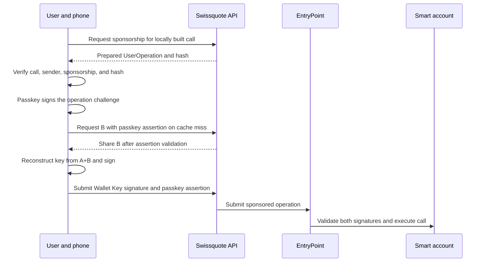
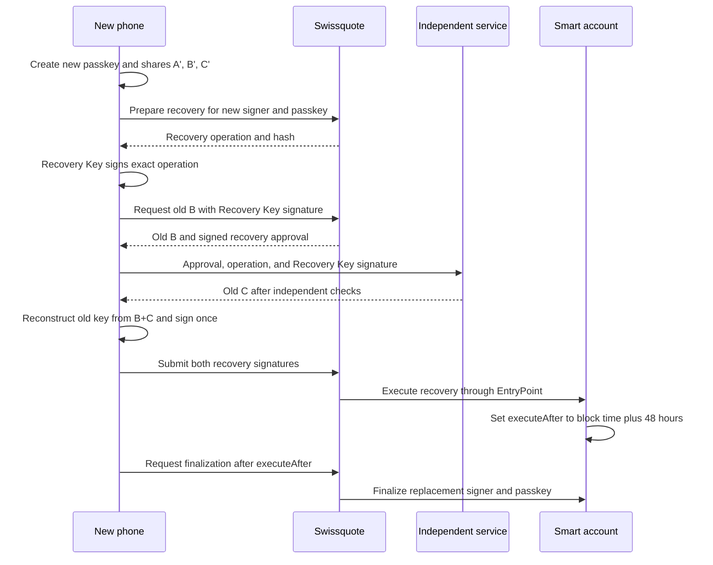

# Shamir key sharing and wallet recovery

This guide explains Swissquote Wallet's 2-of-3 key sharing, payment authorization and lost-device recovery. It follows the implementation in this repository. [protocol.md](../protocol.md) is the protocol specification and takes precedence if the implementation differs. The [README](../README.md) covers the threat model, the 24-hour hold, the lock and the exit without Swissquote.

The central rule is that rebuilding the wallet key does not, by itself, authorize a payment. The smart account requires a second signature. That is the user's passkey for a payment, or the user's separate Recovery Key for starting recovery.

## The keys and shares

| Item | Purpose | Where it lives |
| --- | --- | --- |
| Wallet Key | A secp256k1 private key that signs wallet operations | Generated and temporarily reconstructed on the phone. Distributed as three shares. |
| Share A | The phone's Shamir share, at position 1 | The user's phone, in browser storage in this build |
| Share B | Swissquote's Shamir share, at position 2 | Swissquote's share vault |
| Share C | The independent service's Shamir share, at position 3 | The partner's separate share vault |
| Passkey | A P-256 WebAuthn credential approving normal operations | The user's authenticator. Its public key is registered on the smart account. |
| Recovery Key | A separate secp256k1 key authorizing recovery | A file saved by the user and kept offline. Its public address is registered with the account and share holders. |
| Guardian key | Swissquote's authority to cancel pending recovery | Swissquote. This build also uses it for sponsorship and tickets. |

The Recovery Key is also called the confirmation key in the protocol. It is independent of the Wallet Key and is not a fourth Shamir share. The wallet address is the smart account's address, which is different from the Wallet Key's signer address.

## How 2-of-3 Shamir sharing works

The implementation chooses a private key `k` and a random coefficient `a`, then evaluates a line:

```text
f(x) = k + a × x mod n

A = (1, f(1))
B = (2, f(2))
C = (3, f(3))
```

Here, `n` is the order of the secp256k1 group. Arithmetic uses this scalar field, including modular division. It does not use JavaScript floating-point arithmetic.

Each share contains a position `x` and a scalar `y`. One share provides one point on the line, which is insufficient to reconstruct `k`. Two distinct points determine the line, so any two valid shares recover its intercept, `f(0) = k`.

For two shares `(x1, y1)` and `(x2, y2)`, the code computes:

```text
k = (y1 × x2 − y2 × x1) / (x2 − x1) mod n
```

For the actual share positions, this becomes:

```text
A + B:  k = 2 × yA − yB             mod n
A + C:  k = (3 × yA − yC) / 2       mod n
B + C:  k = 3 × yB − 2 × yC         mod n
```

Two copies of the same share do not satisfy the threshold. Shares from different Wallet Keys do not reconstruct the expected signer either.

### A small numerical example

This example uses a small field solely to illustrate the arithmetic. Actual keys use the secp256k1 scalar field.

Choose `k = 5`, `a = 7`, and modulus `17`:

```text
f(x) = 5 + 7 × x mod 17

A = (1, 12)
B = (2,  2)
C = (3,  9)
```

Reconstructing with A and B gives `2 × 12 − 2 = 22`, which is `5 mod 17`. With B and C, `3 × 2 − 2 × 9 = −12`, which is also `5 mod 17`.

### Checking that shares belong to the correct key

The phone also creates Feldman commitments:

```text
C0 = k × G
C1 = a × G
```

`G` is the secp256k1 generator point. A holder checks its share `(x, y)` using:

```text
y × G == C0 + x × C1
```

This checks that the received share matches the committed polynomial. Swissquote verifies Share B before storing it, and the partner verifies Share C. The public commitment `C0` also identifies the Wallet Key's public address. Recovering `k` from that public point requires solving the elliptic-curve discrete logarithm problem.

When the phone reconstructs a key, it independently checks that the resulting key's address equals the signer it expects. Invalid or mixed shares are refused.

### Sharing versus threshold signing

This build uses Shamir secret sharing followed by ordinary ECDSA signing. The complete Wallet Key exists briefly on the phone during creation and reconstruction, and may remain in its memory cache for normal operations.

It does not implement a distributed threshold ECDSA protocol in which participants produce a signature while the complete private key never exists at one participant. The protocol's statement that two shares can jointly produce a signature means that those shares can reconstruct a key capable of signing.

## Creating a wallet

Creating a wallet needs no Swissquote account and no sign-in.

1. The phone creates a passkey. The account will store its P-256 public key, and the authenticator keeps the signing credential.
2. The phone generates the Wallet Key, its three Shamir shares and the commitments.
3. The phone sends only Share B, the commitments and the passkey public key to Swissquote's `POST /api/shares`.
4. Swissquote validates B, stores it and returns a signed share-registration ticket, valid for 5 minutes.
5. The phone sends Share C and that ticket directly to the independent service. The partner checks Swissquote's signature, the ticket's expiry, the signer and C's commitment before storing C.
6. The phone retains Share A and caches the Wallet Key in memory.
7. The phone generates a separate Recovery Key and offers its secret as a file to download or share. The user confirms **I saved it off this phone**.
8. The Wallet Key signs a message naming the Recovery Key's address. The partner and Swissquote both verify this binding before accepting that Recovery Key for future share release.
9. `POST /api/wallets` checks that binding and registers the smart account configuration. Deployment occurs when a first operation needs the account on chain.

The partner URL is pinned in the app build through `NEXT_PUBLIC_PARTNER_URL`. The phone does not take it from Swissquote's API response. In the intended flow, Swissquote receives B and never receives C during creation.

The Recovery Key binding matters because a share holder must not be able to substitute its own recovery address. It accepts the initial binding only when the Wallet Key signs it, and the vault refuses to rebind that share to a different Recovery Key.

### Linking a Swissquote account

Later, from Settings, the user can link the wallet to their Swissquote account. Linking adds Swissquote's Travel Rule ownership proof, an ID check before recovery and the lock on a lost phone. It changes nothing in the shares or on chain.

1. The phone signs in to Swissquote. The session and the client's KYC record are mocked. A phone without a session Swissquote knows signs in as a new made-up client.
2. With Face ID, the passkey signs keccak256 of "Wallet 0x… belongs to Swissquote client *number*.", as it does to cancel a held payment. No Wallet Key is rebuilt and Share B is not released. `POST /api/wallets/:address/link` checks the session and the assertion against the wallet's live passkey, and keeps the statement and the assertion as the owner record. A wallet linked to one client cannot be linked to another, and there is no unlink.

## Sending a payment

The normal signing pair is A plus B. The partner does not participate in a normal payment.



Swissquote runs its compliance policy and prepares a sponsored ERC-4337 UserOperation, with a plain-language summary of the call. The phone checks that the operation contains the call it built, belongs to its account, has sponsorship and hashes to the supplied `userOpHash`. It shows the summary under **Checked by Swissquote** before Face ID.

The passkey then approves that exact hash. If the Wallet Key is absent from the cache, the phone sends the assertion to Swissquote. Swissquote validates it against the wallet's live passkey and the prepared normal operation before releasing B. The phone combines A and B, checks the rebuilt signer, and signs the same hash with the Wallet Key.

The account accepts `MODE_NORMAL` only when both the Wallet Key signature and WebAuthn assertion validate. Normal mode cannot directly start recovery. The contract sees signatures and registered public keys, not Shamir shares or which two holders supplied them.

Swissquote submits through EntryPoint v0.7 and sponsors gas using its paymaster. The backend submits the operation itself, so this path needs no external bundler.

A payment above 1,000 USDC follows the same signing path, but Swissquote releases it 24 hours later in chain time, after running compliance again. Swissquote's sponsorship of it starts at the release time, so the EntryPoint refuses it sooner, whoever submits it. The client can cancel it until then, with Face ID or the Recovery Key. That cancel discards only Swissquote's copy. The signed operation stays valid on chain until 48 hours after its release time. These are Swissquote's assistance rules. The account itself enforces only the signatures.

### The key cache

`KEY_TTL` is three hours. The reconstructed Wallet Key stays in JavaScript memory, with a timer to clear it and an expiry check before reuse. It is not saved in device storage. A cache hit avoids retrieving B and reconstructing the key again, but each payment still requires a fresh passkey assertion.

The protocol also requires clearing the key when the app closes. In this browser implementation, destruction of the page runtime removes the memory cache. There is no explicit `pagehide` wipe hook in `phone.ts`, and merely backgrounding the page does not explicitly clear it.

## Recovering after losing the phone

Losing the phone means losing access to both Share A and the old passkey. The user does not recover by rebuilding the old passkey. Recovery installs a new Wallet Key and a new passkey on the existing smart account.

The required inputs are the Recovery Key kept at home, Swissquote's assistance, the independent service's assistance, and a new device. A wallet linked to a Swissquote account also needs the owner's ID. For an unlinked wallet that is all, with the 48-hour delay and the cancel, exactly as [protocol.md](../protocol.md) describes.

### 1. Prepare the new device

The user loads or pastes the saved Recovery Key file into `/recover`. The Recovery Key signs a timestamped lookup, valid for 300 seconds. `GET /api/recovery` returns the wallet's address, any pending recovery and whether it is linked to a Swissquote client. It returns nothing about that client, so the key alone does not tell its holder whose ID to forge.

The new device creates a new passkey and splits a fresh Wallet Key into A', B' and C'. The new shares are stored with their respective holders, and the new Wallet Key binds them to the existing Recovery Key's address.

For a linked wallet, `/recover` asks for the number on the user's ID card on **Confirm it's you**, before **Secure this phone**. Swissquote compares it, ignoring case, with the ID number in the wallet owner's KYC record. Five wrong numbers, each within an hour of the last, stop ID checks on that wallet for an hour. The check is mocked. There is no document scan or liveness check, so an ID that carries the owner's number passes. An unlinked wallet has no ID step. `/recover` goes from the Recovery Key to **Secure this phone**.

### 2. Prepare the recovery operation

The new phone calls `POST /api/recovery`. Swissquote finds the registered wallet by Recovery Key address, runs the ID check if the wallet is linked, and verifies the binding of the new signer and shares. Passing the ID check signs the new phone in to Swissquote as the owner. Swissquote then prepares:

```text
initiateRecovery(newSigner, newPasskey)
```

The phone checks the returned operation and hash against that exact call. The Recovery Key then signs the operation hash. This signature authorizes the proposed replacement credentials, rather than approving an unspecified recovery request.

### 3. Release the old shares B and C

The new phone sends the recovery hash and Recovery Key signature to Swissquote's wallet recovery endpoint. Swissquote checks that it prepared a recovery operation for this wallet, verifies the signature against the Recovery Key bound to the old signer, and checks that another recovery is not already pending.

Swissquote releases the old Share B and signs a `RecoveryApproval` ticket naming the wallet, operation hash, and expiry. Tickets in this build expire after five minutes.

The phone sends that ticket, the operation, and the Recovery Key signature to the partner. The partner independently:

- Verifies Swissquote's approval signature and expiry.
- Recomputes the UserOperation hash and checks the approved wallet and hash.
- Confirms that the call is `initiateRecovery`.
- Determines the wallet's current signer, using on-chain credentials or a verified initial deployment configuration.
- Verifies the signature against the Recovery Key bound to its old Share C.

Only after those checks does the partner release C to the new phone. The normal flow sends B and C separately to that phone. It does not send C through Swissquote.

### 4. Start recovery on-chain

The new phone combines the old B and C, verifies the reconstructed old signer, and uses that old Wallet Key for the recovery signature. It submits both the old Wallet Key signature and the Recovery Key signature in `MODE_RECOVERY`.



The smart account permits recovery mode only for a direct `initiateRecovery` call. Both signatures must validate against its current signer and Recovery Key. Recovery mode cannot authorize a token transfer through `execute`.

On successful initiation, the account records the proposed signer, passkey, and `executeAfter = block.timestamp + 48 hours`. A second initiation is refused while recovery is pending. The old key reconstructed for this recovery is not placed in the normal key cache by `startRecovery`.

### 5. Wait or cancel

The 48-hour delay is enforced by the contract's constant `RECOVERY_DELAY`, using blockchain time. A browser countdown does not determine whether finalization is allowed, and changing the browser clock cannot bypass the contract check.

While the recovery remains pending, the old signer and passkey still control normal operations. The old phone can cancel through a normal signed operation calling `execute(account, 0, cancelRecovery())`. That cancel needs Swissquote's sponsorship. If the user locked the old phone of a linked wallet, Swissquote refuses it, and the user cancels with the Recovery Key instead.

Swissquote can also call `cancelRecovery` directly as guardian. The app's guardian-cancellation endpoint requires a Recovery Key signature bound to the wallet and the pending deadline. That API authorization is separate from the guardian permission enforced on-chain.

Cancellation deletes the pending recovery and leaves the current signer and passkey unchanged. The contract allows cancellation for as long as recovery is pending, including after the deadline if nobody has finalized it yet.

### 6. Finalize

Once blockchain time reaches `executeAfter`, anyone can call `finalizeRecovery`. The app asks Swissquote to submit it and pay gas. The finalizer cannot choose different replacement credentials. The contract installs the signer and passkey already recorded in the pending recovery.

| State | Before finalization | After finalization |
| --- | --- | --- |
| Wallet address and contract | Existing account | Same account |
| Wallet signer | Old Wallet Key | New Wallet Key |
| Passkey | Old passkey | New passkey |
| Recovery Key | Existing Recovery Key | Same Recovery Key |
| Guardian | Existing guardian | Same guardian |
| Assets | Remain in the account, subject to any normal payments during the wait | Remain in the same account. Recovery does not transfer them. |
| Pending recovery | Recorded replacement and deadline | Cleared |

The recovered phone uses A' plus B' for subsequent payments. Old shares may still reconstruct the old key, but that key and the old passkey no longer authorize this account after finalization.

## What each participant can do

| Material or access | Capability and restriction |
| --- | --- |
| A alone, B alone, or C alone | Insufficient to reconstruct the Wallet Key |
| Any two valid shares | Can reconstruct the Wallet Key. Ordinary payments still require the registered passkey. |
| B and C held by colluding services | Can reconstruct the Wallet Key. Cannot make normal payments without the passkey or start recovery without the Recovery Key. |
| Recovery Key alone | Cannot directly transfer funds or satisfy the Wallet Key signature. Can request the assisted recovery flow, which needs the owner's ID number on a linked wallet. On an unlinked wallet it can start a recovery, which the old phone or Swissquote, asked with the Recovery Key, can cancel during the 48 hours. |
| Old phone with usable passkey and shares or cached key | Can make normal payments and cancel pending recovery until replacement credentials take effect |
| Swissquote guardian | Can cancel a pending recovery. This guardian permission does not grant normal spending authority. |
| Swissquote's lock | On a linked wallet only, refuses a reported phone's payments, its Share B requests and its cancels of a recovery. Nothing changes on chain. |
| Any finalizer after the deadline | Can install the already-authorized pending credentials. Cannot choose new ones. |
| The partner in exit mode, after Swissquote is gone for `EXIT_AFTER` (30 days by default) | Releases C only for a normal operation the account's passkey approved. The phone still needs A and the passkey to sign. |

Availability is a separate issue from signing authority. Swissquote can refuse B, sponsorship or submission, lock the phone of a linked wallet, and prevent recovery by cancelling as guardian. The partner can refuse C. The contract does not freeze assets when a service refuses assistance. The one path around an unavailable holder is exit mode. Once Swissquote's services have been gone for `EXIT_AFTER`, the partner releases C for a normal operation approved by the account's current passkey, read on chain or, for an undeployed wallet, from the deployment config the operation carries. The phone rebuilds the key from A and C and submits to the EntryPoint itself, paying its own gas. In this build the exit runs from the command line (`npm run exit`). Exit mode does not cover a running Swissquote that refuses one client, or a phone lost while Swissquote is gone.

## Storage and current implementation limits

- With WebAuthn PRF support, Share A is AES-GCM sealed under the passkey-derived secret and bound to the signer address. Without PRF, `phone.ts` stores A unsealed in browser storage. The passkey requirement for on-chain payments remains, but local share confidentiality is weaker.
- Swissquote and the partner store their shares in separate SQLite vaults, AES-GCM sealed under separate keys. `npm run local` gives each process only its own key. These are software vaults, not HSMs.
- `lib/wallet/shamir.ts` is our own code, about 30 lines of logic on @noble/curves. It needs an audit, or a swap for an audited library.
- The saved Recovery Key file contains a private signing key. The app sends its public address and signatures to the holders, rather than deliberately uploading the private key. Recovery temporarily loads that secret on the new device to sign.
- The identity step runs only for a linked wallet, and it is a demonstration, not a real identity check. It compares a typed number with a mocked KYC record, so it shows the gate, not identity assurance. The second signature and the 48-hour contract delay still apply, and they are all an unlinked wallet has.
- A stolen, usable passkey and signing material can authorize normal payments while the old credentials remain active, including during a pending recovery. Recovery is not a freeze. On a linked wallet, Swissquote's lock stops its own help to a reported phone, but not a key still cached on it, for up to 3 hours, submitted through a public bundler with the thief's own ETH. An unlinked wallet has no lock.
- If A is lost and B or C is unavailable, the implemented recovery path cannot reconstruct the old Wallet Key. Losing the Recovery Key as well also removes the implemented authorization path.
- A malicious app or compromised new device can access reconstructed keys or the loaded Recovery Key. Share distribution does not protect secrets from the runtime that reconstructs and uses them.
- The code exposes on-chain recovery events and pending state. The protocol's cancellation window should not be interpreted as proof that production alert delivery or bank identity verification is implemented.

## Implementation references

| Source | Responsibility |
| --- | --- |
| [protocol.md](../protocol.md) | Authoritative custody and recovery rules |
| [shamir.ts](../lib/wallet/shamir.ts) | Split, interpolation, Feldman commitments, and share verification |
| [phone.ts](../lib/wallet/phone.ts) | Phone storage, key cache, normal signing, and lost-device recovery |
| [vault.ts](../lib/wallet/vault.ts) | Holder storage and Recovery Key binding |
| [tickets.ts](../lib/wallet/tickets.ts) | Signed share-registration and recovery-approval tickets |
| [operations.ts](../lib/wallet/api/operations.ts) | Sponsorship, limits, binding checks, operation preparation, held payments and submission |
| [clients.ts](../lib/wallet/api/clients.ts) | The mocked Swissquote sign-in for linking, the KYC record and the ID check of a linked wallet |
| [link route](../app/api/wallets/[address]/link/route.ts) | The owner record a linked wallet's passkey signs |
| [locks.ts](../lib/wallet/api/locks.ts) | The lock on a reported phone of a linked wallet |
| [partner/server.ts](../services/partner/server.ts) | Independent validation and release of Share C |
| [SwissquoteAccount.sol](../contracts/src/SwissquoteAccount.sol) | Both signature modes, 48-hour delay, cancellation, and finalization |
| [wallet recovery route](../app/api/wallets/[address]/recovery/route.ts) | Share B release, guardian cancellation, and assisted finalization |
| [shamir.check.ts](../lib/wallet/shamir.check.ts) | Tests that valid share pairs reconstruct the key and invalid shares fail validation |

